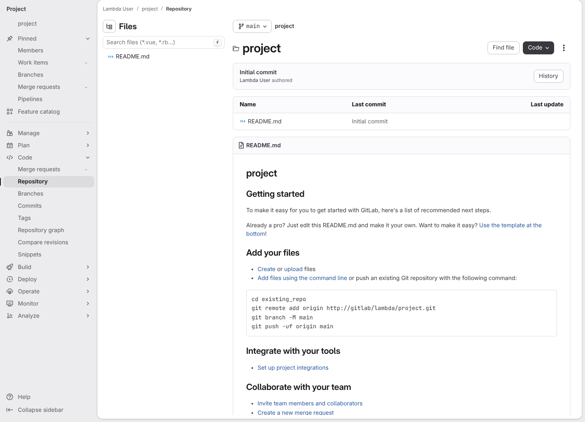
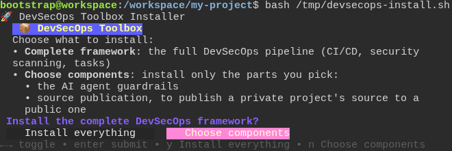
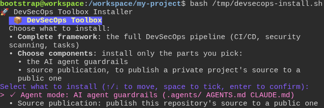
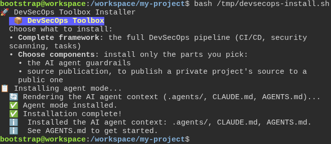
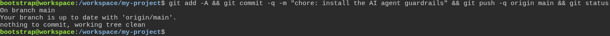
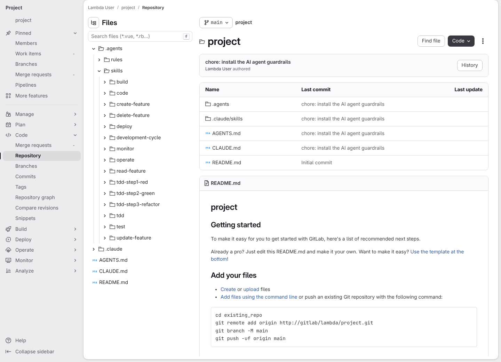
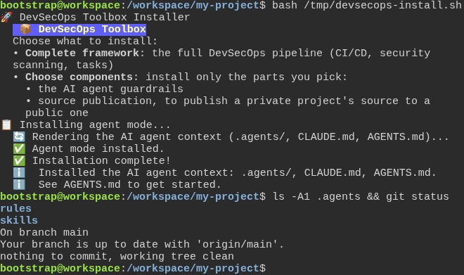
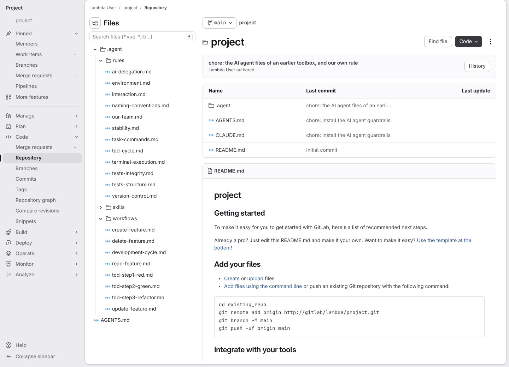
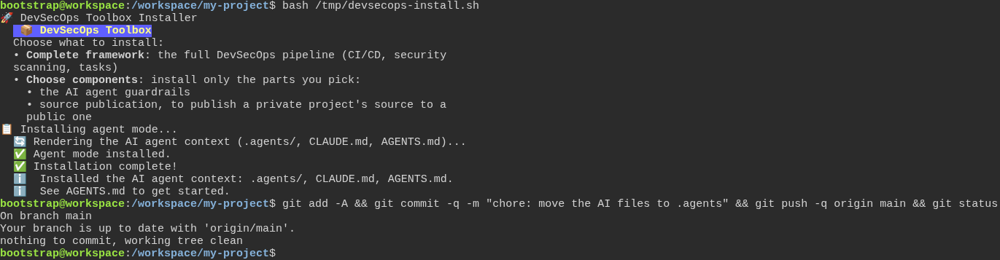
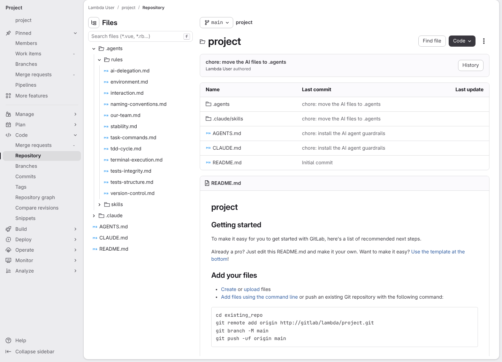

# Installing only the AI agent files (agent mode)

**Scenario:** Saying no to the full framework installs only the AI agent files

<a name="storyboard-result"></a>

> [!tip] PASSED
> 10 steps · 10 frames

**On this page**

[Result](#storyboard-result) · [Installing again later](#storyboard-chapter-1) · [Moving from the old .agent folder](#storyboard-chapter-2) · [Replay and source](#storyboard-replay)

<table width="100%">
<tr>
<th width="50%">

**1. Given a fresh GitLab project with only a README on its main branch**

</th>
<th width="50%">

**2. When the developer starts the installer and picks "Choose components" instead of the complete framework**

</th>
</tr>
<tr>
<td width="50%" valign="top">

[](../../screenshots/base/01-install/agent-mode-only/agent-mode-gitlab-before.webp)

GitLab's page for the main branch of a brand-new project. The Files panel on the left lists one file, README.md, and the table shows it on the commit "Initial commit".
The project's random name shows as "project", and dates and avatars are hidden, so the picture is the same on every run.

<details>
<summary>Command</summary>

```shell
http://gitlab/<lambda-user>/<project>/-/tree/main
```

</details>

</td>
<td width="50%" valign="top">

[](../../screenshots/base/01-install/agent-mode-only/terminal-2-choice.webp)

The terminal, from the typed installer command down. The installer lists its two choices, "Complete framework" and "Choose components", then asks "Install the complete DevSecOps framework?".
The developer has moved to the answer "Choose components", the highlighted button, and is about to press Enter.

<details>
<summary>Command</summary>

```shell
curl -fsSL https://gitlab.com/digital-commons/devsecops/the-devsecops-toolbox/-/raw/main/.config/devsecops/install.sh -o /tmp/devsecops-install.sh && bash /tmp/devsecops-install.sh
```

</details>

</td>
</tr>
</table>

<table width="100%">
<tr>
<th width="50%">

**3. Then a checklist opens with the AI agent line already ticked**

</th>
<th width="50%">

**4. And once the developer confirms the ticked line, the installer installs only the AI agent files**

</th>
</tr>
<tr>
<td width="50%" valign="top">

[](../../screenshots/base/01-install/agent-mode-only/terminal-3-checklist.webp)

The same terminal once that answer is given. The question is gone, and a checklist headed "Select what to install" takes its place.
Its first line, "✓ Agent mode", is already ticked, and "Source publication" below it is not.

</td>
<td width="50%" valign="top">

[](../../screenshots/base/01-install/agent-mode-only/terminal-4-installed.webp)

The developer presses Enter on the checklist as it is, and the checklist clears itself. The installer then says "Agent mode installed." and "Installed the AI agent context: .agents/, CLAUDE.md, AGENTS.md.", and gives the prompt back.

</td>
</tr>
</table>

<table width="100%">
<tr>
<th width="50%">

**5. When the developer commits the new files and pushes them to the main branch**

</th>
<th width="50%">

**6. Then GitLab shows the AI agent files beside the README on the main branch, and nothing else**

</th>
</tr>
<tr>
<td width="50%" valign="top">

[](../../screenshots/base/01-install/agent-mode-only/terminal-5-push.webp)

Agent mode leaves the commit to the developer. The same terminal, cleared, then one typed line: it adds the new files, commits them as "chore: install the AI agent guardrails" and pushes them to the main branch on GitLab.
Git answers "Your branch is up to date with 'origin/main'." and "nothing to commit, working tree clean": everything is on GitLab now.

<details>
<summary>Command</summary>

```shell
git add -A && git commit -q -m "chore: install the AI agent guardrails" && git push -q origin main && git status
```

</details>

</td>
<td width="50%" valign="top">

[](../../screenshots/base/01-install/agent-mode-only/agent-mode-gitlab-after.webp)

The same GitLab page as the first card. The table now lists .agents, .claude/skills, AGENTS.md and CLAUDE.md on the commit "chore: install the AI agent guardrails", and README.md is still on "Initial commit".
The Files panel opens .agents and its skills: fifteen of them, each a folder with its instructions. The .claude/skills row is where the AI tools that only look there find the same skills.

</td>
</tr>
</table>

<a name="storyboard-chapter-1"></a>

## Installing again later

<table width="100%">
<tr>
<th width="50%">

**7. When the developer runs the installer again later, git finds nothing to commit**

</th>
<th width="50%">


</th>
</tr>
<tr>
<td width="50%" valign="top">

[](../../screenshots/base/01-install/agent-mode-only/terminal-6-installed-again.webp)

Later, the developer runs the same installer again to get the latest AI agent files, with the same two answers. It says "Agent mode installed." as it did the first time.
Right below, the developer types \`ls -A1 .agents &amp;&amp; git status\`. The folder still holds only rules and skills, with no second .agents folder inside it, and git says "nothing to commit, working tree clean": the files are the ones already on the main branch.

<details>
<summary>Command</summary>

```shell
bash /tmp/devsecops-install.sh
```

</details>

</td>
<td width="50%" valign="top">


</td>
</tr>
</table>

<a name="storyboard-chapter-2"></a>

## Moving from the old .agent folder

<table width="100%">
<tr>
<th width="50%">

**8. Given the main branch still keeps the AI agent files in the old .agent folder, with a rule the team added**

</th>
<th width="50%">

**9. When the developer runs the installer over the old folder and pushes the result to the main branch**

</th>
</tr>
<tr>
<td width="50%" valign="top">

[](../../screenshots/base/01-install/agent-mode-only/agent-mode-gitlab-old-folder.webp)

Off camera, the project goes back to the way an earlier release of the toolbox installed it: a folder named .agent, without the s, holding the rules, the skills and eight step-by-step guides in .agent/workflows. The team has also added a rule of its own there, our-team.md, and pushed it to the main branch.
GitLab's page for the main branch, the Files panel open on .agent, its rules and its workflows.

</td>
<td width="50%" valign="top">

[](../../screenshots/base/01-install/agent-mode-only/terminal-7-installed-over-old-folder.webp)

The developer runs the installer once more, with the same answers. Then one typed line commits what it changed and pushes it to the main branch, and git ends on "nothing to commit, working tree clean".

<details>
<summary>Command</summary>

```shell
git add -A && git commit -q -m "chore: move the AI files to .agents" && git push -q origin main && git status
```

</details>

</td>
</tr>
</table>

<table width="100%">
<tr>
<th width="50%">

**10. Then GitLab shows the team's rule in .agents/rules, and no .agent folder is left on the main branch**

</th>
<th width="50%">


</th>
</tr>
<tr>
<td width="50%" valign="top">

[](../../screenshots/base/01-install/agent-mode-only/agent-mode-gitlab-moved.webp)

The same GitLab page. The table lists .agents and .claude/skills, and no .agent folder is left. The Files panel opens .agents and its rules: our-team.md moved there, next to the toolbox rules.
.agents holds rules and skills only. The eight guides are skills now, and no workflows folder came along.

</td>
<td width="50%" valign="top">


</td>
</tr>
</table>

<a name="storyboard-replay"></a>

<details>
<summary>Replay this scenario · source and checks</summary>

```shell
task test -- --grep "@agent-mode-only"
```

**Source**

```text
project/tests/e2e/features/01-install/agent-mode.feature
```

Every frame is its own pixel baseline (tolerance: 0).

</details>
