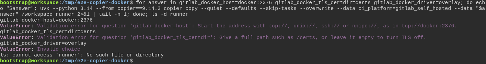
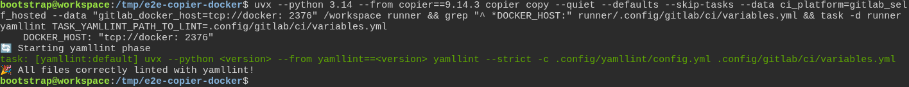

# Copier refuses an answer the new project could not use

**Scenario:** Copier refuses a malformed Docker answer, and the CI file stays valid YAML whatever the address holds

<a name="storyboard-result"></a>

> [!tip] PASSED
> 2 steps · 2 frames

**On this page**

[Result](#storyboard-result) · [Replay and source](#storyboard-replay)

<table width="100%">
<tr>
<th width="50%">

**1. When a project on its own runners gets a Docker address without tcp://, a relative certificate folder and an unknown storage driver, and Copier refuses each one**

</th>
<th width="50%">

**2. Then an address with a space after its colon still gives a CI file that yamllint accepts**

</th>
</tr>
<tr>
<td width="50%" valign="top">

[](../../screenshots/base/01-install/copier-docker-answers/docker-answers-refused.webp)

A project whose CI runs on its own GitLab runners answers three Docker questions. The loop gives each one a common mistake: an address without tcp://, a certificate folder that is not a full path, and overlay, a storage driver Docker no longer has.
Copier refuses all three, each on the line under its answer. The first two messages say what to type instead. The driver gets "Invalid choice": it can only be one of five names. ls finds no runner folder, --overwrite or not.

<details>
<summary>Command</summary>

```shell
for answer in gitlab_docker_host=docker:2376 gitlab_docker_tls_certdir=certs gitlab_docker_driver=overlay; do echo "$answer"; uvx --python 3.14 --from copier==9.14.3 copier copy --quiet --defaults --skip-tasks --overwrite --data ci_platform=gitlab_self_hosted --data "$answer" /workspace runner 2>&1 | tail -n 1; done; ls -d runner
```

</details>

</td>
<td width="50%" valign="top">

[](../../screenshots/base/01-install/copier-docker-answers/docker-host-quoted.webp)

This address starts right, but a space slipped in after its colon: tcp://docker: 2376. Copier only checks how an address starts, so it takes it.
The CI file holds the address in quotes, "tcp://docker: 2376". task yamllint, the project's own YAML check, ends on "All files correctly linted with yamllint!": the CI file is valid YAML.

<details>
<summary>Command</summary>

```shell
uvx --python 3.14 --from copier==9.14.3 copier copy --quiet --defaults --skip-tasks --data ci_platform=gitlab_self_hosted --data "gitlab_docker_host=tcp://docker: 2376" /workspace runner && grep "^ *DOCKER_HOST:" runner/.config/gitlab/ci/variables.yml && task -d runner yamllint TASK_YAMLLINT_PATH_TO_LINT=.config/gitlab/ci/variables.yml
```

</details>

</td>
</tr>
</table>

<a name="storyboard-replay"></a>

<details>
<summary>Replay this scenario · source and checks</summary>

```shell
task test -- --grep "@copier-docker-answers"
```

**Source**

```text
project/tests/e2e/features/01-install/copier-answers.feature
```

Every frame is its own pixel baseline (tolerance: 0).

</details>
