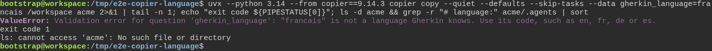
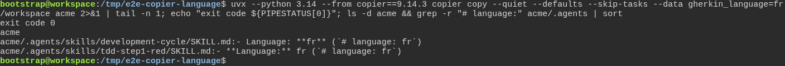

# Copier refuses an answer the new project could not use

**Scenario:** Copier refuses a Gherkin language it does not know, and takes its code

<a name="storyboard-result"></a>

> [!tip] PASSED
> 2 steps · 2 frames

**On this page**

[Result](#storyboard-result) · [Replay and source](#storyboard-replay)

<table width="100%">
<tr>
<th width="50%">

**1. When a developer answers francais for the Gherkin language, and Copier refuses before it writes a single file**

</th>
<th width="50%">

**2. Then the same line with fr writes the project, and its agent rules ask for Gherkin in fr**

</th>
</tr>
<tr>
<td width="50%" valign="top">

[](../../screenshots/base/01-install/copier-gherkin-language/gherkin-language-refused.webp)

The developer means French and types the word: gherkin\_language\=francais. Copier stops on its own message, "Validation error for question 'gherkin\_language': "francais" is not a language Gherkin knows.", and names codes it takes: en, fr, de or es.
The exit code is 1, and ls finds no acme folder: Copier wrote not a single file.

<details>
<summary>Command</summary>

```shell
uvx --python 3.14 --from copier==9.14.3 copier copy --quiet --defaults --skip-tasks --data gherkin_language=francais /workspace acme 2>&1 | tail -n 1; echo "exit code ${PIPESTATUS[0]}"; ls -d acme && grep -r "# language:" acme/.agents | sort
```

</details>

</td>
<td width="50%" valign="top">

[](../../screenshots/base/01-install/copier-gherkin-language/gherkin-language-accepted.webp)

The same line with fr, the code Gherkin gives French. Copier prints nothing, the exit code is 0, and ls finds the acme folder.
The two AI agent rules that name the first line of a test file now ask for "\# language: fr", the line a French Gherkin file starts with.

<details>
<summary>Command</summary>

```shell
uvx --python 3.14 --from copier==9.14.3 copier copy --quiet --defaults --skip-tasks --data gherkin_language=fr /workspace acme 2>&1 | tail -n 1; echo "exit code ${PIPESTATUS[0]}"; ls -d acme && grep -r "# language:" acme/.agents | sort
```

</details>

</td>
</tr>
</table>

<a name="storyboard-replay"></a>

<details>
<summary>Replay this scenario · source and checks</summary>

```shell
task test -- --grep "@copier-gherkin-language"
```

**Source**

```text
project/tests/e2e/features/01-install/copier-answers.feature
```

Every frame is its own pixel baseline (tolerance: 0).

</details>
