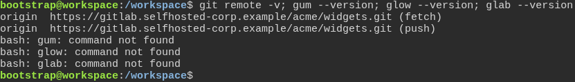
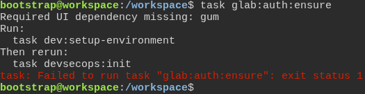
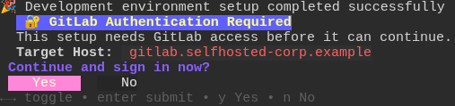
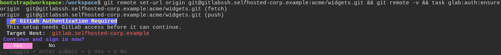
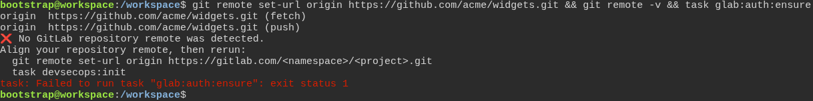
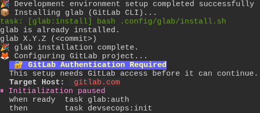
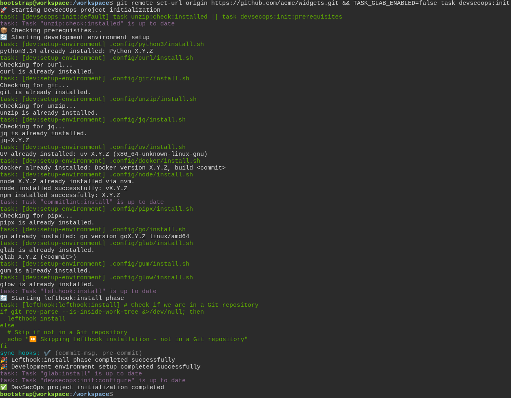

# On the first run, the toolbox names the exact thing to fix

**Scenario:** Every check stops and names the fix, and init finishes cleanly once GitLab is turned off

<a name="storyboard-result"></a>

> [!tip] PASSED
> 7 steps · 7 frames

**On this page**

[Result](#storyboard-result) · [The check names what is missing, and the command that installs it](#storyboard-chapter-1) · [The check reads the right GitLab host](#storyboard-chapter-2) · [init names the exact fix, then bows out cleanly](#storyboard-chapter-3) · [Replay and source](#storyboard-replay)

<a name="storyboard-chapter-1"></a>

## The check names what is missing, and the command that installs it

<table width="100%">
<tr>
<th width="50%">

**1. Given a developer's project points at the company's own GitLab, with none of the toolbox's tools installed yet**

</th>
<th width="50%">

**2. When the developer runs the GitLab check, it names the missing tool and the setup that installs it**

</th>
</tr>
<tr>
<td width="50%" valign="top">

[](../../screenshots/base/01-install/first-run-help/tools-missing.webp)

A copy of the toolbox on a fresh machine. Its git remote points at the company's own GitLab, gitlab.selfhosted-corp.example.
The toolbox needs three tools: gum, glow and glab, the GitLab command line tool. None of them is installed yet, and the shell answers "command not found" for each.

<details>
<summary>Command</summary>

```shell
git remote -v; gum --version; glow --version; glab --version
```

</details>

</td>
<td width="50%" valign="top">

[](../../screenshots/base/01-install/first-run-help/check-names-setup.webp)

The developer runs the GitLab check. It stops at the first tool it misses: "Required UI dependency missing: gum", and the run ends on "Failed to run task".
It names the command to run, task dev:setup-environment, the setup that installs every tool the toolbox needs. Off camera, a machine that already has gum gets the same advice for glow, and one that has both is told to install glab.

<details>
<summary>Command</summary>

```shell
task glab:auth:ensure
```

</details>

</td>
</tr>
</table>

<a name="storyboard-chapter-2"></a>

## The check reads the right GitLab host

<table width="100%">
<tr>
<th width="50%">

**3. When the developer runs that setup, the check names the company's GitLab host and offers to sign in**

</th>
<th width="50%">

**4. Then an SSH-style gitlabssh remote still leads the check to the same GitLab host**

</th>
</tr>
<tr>
<td width="50%" valign="top">

[](../../screenshots/base/01-install/first-run-help/signin-offer-selfhosted.webp)

The developer runs task dev:setup-environment, then the check again. The setup installs every tool, a long run that scrolls off the screen, so the card starts at its last line, "Development environment setup completed successfully".
Nobody has signed in yet, so the check shows "GitLab Authentication Required". "Target Host: gitlab.selfhosted-corp.example" is the host it read from the git remote. Below it, the check asks "Continue and sign in now?", and waits for Yes or No.

<details>
<summary>Command</summary>

```shell
task dev:setup-environment && task glab:auth:ensure
```

</details>

</td>
<td width="50%" valign="top">

[](../../screenshots/base/01-install/first-run-help/signin-offer-gitlabssh.webp)

The developer answered No, and now points the remote at the address the company's GitLab gives for SSH clones. git remote -v shows git@gitlabssh.selfhosted-corp.example.
The check still says "Target Host: gitlab.selfhosted-corp.example". It turns the gitlabssh name back into the gitlab one, the address where you sign in.

<details>
<summary>Command</summary>

```shell
git remote set-url origin git@gitlabssh.selfhosted-corp.example:acme/widgets.git && git remote -v && task glab:auth:ensure
```

</details>

</td>
</tr>
</table>

<table width="100%">
<tr>
<th width="50%">

**5. Then a GitHub remote is refused, with the exact command to point it back at GitLab**

</th>
<th width="50%">


</th>
</tr>
<tr>
<td width="50%" valign="top">

[](../../screenshots/base/01-install/first-run-help/github-refused.webp)

Now the remote points at github.com. The check stops at once with "No GitLab repository remote was detected." It never asks to sign in.
It prints the exact line that points the remote back at GitLab, git remote set-url origin https://gitlab.com/&lt;namespace&gt;/&lt;project&gt;.git, and then task devsecops:init.

<details>
<summary>Command</summary>

```shell
git remote set-url origin https://github.com/acme/widgets.git && git remote -v && task glab:auth:ensure
```

</details>

</td>
<td width="50%" valign="top">


</td>
</tr>
</table>

<a name="storyboard-chapter-3"></a>

## init names the exact fix, then bows out cleanly

<table width="100%">
<tr>
<th width="50%">

**6. When the developer points the remote back at GitLab and runs init, it stops at the sign-in and names the command to run**

</th>
<th width="50%">

**7. Then a project that stays on GitHub turns the GitLab integration off, and init finishes cleanly**

</th>
</tr>
<tr>
<td width="50%" valign="top">

[](../../screenshots/base/01-install/first-run-help/init-stops-at-signin.webp)

The developer follows that advice with gitlab.com and runs init. It first runs the same setup again, which finds every tool already installed. The card starts at the last line of that setup, "Development environment setup completed successfully".
Then init reaches its GitLab step and shows the same sign-in card, now for "Target Host: gitlab.com". The developer answers No, and init pauses with the two commands to run, "task glab:auth" and then "task devsecops:init".

<details>
<summary>Command</summary>

```shell
git remote set-url origin https://gitlab.com/acme/widgets.git && task devsecops:init
```

</details>

</td>
<td width="50%" valign="top">

[](../../screenshots/base/01-install/first-run-help/init-gitlab-off.webp)

A project that stays on GitHub has no GitLab to sign in to. It turns the GitLab part of the toolbox off with TASK\_GLAB\_ENABLED\=false and runs init on its GitHub remote.
Most of the card is init checking every tool again and finding each one already installed. Versions show as X.Y.Z. Then init skips its GitLab step: the task runner says devsecops:init:configure "is up to date". It ends on "DevSecOps project initialization completed", with no sign-in question and no refusal of the remote.

<details>
<summary>Command</summary>

```shell
git remote set-url origin https://github.com/acme/widgets.git && TASK_GLAB_ENABLED=false task devsecops:init
```

</details>

</td>
</tr>
</table>

<a name="storyboard-replay"></a>

<details>
<summary>Replay this scenario · source and checks</summary>

```shell
task test -- --grep "@first-run-help"
```

**Source**

```text
project/tests/e2e/features/01-install/first-run-help.feature
```

Every frame is its own pixel baseline (tolerance: 0).

</details>
