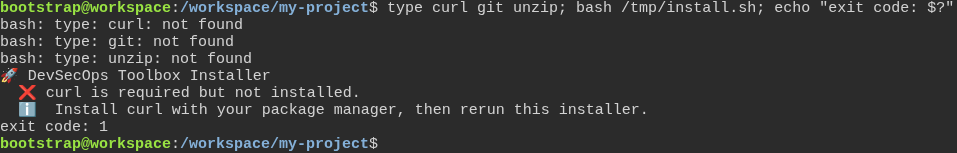
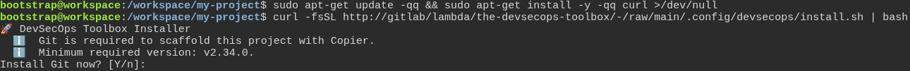
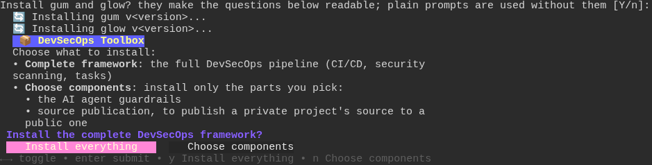
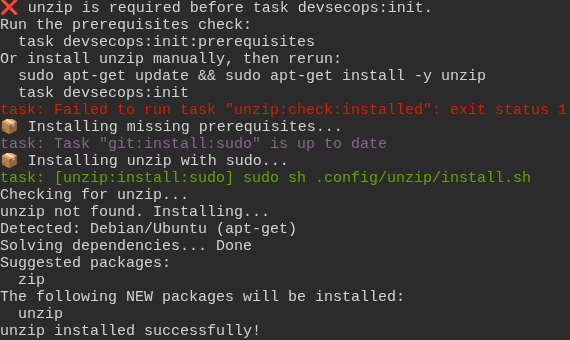
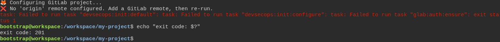
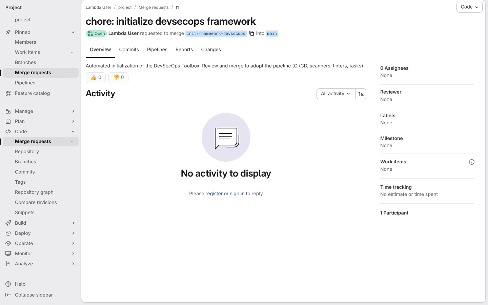
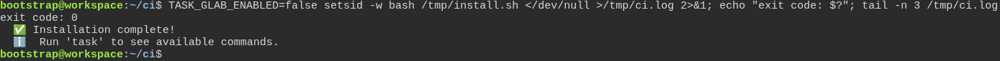

# Trusting the installer on a fresh machine

**Scenario:** The installer refuses cleanly, sets up a bare machine through the pipe, and says what to do next

<a name="storyboard-result"></a>

> [!tip] PASSED
> 7 steps · 7 frames

**On this page**

[Result](#storyboard-result) · [Without curl, the installer refuses cleanly](#storyboard-chapter-1) · [The one-line install sets up the bare machine](#storyboard-chapter-2) · [Following that advice opens the merge request](#storyboard-chapter-3) · [With no terminal at all, nothing is asked](#storyboard-chapter-4) · [Replay and source](#storyboard-replay)

<a name="storyboard-chapter-1"></a>

## Without curl, the installer refuses cleanly

<table width="100%">
<tr>
<th width="50%">

**1. When the developer runs the installer on a fresh machine without curl, it stops at its first check and says to install curl first**

</th>
<th width="50%">


</th>
</tr>
<tr>
<td width="50%" valign="top">

[](../../screenshots/base/01-install/fresh-machine/refusal.webp)

A brand-new Ubuntu machine, with the installer file copied onto it. One typed line: "type" answers "not found" for curl, git and unzip, then the installer runs.
It prints its title and stops at its very first check: "curl is required but not installed." It says to install curl and run it again, and exits with code 1 before changing anything.

<details>
<summary>Command</summary>

```shell
type curl git unzip; bash /tmp/install.sh; echo "exit code: $?"
```

</details>

</td>
<td width="50%" valign="top">


</td>
</tr>
</table>

<a name="storyboard-chapter-2"></a>

## The one-line install sets up the bare machine

<table width="100%">
<tr>
<th width="50%">

**2. When the developer installs curl and pipes the installer from GitLab into bash, the installer asks before installing Git**

</th>
<th width="50%">

**3. And the installer asks before adding gum and glow, then asks what to install, all through the pipe**

</th>
</tr>
<tr>
<td width="50%" valign="top">

[](../../screenshots/base/01-install/fresh-machine/one-liner.webp)

The same terminal, cleared. The developer installs curl with sudo, as told, then runs the one-line install from the README: curl downloads the installer from GitLab and bash runs it straight from the pipe. The test GitLab serves it the way gitlab.com does.
The installer says Git is required, at least version 2.34.0, and waits on "Install Git now? \[Y/n\]:". Bash is reading the script from the pipe, so the installer reads the answer from the keyboard instead.

<details>
<summary>Command</summary>

```shell
sudo apt-get update && sudo apt-get install -y curl && curl -fsSL https://gitlab.com/digital-commons/devsecops/the-devsecops-toolbox/-/raw/main/.config/devsecops/install.sh | bash
```

</details>

</td>
<td width="50%" valign="top">

[](../../screenshots/base/01-install/fresh-machine/gum-and-glow.webp)

The developer pressed Enter on each question, which means yes: Git, then task, then uv. This card starts at the last plain question, "Install gum and glow?", plain because gum is the tool that would make it pretty.
Once both are installed, the installer lists its two choices, "Complete framework" and "Choose components", and asks "Install the complete DevSecOps framework?". Version numbers show as v&lt;version&gt;, since they move with each release.

</td>
</tr>
</table>

<table width="100%">
<tr>
<th width="50%">

**4. Then the setup finds unzip missing and installs it with sudo by itself**

</th>
<th width="50%">

**5. And the installer stops and says the project needs a GitLab remote**

</th>
</tr>
<tr>
<td width="50%" valign="top">

[](../../screenshots/base/01-install/fresh-machine/unzip-installed.webp)

The developer keeps the complete framework and presses Enter on every Copier question. The installer builds the project, then runs its setup, task devsecops:init, and the output scrolls on for minutes.
This part scrolled by on the way: the setup says "unzip is required before task devsecops:init.", installs it with sudo on its own, and ends on "unzip installed successfully!". Apt's progress lines are left out.

</td>
<td width="50%" valign="top">

[](../../screenshots/base/01-install/fresh-machine/no-remote.webp)

The end of the run. The setup reaches "Configuring GitLab project..." and its GitLab sign-in check, glab:auth:ensure, stops it: "No 'origin' remote configured. Add a GitLab remote, then re-run." The folder is not linked to any GitLab project, so the framework has nowhere to go yet.
The developer then types echo "exit code: $?": the run ended with exit code 201, and the prompt is back.

</td>
</tr>
</table>

<a name="storyboard-chapter-3"></a>

## Following that advice opens the merge request

<table width="100%">
<tr>
<th width="50%">

**6. Then once the developer links the folder to a GitLab project and runs the setup again, GitLab shows the framework merge request into the main branch**

</th>
<th width="50%">


</th>
</tr>
<tr>
<td width="50%" valign="top">

[](../../screenshots/base/01-install/fresh-machine/framework-merge-request.webp)

In the same terminal, the developer turns the folder into a git repository, adds an empty GitLab project as its origin remote and runs the setup again. The sign-in to GitLab with glab was done off screen.
GitLab's page for the merge request the setup opened: "chore: initialize devsecops framework", Open, from the init-framework-devsecops branch into the main branch. The project's random name shows as "project". The merge box and the tab counters are hidden, as they follow the pipelines GitLab starts on its own.

<details>
<summary>Command</summary>

```shell
git init && git remote add origin https://gitlab.com/<namespace>/<project>.git && task devsecops:init
```

</details>

</td>
<td width="50%" valign="top">


</td>
</tr>
</table>

<a name="storyboard-chapter-4"></a>

## With no terminal at all, nothing is asked

<table width="100%">
<tr>
<th width="50%">

**7. Then on a machine with no terminal at all, as in a CI job, the same installer asks nothing and installs the complete framework**

</th>
<th width="50%">


</th>
</tr>
<tr>
<td width="50%" valign="top">

[](../../screenshots/base/01-install/fresh-machine/no-terminal.webp)

A new empty folder on the same machine, and one typed line that runs the installer the way a CI job does: setsid leaves it no terminal, &lt;/dev/null leaves it nothing to read, and TASK\_GLAB\_ENABLED\=false skips the GitLab part, as the README advises for a folder with no GitLab project.
Nobody answers anything and everything goes to /tmp/ci.log. The run ends with exit code 0, and the log ends on "Installation complete!" and "Run 'task' to see available commands."

<details>
<summary>Command</summary>

```shell
TASK_GLAB_ENABLED=false setsid -w bash /tmp/install.sh </dev/null >/tmp/ci.log 2>&1; echo "exit code: $?"; tail -n 3 /tmp/ci.log
```

</details>

</td>
<td width="50%" valign="top">


</td>
</tr>
</table>

<a name="storyboard-replay"></a>

<details>
<summary>Replay this scenario · source and checks</summary>

```shell
task test -- --grep "@fresh-machine"
```

**Source**

```text
project/tests/e2e/features/01-install/fresh-machine.feature
```

Every frame is its own pixel baseline (tolerance: 0).

</details>
