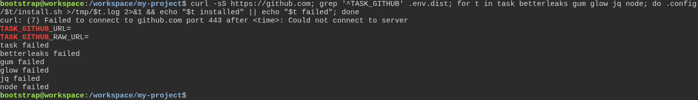
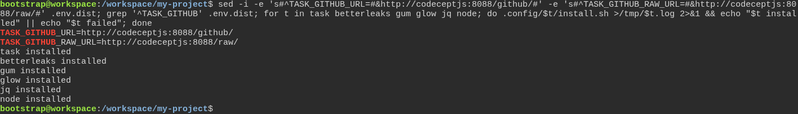

# Trusting the installer on a fresh machine

**Scenario:** On a network without GitHub, two lines in .env.dist bring the toolbox tools from a mirror

<a name="storyboard-result"></a>

> [!tip] PASSED
> 2 steps · 2 frames

**On this page**

[Result](#storyboard-result) · [Replay and source](#storyboard-replay)

<table width="100%">
<tr>
<th width="50%">

**1. Given a machine that cannot reach GitHub, where the six toolbox installers that download from it all fail**

</th>
<th width="50%">

**2. Then once .env.dist names a GitHub mirror, the same six installers all get their tool from it**

</th>
</tr>
<tr>
<td width="50%" valign="top">

[](../../screenshots/base/01-install/github-mirror/no-github.webp)

A machine that cannot reach GitHub, in a project with the six toolbox installers that download from it. curl cannot connect to github.com, and the two GitHub settings of .env.dist are empty, which means GitHub itself.
The developer runs the six installers one after the other. Each one fails, since GitHub is out of reach.

<details>
<summary>Command</summary>

```shell
curl -sS https://github.com; grep '^TASK_GITHUB' .env.dist; for t in task betterleaks gum glow jq node; do .config/$t/install.sh >/tmp/$t.log 2>&1 && echo "$t installed" || echo "$t failed"; done
```

</details>

</td>
<td width="50%" valign="top">

[](../../screenshots/base/01-install/github-mirror/from-mirror.webp)

The developer writes the address of the network's GitHub mirror in .env.dist, one for github.com and one for raw.githubusercontent.com. Here the mirror is the test's own, standing in for the Nexus of a forge.
The same six installers run again, and each one says installed. Every download went through the mirror, and none reached GitHub.

<details>
<summary>Command</summary>

```shell
sed -i -e 's#^TASK_GITHUB_URL=#&http://codeceptjs:8088/github/#' -e 's#^TASK_GITHUB_RAW_URL=#&http://codeceptjs:8088/raw/#' .env.dist; grep '^TASK_GITHUB' .env.dist; for t in task betterleaks gum glow jq node; do .config/$t/install.sh >/tmp/$t.log 2>&1 && echo "$t installed" || echo "$t failed"; done
```

</details>

</td>
</tr>
</table>

<a name="storyboard-replay"></a>

<details>
<summary>Replay this scenario · source and checks</summary>

```shell
task test -- --grep "@github-mirror"
```

**Source**

```text
project/tests/e2e/features/01-install/fresh-machine.feature
```

Every frame is its own pixel baseline (tolerance: 0).

</details>
