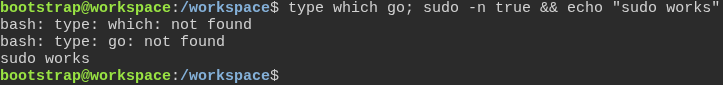
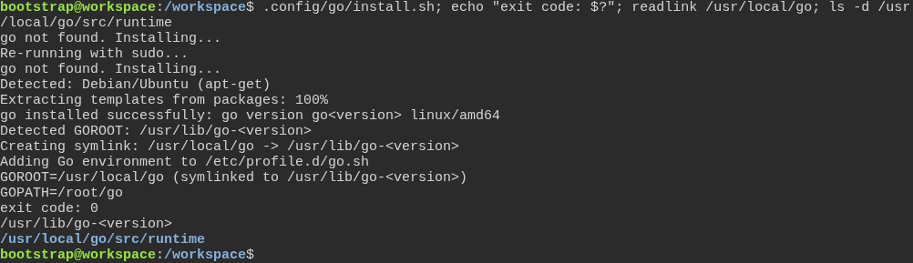

# The Go installer sets up the developer's own shell

**Scenario:** On a machine without which, the Go installer links /usr/local/go to the Go it installed

<a name="storyboard-result"></a>

> [!tip] PASSED
> 2 steps · 2 frames

**On this page**

[Result](#storyboard-result) · [Replay and source](#storyboard-replay)

<table width="100%">
<tr>
<th width="50%">

**1. Given a developer with sudo is on a machine without which and without Go**

</th>
<th width="50%">

**2. Then the Go installer links /usr/local/go to the Go it installed, and Go's standard library is there**

</th>
</tr>
<tr>
<td width="50%" valign="top">

[](../../screenshots/base/01-install/go-install-goroot/machine-without-which.webp)

A fresh Ubuntu machine with no which command, as on a base Arch Linux install, and no Go. The developer's account has sudo.

<details>
<summary>Command</summary>

```shell
type which go; sudo -n true && echo "sudo works"
```

</details>

</td>
<td width="50%" valign="top">

[](../../screenshots/base/01-install/go-install-goroot/go-root-link.webp)

The developer runs the Go installer, the same line task dev:setup-environment runs. With sudo it runs again as root, installs Go with apt-get and says where Go lives, then links /usr/local/go there.
readlink shows where /usr/local/go points, and ls finds Go's standard library under it, in src/runtime: a tool that sets GOROOT to /usr/local/go builds with the Go that was installed.

<details>
<summary>Command</summary>

```shell
.config/go/install.sh; echo "exit code: $?"; readlink /usr/local/go; ls -d /usr/local/go/src/runtime
```

</details>

</td>
</tr>
</table>

<a name="storyboard-replay"></a>

<details>
<summary>Replay this scenario · source and checks</summary>

```shell
task test -- --grep "@go-install-goroot"
```

**Source**

```text
project/tests/e2e/features/01-install/go-install-zsh.feature
```

Every frame is its own pixel baseline (tolerance: 0).

</details>
