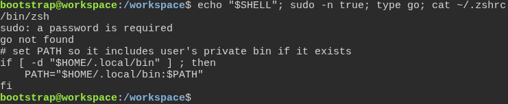
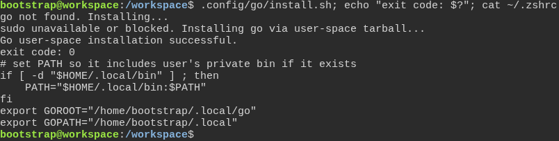
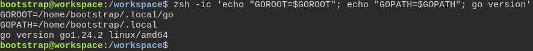
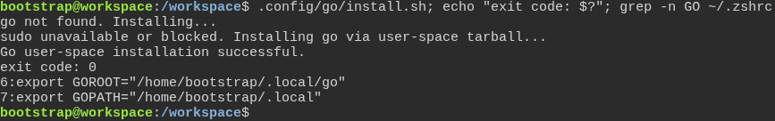

# The Go installer sets up the developer's own shell

**Scenario:** Without sudo, the Go installer writes GOROOT and GOPATH to the startup file of zsh, once

<a name="storyboard-result"></a>

> [!tip] PASSED
> 4 steps · 4 frames

**On this page**

[Result](#storyboard-result) · [Replay and source](#storyboard-replay)

<table width="100%">
<tr>
<th width="50%">

**1. Given a developer whose login shell is zsh has no sudo and no Go**

</th>
<th width="50%">

**2. When the Go installer runs without sudo, it adds GOROOT and GOPATH to \~/.zshrc**

</th>
</tr>
<tr>
<td width="50%" valign="top">

[](../../screenshots/base/01-install/go-install-zsh/zsh-user-without-sudo.webp)

A fresh Ubuntu machine where the developer's login shell is zsh: $SHELL is /bin/zsh. The account has no sudo, so sudo asks for a password, and Go is not installed.
\~/.zshrc holds the four lines Ubuntu puts in \~/.profile: \~/.local/bin joins the PATH when that folder exists. It does not exist yet, so this terminal does not have it.

<details>
<summary>Command</summary>

```shell
echo "$SHELL"; sudo -n true; type go; cat ~/.zshrc
```

</details>

</td>
<td width="50%" valign="top">

[](../../screenshots/base/01-install/go-install-zsh/go-installer-writes-zshrc.webp)

The developer runs the Go installer, the same line task dev:setup-environment runs. Without sudo it installs Go in the home folder, under \~/.local/go, and exits with code 0.
\~/.zshrc now ends with the two lines the installer added: GOROOT, where Go lives, and GOPATH, where go install puts what it builds.

<details>
<summary>Command</summary>

```shell
.config/go/install.sh; echo "exit code: $?"; cat ~/.zshrc
```

</details>

</td>
</tr>
</table>

<table width="100%">
<tr>
<th width="50%">

**3. Then a new zsh has GOROOT and GOPATH set and runs Go**

</th>
<th width="50%">

**4. And a second run of the installer does not add the lines twice**

</th>
</tr>
<tr>
<td width="50%" valign="top">

[](../../screenshots/base/01-install/go-install-zsh/new-zsh-runs-go.webp)

A new zsh reads \~/.zshrc: GOROOT and GOPATH are set, \~/.local/bin is now on the PATH, and go version answers go1.24.2.

<details>
<summary>Command</summary>

```shell
zsh -ic 'echo "GOROOT=$GOROOT"; echo "GOPATH=$GOPATH"; go version'
```

</details>

</td>
<td width="50%" valign="top">

[](../../screenshots/base/01-install/go-install-zsh/second-run-adds-nothing.webp)

Back in the first terminal, Go is still not on the PATH: \~/.local/bin did not exist when it opened. So a second run installs Go again.
grep finds GOROOT and GOPATH once each, on lines 6 and 7 of \~/.zshrc: the second run did not add them again.

<details>
<summary>Command</summary>

```shell
.config/go/install.sh; echo "exit code: $?"; grep -n GO ~/.zshrc
```

</details>

</td>
</tr>
</table>

<a name="storyboard-replay"></a>

<details>
<summary>Replay this scenario · source and checks</summary>

```shell
task test -- --grep "@go-install-zsh"
```

**Source**

```text
project/tests/e2e/features/01-install/go-install-zsh.feature
```

Every frame is its own pixel baseline (tolerance: 0).

</details>
