# The whole install, from an empty project to a locked-down GitLab

**Scenario:** One interactive install builds the framework and configures GitLab

<a name="storyboard-result"></a>

> [!tip] PASSED
> 13 steps · 13 frames

**On this page**

[Result](#storyboard-result) · [Install the framework](#storyboard-chapter-1) · [GitLab is locked and wired](#storyboard-chapter-2) · [The merge request proves itself](#storyboard-chapter-3) · [Replay and source](#storyboard-replay)

<a name="storyboard-chapter-1"></a>

## Install the framework

<table width="100%">
<tr>
<th width="50%">

**1. Given a brand-new empty project waits on GitLab**

</th>
<th width="50%">

**2. When the developer starts the toolbox installer in the freshly cloned project**

</th>
</tr>
<tr>
<td width="50%" valign="top">

[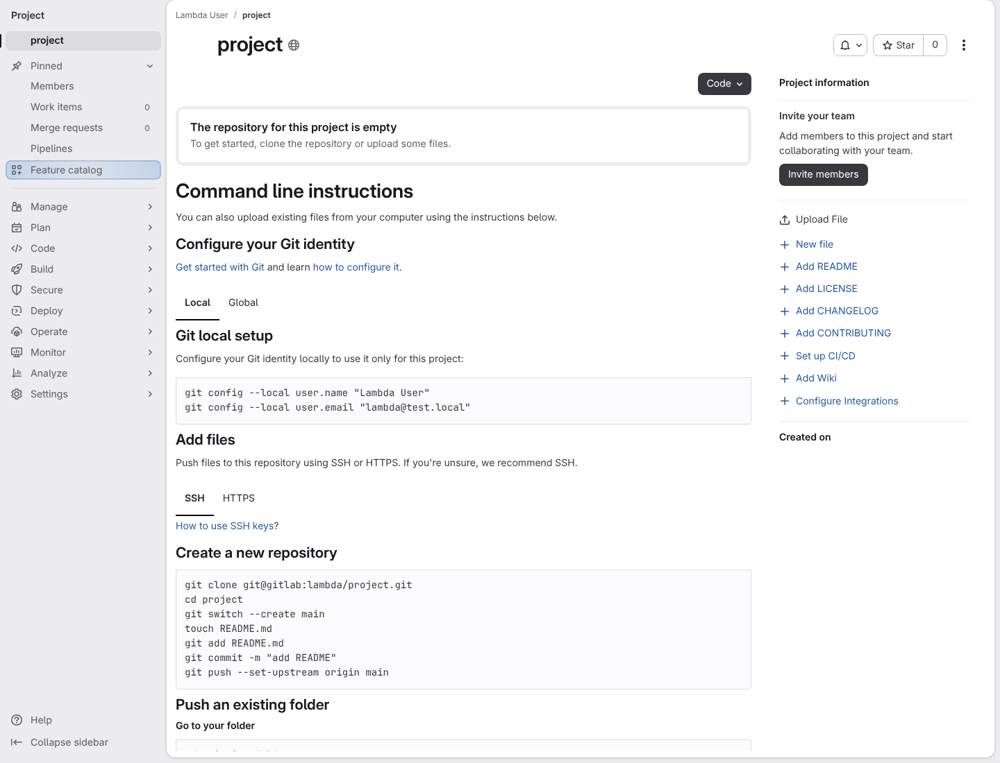](../../screenshots/base/01-install/install-complete/gitlab-empty-project.webp)

GitLab's home page of a brand-new project, as its owner sees it. GitLab says "The repository for this project is empty" and lists the commands that push a first commit.
The project's random name shows as "project", and dates and avatars are hidden, so the picture is the same on every run.

<details>
<summary>Command</summary>

```shell
http://gitlab/<lambda-user>/<project>
```

</details>

</td>
<td width="50%" valign="top">

[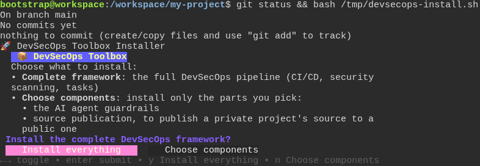](../../screenshots/base/01-install/install-complete/terminal-installer-launch.webp)

The developer's terminal, in the clone of that empty project. Git answers "No commits yet", then the installer starts and asks its first question, "Install the complete DevSecOps framework?".
The card lists the two choices, "Complete framework" and "Choose components". The highlighted button, "Install everything", is the default answer and takes the complete framework.

<details>
<summary>Command</summary>

```shell
curl -fsSL https://gitlab.com/digital-commons/devsecops/the-devsecops-toolbox/-/raw/main/.config/devsecops/install.sh -o /tmp/devsecops-install.sh && git status && bash /tmp/devsecops-install.sh
```

</details>

</td>
</tr>
</table>

<table width="100%">
<tr>
<th width="50%">

**3. And the developer answers the eleven setup questions, keeping every default**

</th>
<th width="50%">

**4. Then the installer prints only the merge request settings it gave GitLab, never the project's runner token**

</th>
</tr>
<tr>
<td width="50%" valign="top">

[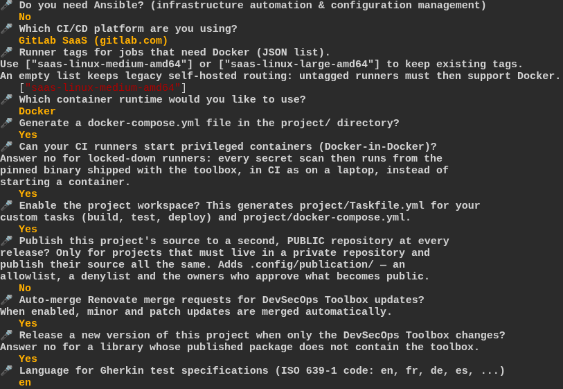](../../screenshots/base/01-install/install-complete/copier-questionnaire.webp)

Saying yes to the complete framework opens the eleven setup questions of Copier, the tool that builds the project from the answers. The developer presses Enter on each one and keeps its default.
The card is caught on the last question, the language of the test descriptions, with its default "en". Above it, the ten answers already given: No to Ansible, GitLab SaaS (gitlab.com), the runner tag saas-linux-medium-amd64, Docker, then Yes, Yes, Yes, No, Yes and Yes.

<details>
<summary>Command</summary>

```shell
y
```

</details>

</td>
<td width="50%" valign="top">

[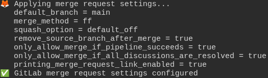](../../screenshots/base/01-install/install-complete/terminal-merge-settings.webp)

On the way, the installer sets the project's merge request rules on GitLab. This part scrolled by: "Applying merge request settings...", one line per setting GitLab now holds, such as "merge\_method \= ff", and "GitLab merge request settings configured".
GitLab answers that change with the whole project, its runner registration token included: a secret that lets a machine sign up to run the project's jobs. The test reads that token from GitLab and checks that the whole session never printed it.
The test also runs the same step with a merge method GitLab refuses. The step fails on GitLab's own reason, and prints no token either.

</td>
</tr>
</table>

<table width="100%">
<tr>
<th width="50%">

**5. Then the installer's merge request into the main branch now waits for review on GitLab**

</th>
<th width="50%">


</th>
</tr>
<tr>
<td width="50%" valign="top">

[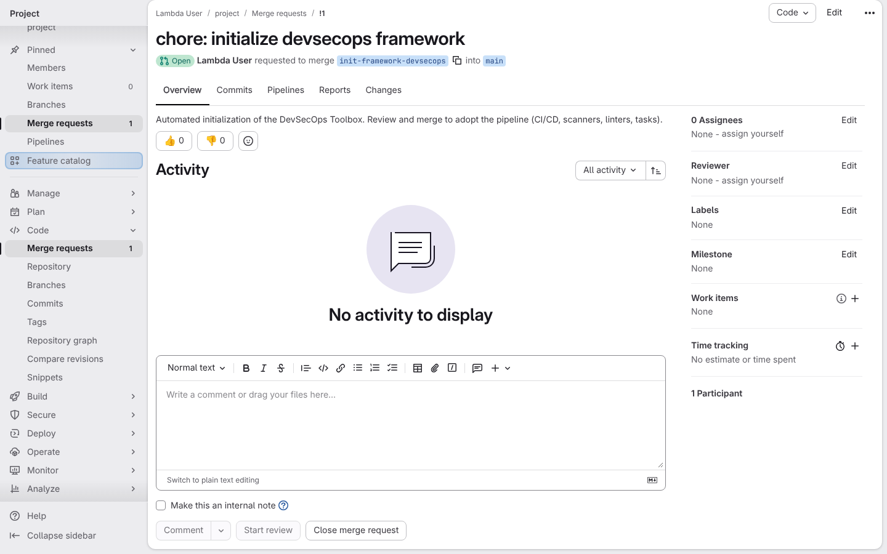](../../screenshots/base/01-install/install-complete/gitlab-merge-request.webp)

The installer builds the framework, pushes it to a new branch, init-framework-devsecops, and opens a merge request into the main branch. This is GitLab's page for it: "chore: initialize devsecops framework", Open.
A merge request is a change that waits for review before it joins the main branch. The framework never reaches the main branch any other way.

<details>
<summary>Command</summary>

```shell
http://gitlab/<lambda-user>/<project>/-/merge_requests/1
```

</details>

</td>
<td width="50%" valign="top">


</td>
</tr>
</table>

<a name="storyboard-chapter-2"></a>

## GitLab is locked and wired

<table width="100%">
<tr>
<th width="50%">

**6. Then GitLab now lets the main branch accept only fast-forward merges**

</th>
<th width="50%">

**7. And GitLab now refuses pushes straight to the main branch**

</th>
</tr>
<tr>
<td width="50%" valign="top">

[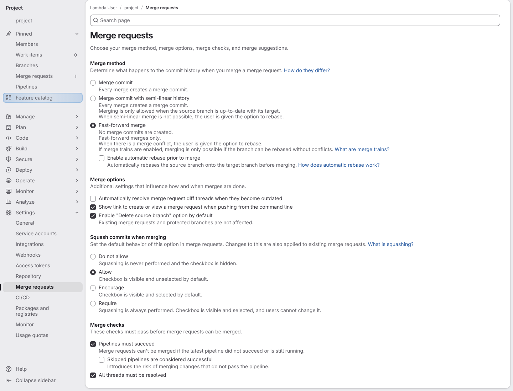](../../screenshots/base/01-install/install-complete/gitlab-merge-settings.webp)

The project's merge request settings. "Fast-forward merge" is selected, so the history of the main branch stays a straight line.
Under "Merge checks", "Pipelines must succeed" and "All threads must be resolved" are ticked: nothing broken or still under discussion can merge.

<details>
<summary>Command</summary>

```shell
http://gitlab/<lambda-user>/<project>/-/settings/merge_requests
```

</details>

</td>
<td width="50%" valign="top">

[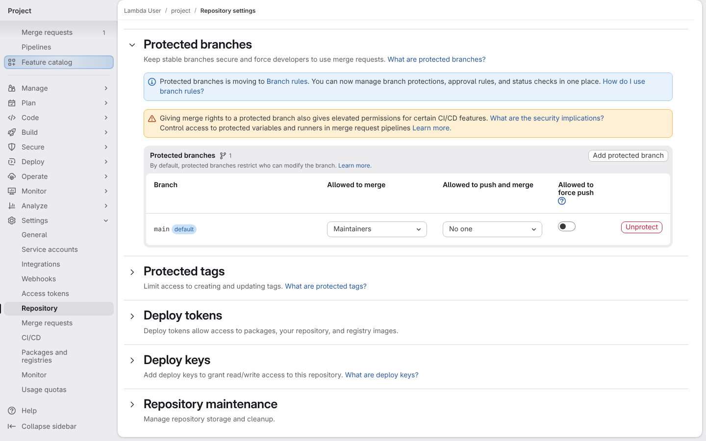](../../screenshots/base/01-install/install-complete/gitlab-protected-branch.webp)

The protected branches settings. On the main branch, "Allowed to merge" is "Maintainers" and "Allowed to push and merge" is "No one": every change has to go through a merge request.

<details>
<summary>Command</summary>

```shell
http://gitlab/<lambda-user>/<project>/-/settings/repository
```

</details>

</td>
</tr>
</table>

<table width="100%">
<tr>
<th width="50%">

**8. And GitLab now holds the project's two automation tokens**

</th>
<th width="50%">

**9. And GitLab now keeps both tokens as CI/CD variables**

</th>
</tr>
<tr>
<td width="50%" valign="top">

[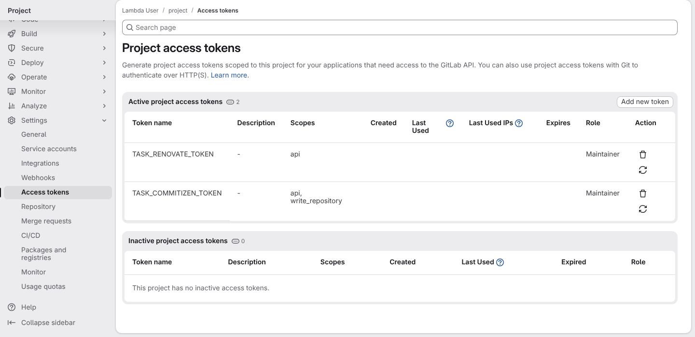](../../screenshots/base/01-install/install-complete/gitlab-access-tokens.webp)

The project access tokens page lists the two tokens the install created: TASK\_COMMITIZEN\_TOKEN, which the release uses, and TASK\_RENOVATE\_TOKEN, which the update bot uses. Both have the Maintainer role.

<details>
<summary>Command</summary>

```shell
http://gitlab/<lambda-user>/<project>/-/settings/access_tokens
```

</details>

</td>
<td width="50%" valign="top">

[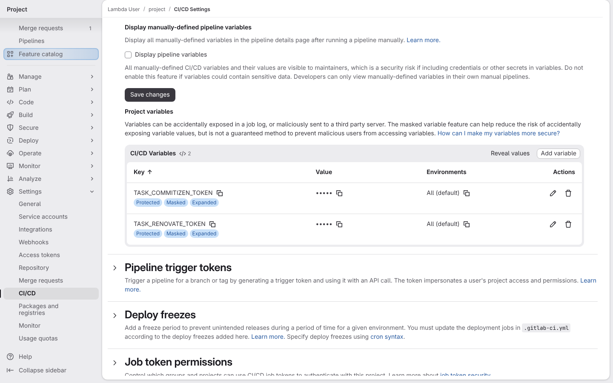](../../screenshots/base/01-install/install-complete/gitlab-cicd-variables.webp)

The project's CI/CD variables hold both tokens under the same names, so the pipeline can read them. GitLab shows their values as dots.

<details>
<summary>Command</summary>

```shell
http://gitlab/<lambda-user>/<project>/-/settings/ci_cd
```

</details>

</td>
</tr>
</table>

<table width="100%">
<tr>
<th width="50%">

**10. And GitLab now runs Renovate from a nightly pipeline schedule**

</th>
<th width="50%">


</th>
</tr>
<tr>
<td width="50%" valign="top">

[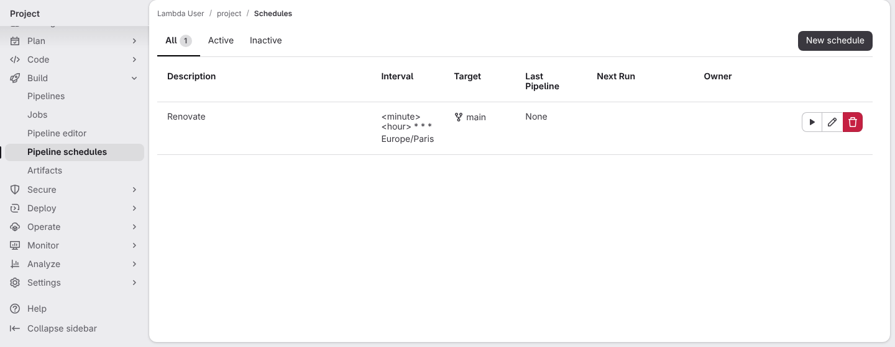](../../screenshots/base/01-install/install-complete/gitlab-pipeline-schedules.webp)

The project's pipeline schedules. The install created one, "Renovate", on the main branch, once a night between 2 and 5 am, Paris time. The hour and the minute come from the project's number, so the projects of a group do not all start at once.
Pipelines on the main branch now leave Renovate to this schedule, so a merge no longer rebases every open Renovate merge request.

<details>
<summary>Command</summary>

```shell
http://gitlab/<lambda-user>/<project>/-/pipeline_schedules
```

</details>

</td>
<td width="50%" valign="top">


</td>
</tr>
</table>

<a name="storyboard-chapter-3"></a>

## The merge request proves itself

<table width="100%">
<tr>
<th width="50%">

**11. Then the framework's first pipeline passes, its MegaLinter job green on every linter, the secret and dependency scanners included**

</th>
<th width="50%">

**12. And the merge request merges into the main branch**

</th>
</tr>
<tr>
<td width="50%" valign="top">

[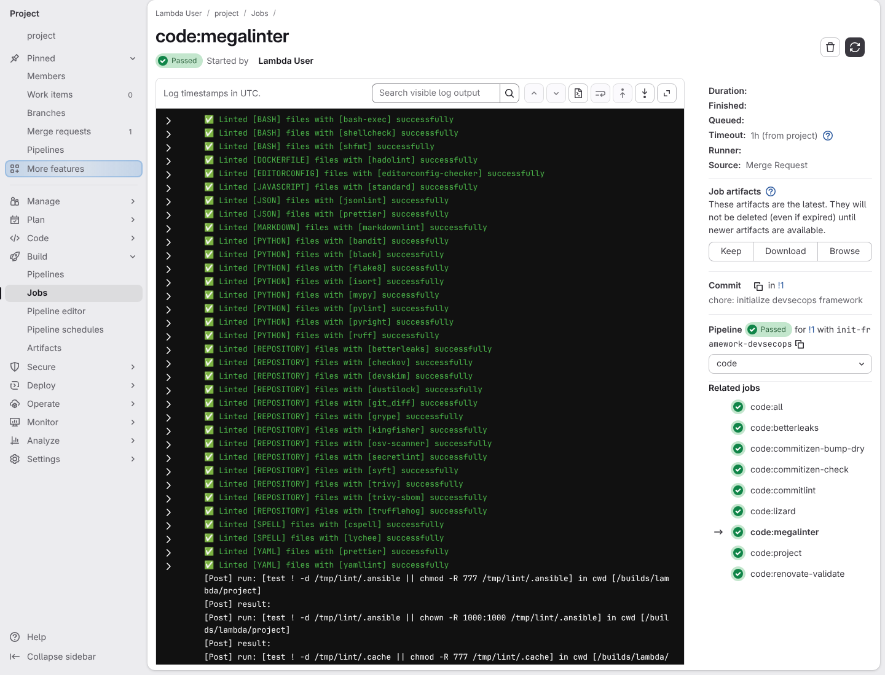](../../screenshots/base/01-install/install-complete/framework-megalinter-log.webp)

A runner, the machine that runs pipelines, now serves this project, and the merge request's pipeline runs every job the framework ships. All of them pass.
The card is the log of one of them, the code:megalinter job: MegaLinter's verdict for each of its linters, one line each, every one "successfully". The secret and dependency scanners betterleaks, grype, trivy and trufflehog are among them.
The panel on the right says the job and its pipeline Passed, and lists the other code jobs of the pipeline, all green.

<details>
<summary>Command</summary>

```shell
http://gitlab/<lambda-user>/<project>/-/jobs
```

</details>

</td>
<td width="50%" valign="top">

[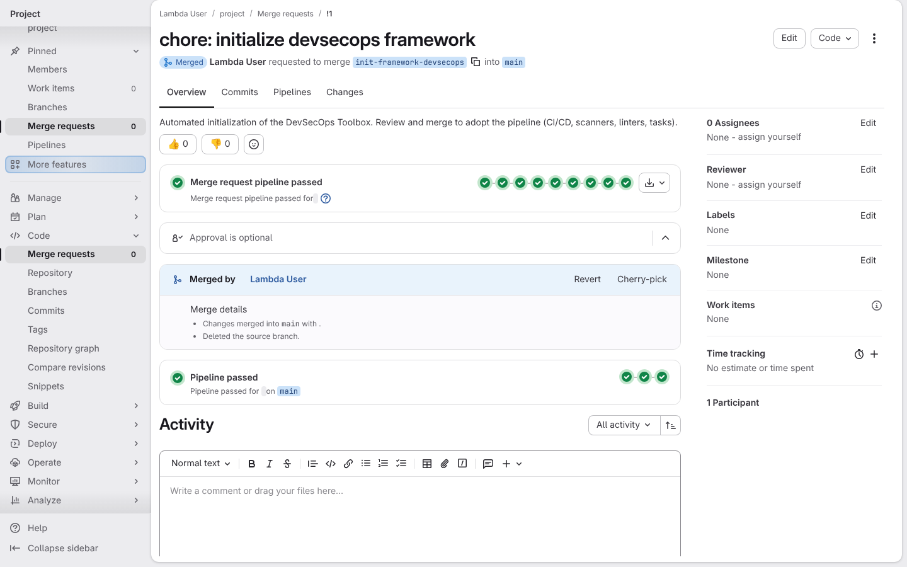](../../screenshots/base/01-install/install-complete/framework-mr-merged.webp)

The same merge request page as in chapter 1, now Merged. "Merge request pipeline passed" shows its stages, all green, as the "Pipelines must succeed" rule demands, and "Deleted the source branch" closes the review.
Below it, "Pipeline passed on main": the merge started the main branch's own pipeline, and its three stages, plan, release and feedback, passed too. With only chores in the history, the release makes no new version, and the job still passes.

<details>
<summary>Command</summary>

```shell
http://gitlab/<lambda-user>/<project>/-/merge_requests/1
```

</details>

</td>
</tr>
</table>

<table width="100%">
<tr>
<th width="50%">

**13. And the main branch now carries the whole framework, merged through review**

</th>
<th width="50%">


</th>
</tr>
<tr>
<td width="50%" valign="top">

[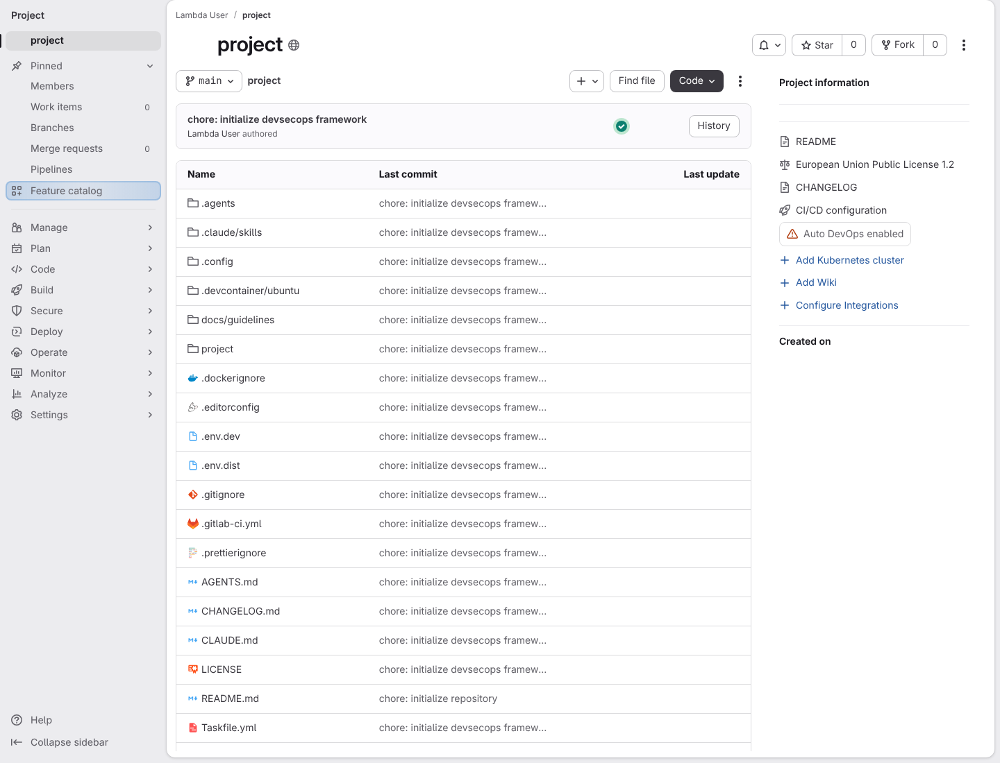](../../screenshots/base/01-install/install-complete/framework-on-main.webp)

The same home page as the first card. The main branch now holds the whole framework, .agents, .claude, .config, .gitlab-ci.yml and Taskfile.yml among them, on the commit "chore: initialize devsecops framework". Only README.md stays on "chore: initialize repository", the commit the installer made to create the main branch. The green check next to the last commit is the main branch's pipeline, passed.
The first install is proven end to end.

<details>
<summary>Command</summary>

```shell
http://gitlab/<lambda-user>/<project>
```

</details>

</td>
<td width="50%" valign="top">


</td>
</tr>
</table>

<a name="storyboard-replay"></a>

<details>
<summary>Replay this scenario · source and checks</summary>

```shell
task test -- --grep "@install-complete"
```

**Source**

```text
project/tests/e2e/features/01-install/install.feature
```

Every frame is its own pixel baseline (tolerance: 0).

</details>
