# init always delivers the framework through a review you can see

**Scenario:** init routes through a review from any branch, opens none when there is nothing to review, and steps aside only when you opt out

<a name="storyboard-result"></a>

> [!tip] PASSED
> 15 steps · 15 frames

**On this page**

[Result](#storyboard-result) · [The main branch already exists, and the developer is on an experiment branch](#storyboard-chapter-1) · [Running init again keeps the review, and proposes nothing once it is merged](#storyboard-chapter-2) · [The review switched off on purpose](#storyboard-chapter-3) · [Replay and source](#storyboard-replay)

<a name="storyboard-chapter-1"></a>

## The main branch already exists, and the developer is on an experiment branch

<table width="100%">
<tr>
<th width="50%">

**1. Given GitLab holds a project whose main branch already has a first commit**

</th>
<th width="50%">

**2. And the developer's copy is on a local experiment branch with a commit of its own**

</th>
</tr>
<tr>
<td width="50%" valign="top">

[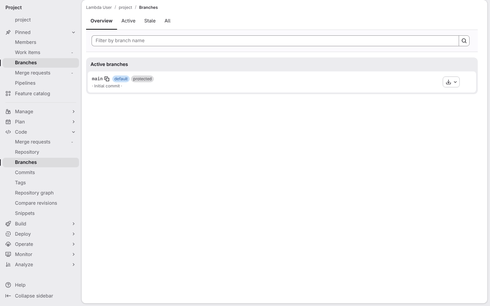](../../screenshots/base/01-install/merge-request-safety/branches-before.webp)

GitLab's branches page for a project that already has a first commit. The main branch is the only branch, marked "default" and "protected", on its commit "Initial commit".
The project's random name shows as "project", and dates and commit codes are hidden, so the picture is the same on every run.

<details>
<summary>Command</summary>

```shell
http://gitlab/<lambda-user>/<project>/-/branches
```

</details>

</td>
<td width="50%" valign="top">

[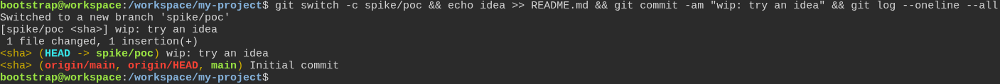](../../screenshots/base/01-install/merge-request-safety/terminal-experiment-branch.webp)

The developer's terminal, in their copy of the project. One typed line makes a branch called spike/poc, adds a line to the README and commits it as "wip: try an idea", then prints the history.
The history shows that commit on spike/poc, where the developer now stands (HEAD), above "Initial commit", where the main branch and its GitLab copy origin/main still are. Commit codes show as &lt;sha&gt;, since they change on every run.

<details>
<summary>Command</summary>

```shell
git switch -c spike/poc && echo idea >> README.md && git commit -am "wip: try an idea" && git log --oneline --all
```

</details>

</td>
</tr>
</table>

<table width="100%">
<tr>
<th width="50%">

**3. When the developer runs the installer on the experiment branch, and it builds the framework branch from the main branch**

</th>
<th width="50%">

**4. Then GitLab holds a merge request into the main branch that carries only the framework commit**

</th>
</tr>
<tr>
<td width="50%" valign="top">

[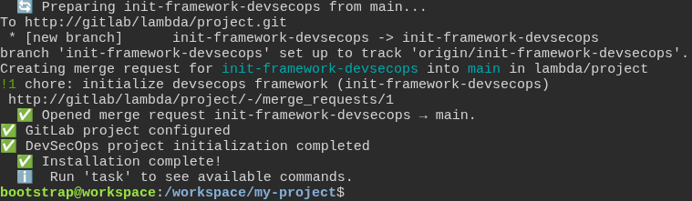](../../screenshots/base/01-install/merge-request-safety/terminal-installer-opens-mr.webp)

The developer runs the installer from spike/poc and accepts every default. This card is the end of that run. The installer says "Preparing init-framework-devsecops from main...": it builds its own branch from the main branch, not from spike/poc.
It pushes that branch to GitLab and opens merge request !1, "chore: initialize devsecops framework", into the main branch, then says "Installation complete!". The line "warning: redirecting" is git saying that GitLab took the push at the same address with ".git/" at the end, nothing more.

<details>
<summary>Command</summary>

```shell
curl -fsSL https://gitlab.com/digital-commons/devsecops/the-devsecops-toolbox/-/raw/main/.config/devsecops/install.sh -o /tmp/devsecops-install.sh && bash /tmp/devsecops-install.sh
```

</details>

</td>
<td width="50%" valign="top">

[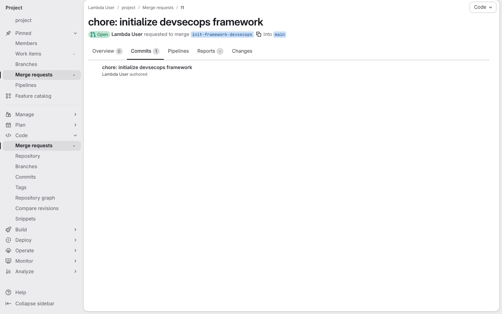](../../screenshots/base/01-install/merge-request-safety/mr-commits.webp)

The Commits tab of that merge request on GitLab. It asks to merge init-framework-devsecops into main, and it carries exactly one commit, "chore: initialize devsecops framework".
The experiment's commit "wip: try an idea" is not in it. The counters of the Pipelines and Changes tabs are hidden: they change with every run and every new framework file.

<details>
<summary>Command</summary>

```shell
http://gitlab/<lambda-user>/<project>/-/merge_requests/1/commits
```

</details>

</td>
</tr>
</table>

<table width="100%">
<tr>
<th width="50%">

**5. And GitLab lists the main branch and the framework branch, never the experiment branch**

</th>
<th width="50%">


</th>
</tr>
<tr>
<td width="50%" valign="top">

[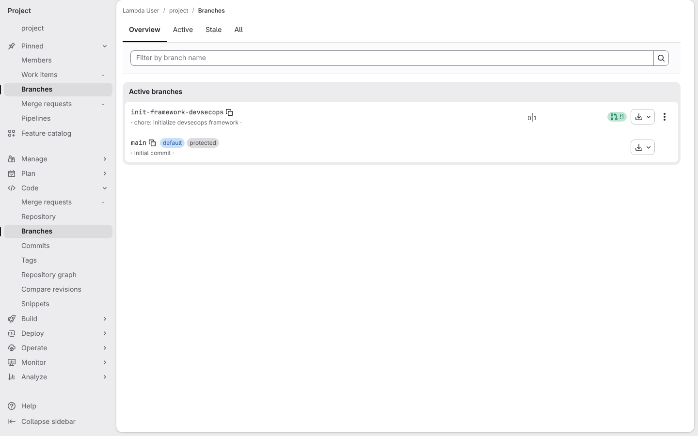](../../screenshots/base/01-install/merge-request-safety/branches-after.webp)

The same branches page as the first card. init-framework-devsecops now stands next to the main branch, one commit ahead of it, with its merge request "!1".
The main branch is still on "Initial commit": nobody pushed to it. There is no spike/poc: the experiment never left the developer's machine.

<details>
<summary>Command</summary>

```shell
http://gitlab/<lambda-user>/<project>/-/branches
```

</details>

</td>
<td width="50%" valign="top">


</td>
</tr>
</table>

<a name="storyboard-chapter-2"></a>

## Running init again keeps the review, and proposes nothing once it is merged

<table width="100%">
<tr>
<th width="50%">

**6. When the developer runs init's GitLab step again while the merge request waits, and it opens no second one**

</th>
<th width="50%">

**7. When the merge request is merged, and the main branch on GitLab holds the framework**

</th>
</tr>
<tr>
<td width="50%" valign="top">

[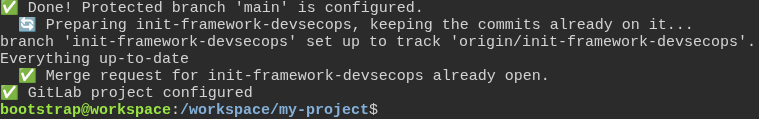](../../screenshots/base/01-install/merge-request-safety/terminal-configure-review-waits.webp)

The developer runs init's GitLab step again, task devsecops:init:configure, while merge request !1 still waits for review. This card is the end of that run.
init says "Preparing init-framework-devsecops, keeping the commits already on it...": the branch and its commit stay as they are. git finds nothing new to push, "Everything up-to-date", and init says "Merge request for init-framework-devsecops already open." No second merge request.

<details>
<summary>Command</summary>

```shell
task devsecops:init:configure
```

</details>

</td>
<td width="50%" valign="top">

[](../../screenshots/base/01-install/merge-request-safety/branches-merged.webp)

The team merged merge request !1. GitLab's branches page lists the main branch alone, on "chore: initialize devsecops framework": the framework now lives on the main branch, and GitLab deleted init-framework-devsecops once it was merged.
The test merges the merge request through GitLab's API without running its pipeline, which is not what this story is about.

<details>
<summary>Command</summary>

```shell
http://gitlab/<lambda-user>/<project>/-/branches
```

</details>

</td>
</tr>
</table>

<table width="100%">
<tr>
<th width="50%">

**8. And the developer's copy is still on the framework branch, with an old main branch and ignored packages**

</th>
<th width="50%">

**9. When the developer runs init's GitLab step again, and it has nothing to propose**

</th>
</tr>
<tr>
<td width="50%" valign="top">

[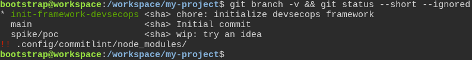](../../screenshots/base/01-install/merge-request-safety/terminal-copy-left-behind.webp)

Back in the developer's terminal. git branch -v shows them still on init-framework-devsecops (the "\*"), on the framework commit. Their own main branch is still on "Initial commit": it has not heard of the merge. spike/poc is the experiment from the first chapter.
The lines marked "!!" are files git ignores. .config/commitlint/node\_modules/ holds the packages the framework installed, thousands of files that must never reach a commit.

<details>
<summary>Command</summary>

```shell
git branch -v && git status --short --ignored
```

</details>

</td>
<td width="50%" valign="top">

[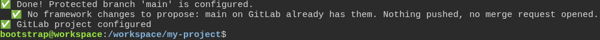](../../screenshots/base/01-install/merge-request-safety/terminal-configure-left-behind.webp)

The developer runs init's GitLab step again, task devsecops:init:configure. This card is the end of that run. It says "No framework changes to propose: main on GitLab already has them. Nothing pushed, no merge request opened."
The developer is still on init-framework-devsecops, on the same commit, with nothing to commit. init did not rebuild its branch from the old main branch, so the ignored packages stayed out of git.

<details>
<summary>Command</summary>

```shell
task devsecops:init:configure
```

</details>

</td>
</tr>
</table>

<table width="100%">
<tr>
<th width="50%">

**10. And the developer brings the main branch up to date**

</th>
<th width="50%">

**11. And the developer runs init's GitLab step once more, and it still has nothing to propose**

</th>
</tr>
<tr>
<td width="50%" valign="top">

[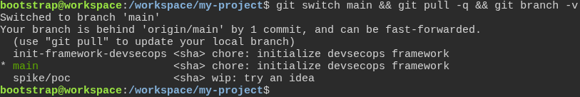](../../screenshots/base/01-install/merge-request-safety/terminal-main-up-to-date.webp)

The developer switches to the main branch. git says it is "behind 'origin/main' by 1 commit": init's last run read the main branch on GitLab. git pull brings the merge in, and git branch -v shows main on the framework commit too.

<details>
<summary>Command</summary>

```shell
git switch main && git pull -q && git branch -v
```

</details>

</td>
<td width="50%" valign="top">

[](../../screenshots/base/01-install/merge-request-safety/terminal-configure-up-to-date.webp)

The same command, now from an up-to-date main branch. It ends the same way: nothing pushed, no merge request opened, and the developer is still on the main branch.

<details>
<summary>Command</summary>

```shell
task devsecops:init:configure
```

</details>

</td>
</tr>
</table>

<table width="100%">
<tr>
<th width="50%">

**12. Then GitLab still lists the main branch alone, with no new branch and no new merge request**

</th>
<th width="50%">


</th>
</tr>
<tr>
<td width="50%" valign="top">

[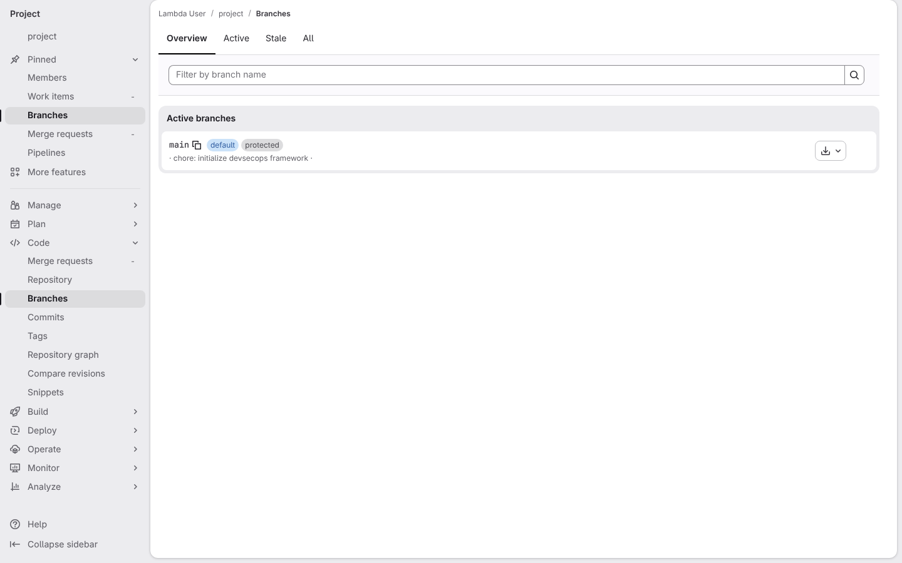](../../screenshots/base/01-install/merge-request-safety/branches-still-alone.webp)

The same branches page as at the start of the chapter. The main branch is still alone: init-framework-devsecops did not come back, so no merge request waits for review.

<details>
<summary>Command</summary>

```shell
http://gitlab/<lambda-user>/<project>/-/branches
```

</details>

</td>
<td width="50%" valign="top">


</td>
</tr>
</table>

<a name="storyboard-chapter-3"></a>

## The review switched off on purpose

<table width="100%">
<tr>
<th width="50%">

**13. When another developer starts the installer on a new project with the review switched off**

</th>
<th width="50%">

**14. Then GitLab shows the main branch alone, with no review branch and no merge request**

</th>
</tr>
<tr>
<td width="50%" valign="top">

[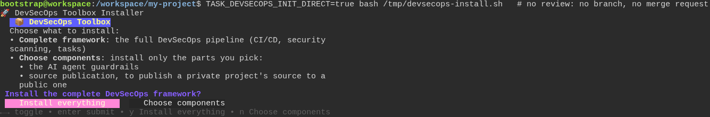](../../screenshots/base/01-install/merge-request-safety/terminal-launch-direct.webp)

A second developer, in the copy of a new empty project, types the installer command with TASK\_DEVSECOPS\_INIT\_DIRECT\=true in front of it, and a comment saying what it is for. That setting switches the review off: no framework branch and no merge request.
The installer starts as usual and asks its first question, "Install the complete DevSecOps framework?". The developer then accepts every default.

<details>
<summary>Command</summary>

```shell
curl -fsSL https://gitlab.com/digital-commons/devsecops/the-devsecops-toolbox/-/raw/main/.config/devsecops/install.sh -o /tmp/devsecops-install.sh && TASK_DEVSECOPS_INIT_DIRECT=true bash /tmp/devsecops-install.sh
```

</details>

</td>
<td width="50%" valign="top">

[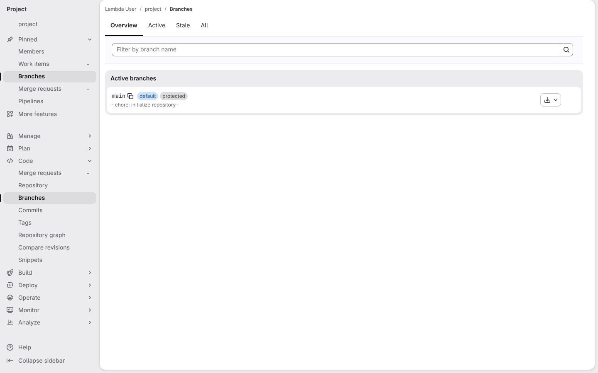](../../screenshots/base/01-install/merge-request-safety/branches-direct.webp)

GitLab's branches page for that project once the installer is done. The main branch is alone, on "chore: initialize repository", the first commit the installer makes in an empty project.
There is no init-framework-devsecops branch and no merge request badge.

<details>
<summary>Command</summary>

```shell
http://gitlab/<lambda-user>/<project>/-/branches
```

</details>

</td>
</tr>
</table>

<table width="100%">
<tr>
<th width="50%">

**15. And the main branch on GitLab holds only the starter README**

</th>
<th width="50%">


</th>
</tr>
<tr>
<td width="50%" valign="top">

[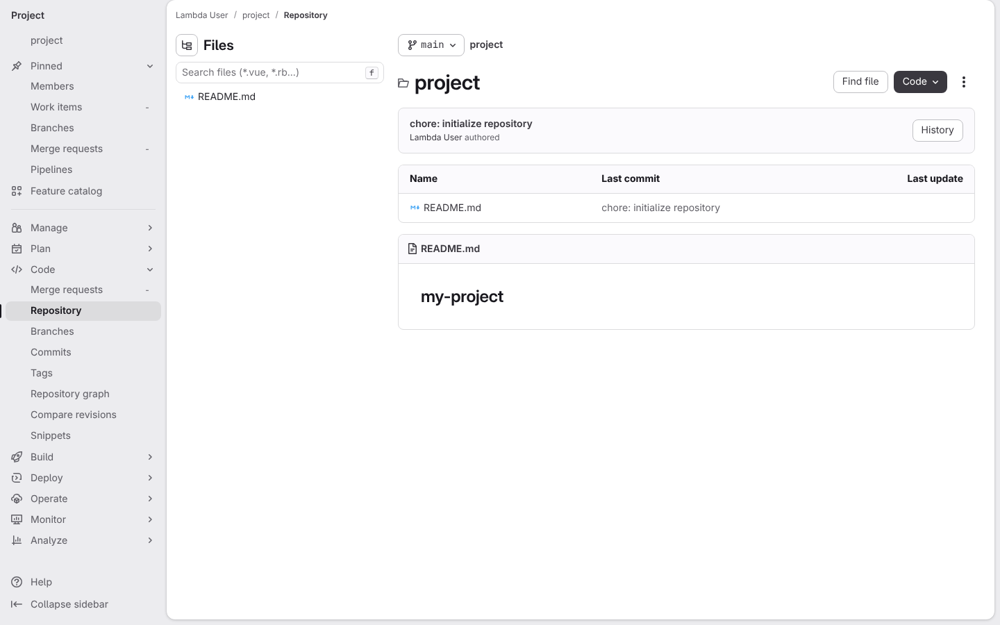](../../screenshots/base/01-install/merge-request-safety/gitlab-main-readme.webp)

The repository page of the main branch. The Files panel and the table list one file, README.md, and its text is the name of the project folder, "my-project".
None of the framework files the installer wrote reached the main branch.

<details>
<summary>Command</summary>

```shell
http://gitlab/<lambda-user>/<project>/-/tree/main
```

</details>

</td>
<td width="50%" valign="top">


</td>
</tr>
</table>

<a name="storyboard-replay"></a>

<details>
<summary>Replay this scenario · source and checks</summary>

```shell
task test -- --grep "@merge-request-safety"
```

**Source**

```text
project/tests/e2e/features/01-install/merge-request-safety.feature
```

Every frame is its own pixel baseline (tolerance: 0).

</details>
