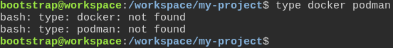
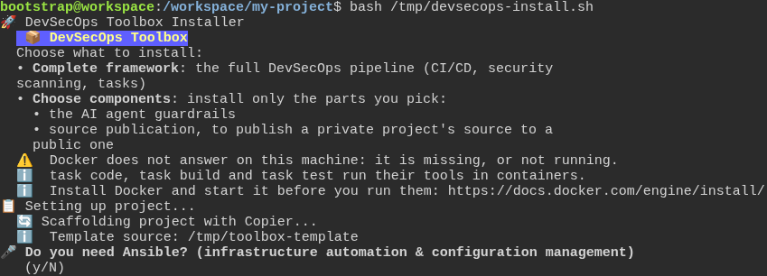

# The installer says when Docker is missing, before it sets up the project

**Scenario:** On a machine without Docker, the installer names what to install and goes on to the setup questions

<a name="storyboard-result"></a>

> [!tip] PASSED
> 2 steps · 2 frames

**On this page**

[Result](#storyboard-result) · [Replay and source](#storyboard-replay)

<table width="100%">
<tr>
<th width="50%">

**1. Given a developer's machine has neither Docker nor Podman**

</th>
<th width="50%">

**2. When the developer starts the installer, it warns that Docker is missing, says where to get it, and goes on to the setup questions**

</th>
</tr>
<tr>
<td width="50%" valign="top">

[](../../screenshots/base/01-install/missing-docker/no-container-engine.webp)

A fresh machine where the toolbox will be installed. The shell finds neither docker nor podman, the two programs that run containers.

<details>
<summary>Command</summary>

```shell
type docker podman
```

</details>

</td>
<td width="50%" valign="top">

[](../../screenshots/base/01-install/missing-docker/installer-warns-no-docker.webp)

The developer starts the installer and, asked what to install, picks the complete framework. Before it sets anything up, the installer warns: "Docker does not answer on this machine: it is missing, or not running."
The next two lines say why it matters, task code, task build and task test run their tools in containers, and where to get Docker. Then the installer goes on: Copier asks its first setup question, "Do you need Ansible?".

<details>
<summary>Command</summary>

```shell
curl -fsSL https://gitlab.com/digital-commons/devsecops/the-devsecops-toolbox/-/raw/main/.config/devsecops/install.sh -o /tmp/devsecops-install.sh && bash /tmp/devsecops-install.sh
```

</details>

</td>
</tr>
</table>

<a name="storyboard-replay"></a>

<details>
<summary>Replay this scenario · source and checks</summary>

```shell
task test -- --grep "@missing-docker"
```

**Source**

```text
project/tests/e2e/features/01-install/missing-docker.feature
```

Every frame is its own pixel baseline (tolerance: 0).

</details>
