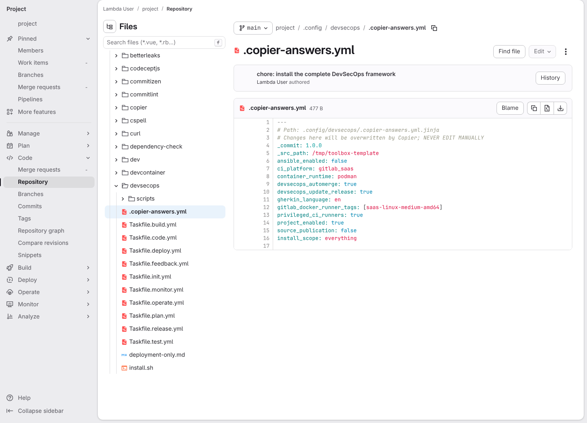
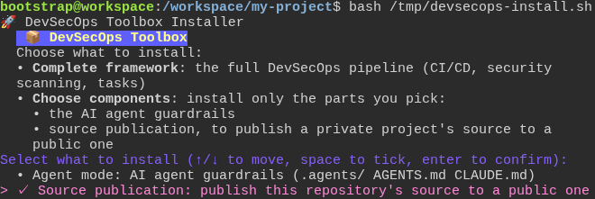
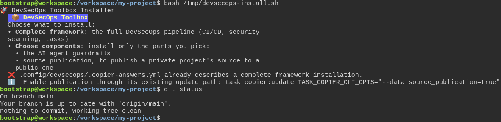

# Installing only the source publication component

**Scenario:** A complete project cannot be replaced by a component install

<a name="storyboard-result"></a>

> [!tip] PASSED
> 3 steps · 3 frames

**On this page**

[Result](#storyboard-result) · [Replay and source](#storyboard-replay)

<table width="100%">
<tr>
<th width="50%">

**1. Given a project whose main branch already carries the complete framework and its own Copier choices**

</th>
<th width="50%">

**2. When the developer ticks source publication on the checklist**

</th>
</tr>
<tr>
<td width="50%" valign="top">

[](../../screenshots/base/01-install/publication-existing-framework/publication-existing-framework-before.webp)

GitLab's page for the answers file on the main branch of a project that already uses the complete framework. Copier wrote it, the developer pushed it, and it records the project's own choices: "container\_runtime: podman", "project\_enabled: true", "source\_publication: false" and "install\_scope: everything".
The developer's copy also holds a tool and a private file of its own. Before the installer runs, the test records every file of the project, its content and its permissions.

<details>
<summary>Command</summary>

```shell
http://gitlab/<lambda-user>/<project>/-/blob/main/.config/devsecops/.copier-answers.yml
```

</details>

</td>
<td width="50%" valign="top">

[](../../screenshots/base/01-install/publication-existing-framework/publication-only-checklist.webp)

The developer runs the installer anyway and answers "Choose components". A checklist opens, and the developer ticks "Source publication" alone. The picture is taken before Enter, because the checklist erases itself once it is answered.

<details>
<summary>Command</summary>

```shell
curl -fsSL https://gitlab.com/digital-commons/devsecops/the-devsecops-toolbox/-/raw/main/.config/devsecops/install.sh -o /tmp/devsecops-install.sh && bash /tmp/devsecops-install.sh
```

</details>

</td>
</tr>
</table>

<table width="100%">
<tr>
<th width="50%">

**3. Then the installer refuses, names the update path, and leaves the project exactly as the main branch holds it**

</th>
<th width="50%">


</th>
</tr>
<tr>
<td width="50%" valign="top">

[](../../screenshots/base/01-install/publication-existing-framework/publication-existing-framework-refused.webp)

The installer stops before copying anything. It says the answers file "already describes a complete framework installation", and gives the command that turns publication on through the project's own update: task copier:update with --data source\_publication\=true.
Then the developer types git status. Git answers "nothing to commit, working tree clean": the project is still exactly what the main branch on GitLab holds. The test also compares every file, its content and its permissions with what it recorded first.

<details>
<summary>Command</summary>

```shell
task copier:update TASK_COPIER_CLI_OPTS="--data source_publication=true"
```

</details>

</td>
<td width="50%" valign="top">


</td>
</tr>
</table>

<a name="storyboard-replay"></a>

<details>
<summary>Replay this scenario · source and checks</summary>

```shell
task test -- --grep "@publication-existing-framework"
```

**Source**

```text
project/tests/e2e/features/01-install/publication-only.feature
```

Every frame is its own pixel baseline (tolerance: 0).

</details>
