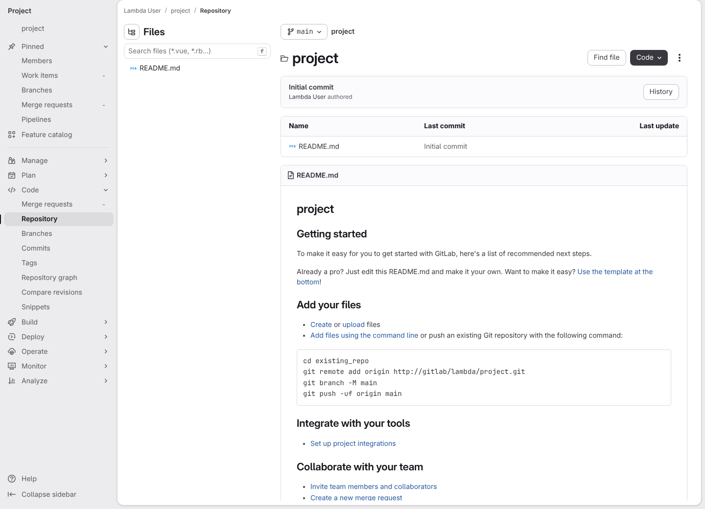
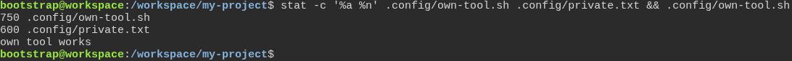
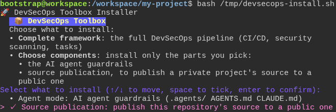
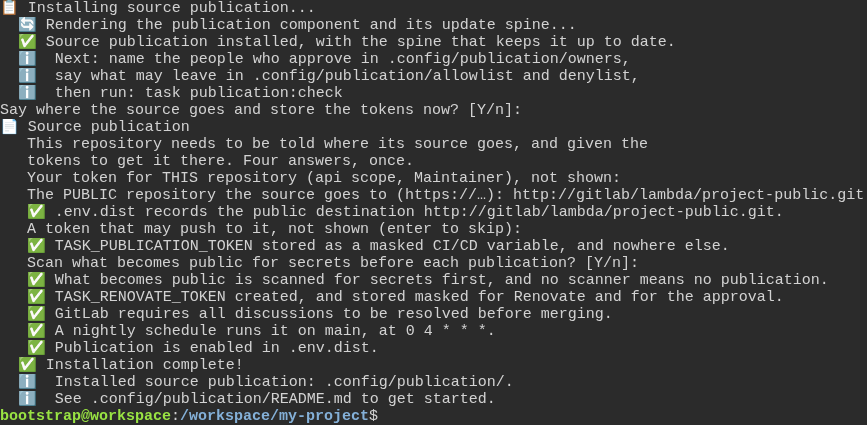
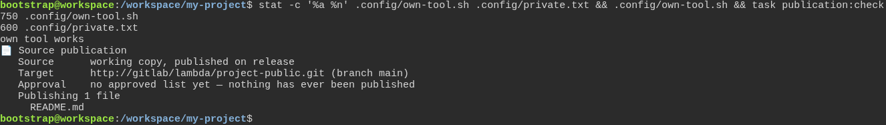
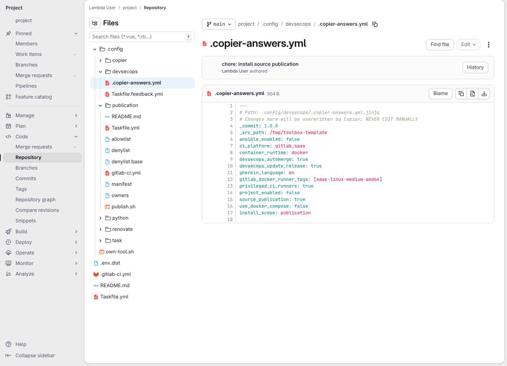
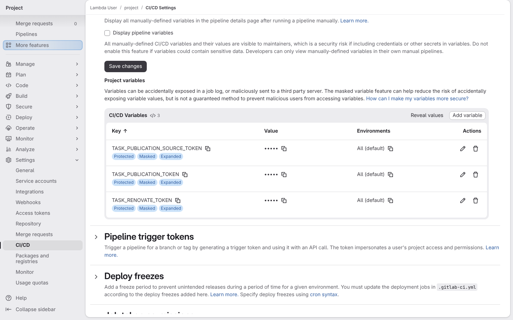
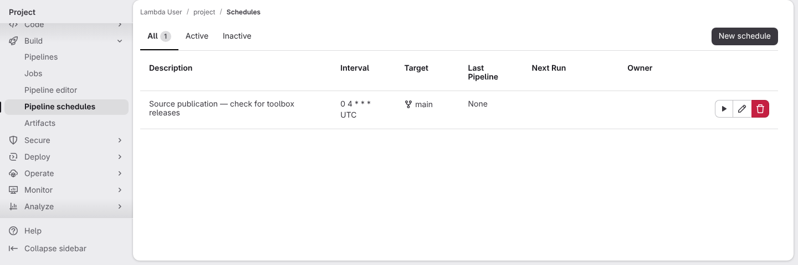

# Installing only the source publication component

**Scenario:** Ticking source publication on the checklist installs it with its update spine, and nothing else

<a name="storyboard-result"></a>

> [!tip] PASSED
> 8 steps · 8 frames

**On this page**

[Result](#storyboard-result) · [Replay and source](#storyboard-replay)

<table width="100%">
<tr>
<th width="50%">

**1. Given a project on GitLab whose main branch holds only its README**

</th>
<th width="50%">

**2. And the developer's copy already has its own executable tool and an owner-only file under its configuration directory**

</th>
</tr>
<tr>
<td width="50%" valign="top">

[](../../screenshots/base/01-install/publication-only/publication-only-gitlab-before.webp)

GitLab's page for the main branch of a new project. The Files panel on the left lists one file, README.md, and the table shows it on the commit "Initial commit".
The project's random name shows as "project", and dates and avatars are hidden, so the picture is the same on every run.

<details>
<summary>Command</summary>

```shell
http://gitlab/<lambda-user>/<project>/-/tree/main
```

</details>

</td>
<td width="50%" valign="top">

[](../../screenshots/base/01-install/publication-only/publication-only-own-files-before.webp)

The developer's copy of the project already has two files of its own under .config, and neither comes from the toolbox. The terminal shows their permissions: 750 for the tool, which only its owner and group may run, and 600 for the private file, which only its owner may read.
Then the tool runs and answers "own tool works". Installing a component must leave both files exactly as they are.

<details>
<summary>Command</summary>

```shell
stat -c '%a %n' .config/own-tool.sh .config/private.txt && .config/own-tool.sh
```

</details>

</td>
</tr>
</table>

<table width="100%">
<tr>
<th width="50%">

**3. When the developer ticks source publication on the checklist**

</th>
<th width="50%">

**4. And the developer says where the source goes and hands over the tokens**

</th>
</tr>
<tr>
<td width="50%" valign="top">

[](../../screenshots/base/01-install/publication-only/publication-only-checklist.webp)

The developer downloads the installer and runs it. It asks whether to install everything, the developer answers "Choose components", and a checklist opens.
The developer unticks "Agent mode", moves down and ticks "Source publication". The picture is taken before Enter, because the checklist erases itself once it is answered.

<details>
<summary>Command</summary>

```shell
curl -fsSL https://gitlab.com/digital-commons/devsecops/the-devsecops-toolbox/-/raw/main/.config/devsecops/install.sh -o /tmp/devsecops-install.sh && bash /tmp/devsecops-install.sh
```

</details>

</td>
<td width="50%" valign="top">

[](../../screenshots/base/01-install/publication-only/publication-only-wiring.webp)

The installer's own words after Enter. It says "Source publication installed, with the spine that keeps it up to date." and what to do next: name the people who approve, say what may leave, then run task publication:check.
Then it asks where the source goes, for two tokens to get it there, and how strict to be. The tokens are typed blind: neither shows on screen, and neither is written to a file.
With them it does the GitLab side. The push token becomes a masked CI/CD variable, a project token is created for Renovate and for the approval, merging now waits until every discussion is resolved, and a nightly schedule is set up. The same questions are task publication:init on any later day.

<details>
<summary>Command</summary>

```shell
curl -fsSL https://gitlab.com/digital-commons/devsecops/the-devsecops-toolbox/-/raw/main/.config/devsecops/install.sh -o /tmp/devsecops-install.sh && bash /tmp/devsecops-install.sh
```

</details>

</td>
</tr>
</table>

<table width="100%">
<tr>
<th width="50%">

**5. Then the project's own files are untouched, and the component says what would become public**

</th>
<th width="50%">

**6. When the developer pushes the install to the main branch, GitLab shows the component, its update spine and the release it came from**

</th>
</tr>
<tr>
<td width="50%" valign="top">

[](../../screenshots/base/01-install/publication-only/publication-only-own-files-after.webp)

The same line as the second card, with task publication:check added at the end. The permissions are still 750 and 600, and the tool still answers "own tool works".
Then the component runs on its own. It names the public repository it was given, says nobody has approved a list yet, and shows what would become public today: README.md, the only file the project tracks so far.

<details>
<summary>Command</summary>

```shell
stat -c '%a %n' .config/own-tool.sh .config/private.txt && .config/own-tool.sh && task publication:check
```

</details>

</td>
<td width="50%" valign="top">

[](../../screenshots/base/01-install/publication-only/publication-only-gitlab-after.webp)

The developer commits everything and pushes it to the main branch. The private file stays on the developer's machine, because git ignores it.
GitLab's page for the answers file on the main branch. The Files panel on the left held a single README.md on the first card. It now shows the component under .config/publication, and copier, devsecops, python, renovate and task, the spine that brings the next toolbox release in, beside .env.dist, .gitlab-ci.yml and Taskfile.yml. The project's own-tool.sh is there too, and no linter or container tool came along.
The file itself records "\_commit: 1.0.0", the toolbox release that rendered it, and "install\_scope: publication". That line is what lets task copier:update and Renovate bring the next release in.

<details>
<summary>Command</summary>

```shell
http://gitlab/<lambda-user>/<project>/-/blob/main/.config/devsecops/.copier-answers.yml
```

</details>

</td>
</tr>
</table>

<table width="100%">
<tr>
<th width="50%">

**7. Then GitLab holds the tokens, masked and protected**

</th>
<th width="50%">

**8. And a nightly check will bring the next toolbox release in**

</th>
</tr>
<tr>
<td width="50%" valign="top">

[](../../screenshots/base/01-install/publication-only/publication-only-variables.webp)

The project's CI/CD variables, in GitLab's settings. TASK\_PUBLICATION\_TOKEN is the token that was typed, the one that may push to the public repository. TASK\_RENOVATE\_TOKEN and TASK\_PUBLICATION\_SOURCE\_TOKEN hold the project token the install created, under the two names that use it: Renovate, and the check that reads who approved.
The list holds these three and no more. Each carries the labels Protected and Masked: GitLab hides their values in job logs and hands them only to protected branches and tags.

<details>
<summary>Command</summary>

```shell
http://gitlab/<lambda-user>/<project>/-/settings/ci_cd
```

</details>

</td>
<td width="50%" valign="top">

[](../../screenshots/base/01-install/publication-only/publication-only-schedule.webp)

The project's pipeline schedules. The one the install created runs on the main branch at "0 4 \* \* \* UTC", every night at four. It has not run yet: its last pipeline is "None".
Each night it asks whether a new toolbox release exists, and Renovate opens the merge request when one does. A quiet repository still gets the latest rules on what may become public.

<details>
<summary>Command</summary>

```shell
http://gitlab/<lambda-user>/<project>/-/pipeline_schedules
```

</details>

</td>
</tr>
</table>

<a name="storyboard-replay"></a>

<details>
<summary>Replay this scenario · source and checks</summary>

```shell
task test -- --grep "@publication-only"
```

**Source**

```text
project/tests/e2e/features/01-install/publication-only.feature
```

Every frame is its own pixel baseline (tolerance: 0).

</details>
