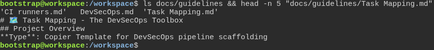
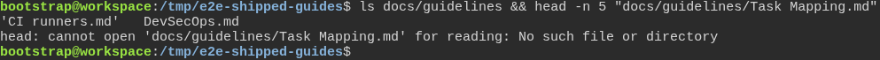

# A generated project gets the guides that describe it, not the toolbox's map of itself

**Scenario:** The toolbox keeps its task map, and a generated project gets every other guide without it

<a name="storyboard-result"></a>

> [!tip] PASSED
> 2 steps · 2 frames

**On this page**

[Result](#storyboard-result) · [Replay and source](#storyboard-replay)

<table width="100%">
<tr>
<th width="50%">

**1. Given the toolbox's guides folder holds a task map of the toolbox itself**

</th>
<th width="50%">

**2. Then a project generated with every default answer gets the other guides and no task map**

</th>
</tr>
<tr>
<td width="50%" valign="top">

[](../../screenshots/base/01-install/shipped-guides/toolbox-guides.webp)

The toolbox itself, in /workspace. Its docs/guidelines folder holds three guides: CI runners.md, DevSecOps.md and Task Mapping.md.
The first lines of Task Mapping.md say what it describes: "Task Mapping - The DevSecOps Toolbox", of type "Copier Template for DevSecOps pipeline scaffolding". That is the toolbox itself, not a project generated from it.

<details>
<summary>Command</summary>

```shell
ls docs/guidelines && head -n 5 "docs/guidelines/Task Mapping.md"
```

</details>

</td>
<td width="50%" valign="top">

[](../../screenshots/base/01-install/shipped-guides/generated-project-guides.webp)

Off camera, Copier generates a new project from the toolbox with every default answer, in /tmp/e2e-shipped-guides. The same line is typed there.
Its docs/guidelines folder holds CI runners.md and DevSecOps.md. head answers "No such file or directory": the toolbox keeps its task map out of the projects it generates.

<details>
<summary>Command</summary>

```shell
uvx --python 3.14 --from copier==9.14.3 copier copy --defaults --skip-tasks /workspace /tmp/e2e-shipped-guides && cd /tmp/e2e-shipped-guides && ls docs/guidelines && head -n 5 "docs/guidelines/Task Mapping.md"
```

</details>

</td>
</tr>
</table>

<a name="storyboard-replay"></a>

<details>
<summary>Replay this scenario · source and checks</summary>

```shell
task test -- --grep "@shipped-guides"
```

**Source**

```text
project/tests/e2e/features/01-install/shipped-guides.feature
```

Every frame is its own pixel baseline (tolerance: 0).

</details>
