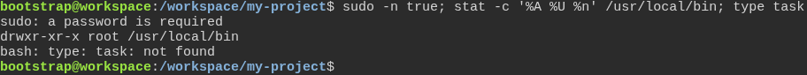
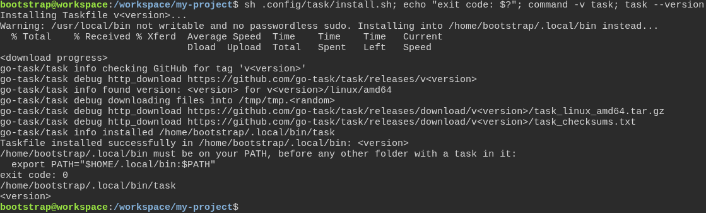

# Trusting the installer on a fresh machine

**Scenario:** Without sudo rights, the task installer puts task in the developer's own folder

<a name="storyboard-result"></a>

> [!tip] PASSED
> 2 steps · 2 frames

**On this page**

[Result](#storyboard-result) · [Replay and source](#storyboard-replay)

<table width="100%">
<tr>
<th width="50%">

**1. Given a fresh machine where the developer has no sudo rights and task is not installed**

</th>
<th width="50%">

**2. Then the task installer puts task in \~/.local/bin, says that folder must be on the PATH, and task runs from there**

</th>
</tr>
<tr>
<td width="50%" valign="top">

[](../../screenshots/base/01-install/task-install-without-sudo/no-sudo.webp)

A brand-new Ubuntu machine where the developer has no sudo rights, with the toolbox's task installer in .config/task. One typed line: sudo asks for a password, /usr/local/bin belongs to root, and task is not installed.

<details>
<summary>Command</summary>

```shell
sudo -n true; stat -c '%A %U %n' /usr/local/bin; type task
```

</details>

</td>
<td width="50%" valign="top">

[](../../screenshots/base/01-install/task-install-without-sudo/task-in-home.webp)

The developer runs the task installer. It cannot write to /usr/local/bin and has no sudo, so it says it installs into /home/bootstrap/.local/bin instead, the developer's own folder. The lines after it come from task's official install script, which ends on "installed /home/bootstrap/.local/bin/task".
The installer then says where task is and that this folder must be on the PATH. The run ends with exit code 0, and the shell finds task in /home/bootstrap/.local/bin. Versions show as &lt;version&gt;, the download progress and the temporary folder as placeholders: they change with each run or update.

<details>
<summary>Command</summary>

```shell
sh .config/task/install.sh; echo "exit code: $?"; command -v task; task --version
```

</details>

</td>
</tr>
</table>

<a name="storyboard-replay"></a>

<details>
<summary>Replay this scenario · source and checks</summary>

```shell
task test -- --grep "@task-install-without-sudo"
```

**Source**

```text
project/tests/e2e/features/01-install/fresh-machine.feature
```

Every frame is its own pixel baseline (tolerance: 0).

</details>
