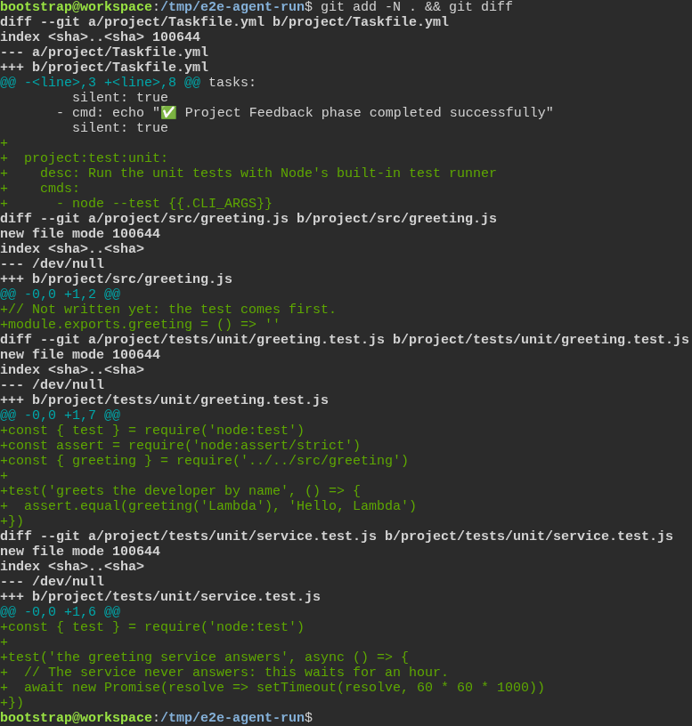
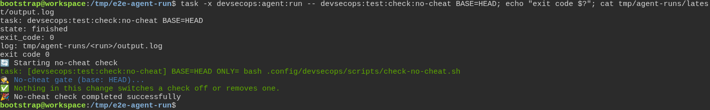
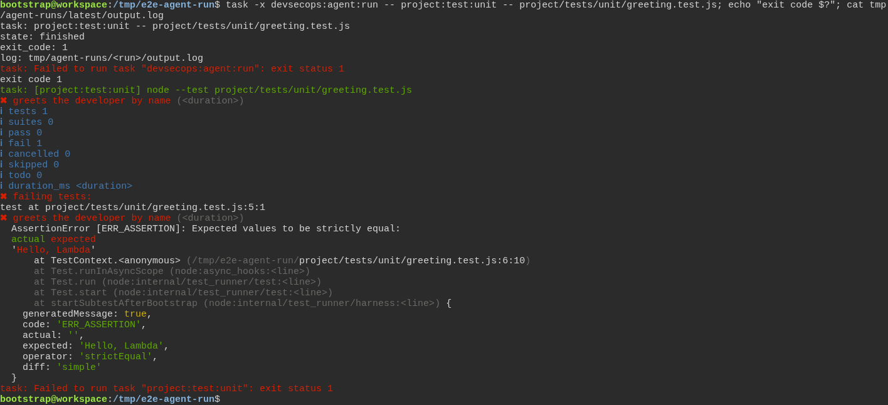
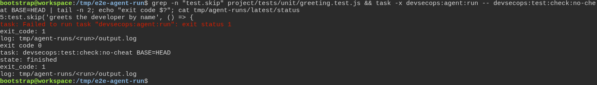
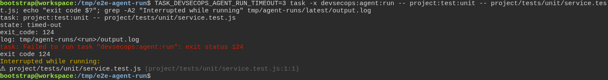

# The toolbox checks the test really failed first, instead of taking anyone's word for it

**Scenario:** An assistant runs its tasks through one entry point that keeps each task's own verdict

<a name="storyboard-result"></a>

> [!tip] PASSED
> 5 steps · 5 frames

**On this page**

[Result](#storyboard-result) · [One entry point, the task's own exit code](#storyboard-chapter-1) · [Nothing typed after the run can change its verdict](#storyboard-chapter-2) · [Replay and source](#storyboard-replay)

<a name="storyboard-chapter-1"></a>

## One entry point, the task's own exit code

<table width="100%">
<tr>
<th width="50%">

**1. Given a project has a unit test task, one test still waiting for its code and one test that never ends**

</th>
<th width="50%">

**2. When the assistant runs a passing check through the runner, and the status file and the shell both say 0**

</th>
</tr>
<tr>
<td width="50%" valign="top">

[](../../screenshots/base/02-daily-work/agent-run/agent-run-setup.webp)

A developer's project, as git sees it. project/Taskfile.yml gains a task of its own, project:test:unit, which hands its arguments to Node's built-in test runner.
Two tests come with it. greeting.test.js expects "Hello, Lambda" from src/greeting.js, which still returns nothing: the code is not written yet. service.test.js waits an hour for an answer that never comes.

<details>
<summary>Command</summary>

```shell
git add -N . && git diff
```

</details>

</td>
<td width="50%" valign="top">

[](../../screenshots/base/02-daily-work/agent-run/agent-run-success.webp)

The assistant hands the task to task devsecops:agent:run, with -x so the task's exit code comes through. The runner starts it from the root of the repository and sends everything it prints to a log of its own, under tmp/agent-runs.
Then it prints the status file of the run: the task, "state: finished", "exit\_code: 0" and the path of the log. The shell agrees, exit code 0, and the log holds the check's own words, "Nothing in this change switches a check off."

<details>
<summary>Command</summary>

```shell
task -x devsecops:agent:run -- devsecops:test:check:no-cheat BASE=HEAD; echo "exit code $?"; cat tmp/agent-runs/latest/output.log
```

</details>

</td>
</tr>
</table>

<table width="100%">
<tr>
<th width="50%">

**3. Then the expected RED comes back with the test's own exit code, 1**

</th>
<th width="50%">


</th>
</tr>
<tr>
<td width="50%" valign="top">

[](../../screenshots/base/02-daily-work/agent-run/agent-run-red.webp)

Same runner, now the expected RED: the greeting test, which fails until the code is written. Node's test runner exits with 1, and that 1 comes back as it is, in the status file and in the shell.
The log says why: the test "greets the developer by name" expected 'Hello, Lambda' and got ''. Both of Task's "Failed to run task" lines carry the same exit status 1.

<details>
<summary>Command</summary>

```shell
task -x devsecops:agent:run -- project:test:unit -- project/tests/unit/greeting.test.js; echo "exit code $?"; cat tmp/agent-runs/latest/output.log
```

</details>

</td>
<td width="50%" valign="top">


</td>
</tr>
</table>

<a name="storyboard-chapter-2"></a>

## Nothing typed after the run can change its verdict

<table width="100%">
<tr>
<th width="50%">

**4. Then a refused check stays 1 in the status file, even when a pipe hands the shell a 0**

</th>
<th width="50%">

**5. Then a test that never ends is stopped at the time limit and comes back 124, never 0**

</th>
</tr>
<tr>
<td width="50%" valign="top">

[](../../screenshots/base/02-daily-work/agent-run/agent-run-pipe.webp)

The assistant switches the greeting test off: test.skip, on line 5. The same check now refuses the change, and the line ends in a pipe into tail, the habit that used to hide failures.
The shell prints exit code 0, the exit code of tail. The status file of the run, printed last, still says "exit\_code: 1": the pipe changed what the shell saw, not the verdict.

<details>
<summary>Command</summary>

```shell
grep -n "test.skip" project/tests/unit/greeting.test.js && task -x devsecops:agent:run -- devsecops:test:check:no-cheat BASE=HEAD | tail -n 2; echo "exit code $?"; cat tmp/agent-runs/latest/status
```

</details>

</td>
<td width="50%" valign="top">

[](../../screenshots/base/02-daily-work/agent-run/agent-run-timeout.webp)

The last test never ends. With the time limit set to 3 seconds, the runner stops it and says so: "state: timed-out" and "exit\_code: 124". The shell sees 124 too, never 0.
The last lines come from the log of the run: Node's test runner reports service.test.js "Interrupted while running".
Off camera, the status file is read while the test still runs. It says "state: running" with no exit code: a run that never comes back never reads as a success.

<details>
<summary>Command</summary>

```shell
TASK_DEVSECOPS_AGENT_RUN_TIMEOUT=3 task -x devsecops:agent:run -- project:test:unit -- project/tests/unit/service.test.js; echo "exit code $?"; grep -A2 "Interrupted while running" tmp/agent-runs/latest/output.log
```

</details>

</td>
</tr>
</table>

<a name="storyboard-replay"></a>

<details>
<summary>Replay this scenario · source and checks</summary>

```shell
task test -- --grep "@agent-run"
```

**Source**

```text
project/tests/e2e/features/02-daily-work/tdd-cycle.feature
```

Every frame is its own pixel baseline (tolerance: 0).

</details>
