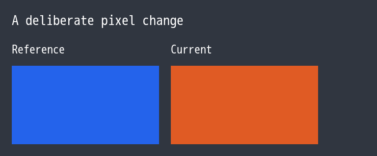
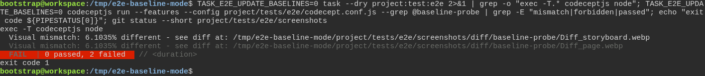
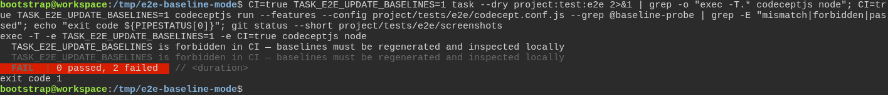
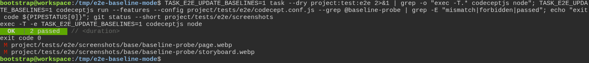
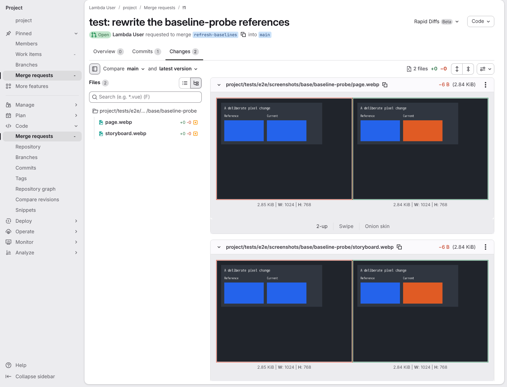

# The toolbox checks the test really failed first, instead of taking anyone's word for it

**Scenario:** Only an explicit local request may replace an image reference

<a name="storyboard-result"></a>

> [!tip] PASSED
> 5 steps · 5 frames

**On this page**

[Result](#storyboard-result) · [A visible difference must fail](#storyboard-chapter-1) · [A developer rewrites the references, a reviewer accepts them](#storyboard-chapter-2) · [Replay and source](#storyboard-replay)

<a name="storyboard-chapter-1"></a>

## A visible difference must fail

<table width="100%">
<tr>
<th width="50%">

**1. Given a reference image and a captured page differ visibly in their pixels**

</th>
<th width="50%">

**2. Then a flag set to zero, like no flag at all, is not passed on, and both checks refuse the difference**

</th>
</tr>
<tr>
<td width="50%" valign="top">

[](../../screenshots/base/02-daily-work/baseline-mode/baseline-mode-difference.webp)

The page under test, as Chromium captures it: the box labelled Current is now orange. The committed reference image of this page has both boxes in blue, so the two images differ in their pixels.
A throwaway copy of the toolbox holds that reference twice, once for each of the suite's two visual checks, and one test that compares the page with both.

</td>
<td width="50%" valign="top">

[](../../screenshots/base/02-daily-work/baseline-mode/baseline-mode-zero.webp)

Each card types the same line with another setting. First, what task project:test:e2e would hand to its test container: with the flag set to 0, the bare command, so the test never sees the flag.
Then the test itself, run with the 0 anyway. Both checks fail on "Visual mismatch", the run exits with the code 1, and git status prints nothing: both references are untouched. No flag at all gives the same result.

<details>
<summary>Command</summary>

```shell
TASK_E2E_UPDATE_BASELINES=0 task --dry project:test:e2e 2>&1 | grep -o "exec -T.* codeceptjs node"; TASK_E2E_UPDATE_BASELINES=0 codeceptjs run --features --config project/tests/e2e/codecept.conf.js --grep @baseline-probe | grep -E "mismatch|forbidden|passed"; echo "exit code ${PIPESTATUS[0]}"; git status --short project/tests/e2e/screenshots
```

</details>

</td>
</tr>
</table>

<table width="100%">
<tr>
<th width="50%">

**3. And in CI the flag set to 1 reaches the test with CI set, and both checks refuse to rewrite anything**

</th>
<th width="50%">


</th>
</tr>
<tr>
<td width="50%" valign="top">

[](../../screenshots/base/02-daily-work/baseline-mode/baseline-mode-ci.webp)

Same line, as a CI job would run it, with the flag set to 1. The task hands the flag over together with CI\=true, so the test knows where it runs.
Both checks refuse at once, "TASK\_E2E\_UPDATE\_BASELINES is forbidden in CI", and git sees no change. In CI, a visual difference can only fail the run.

<details>
<summary>Command</summary>

```shell
CI=true TASK_E2E_UPDATE_BASELINES=1 task --dry project:test:e2e 2>&1 | grep -o "exec -T.* codeceptjs node"; CI=true TASK_E2E_UPDATE_BASELINES=1 codeceptjs run --features --config project/tests/e2e/codecept.conf.js --grep @baseline-probe | grep -E "mismatch|forbidden|passed"; echo "exit code ${PIPESTATUS[0]}"; git status --short project/tests/e2e/screenshots
```

</details>

</td>
<td width="50%" valign="top">


</td>
</tr>
</table>

<a name="storyboard-chapter-2"></a>

## A developer rewrites the references, a reviewer accepts them

<table width="100%">
<tr>
<th width="50%">

**4. When the flag is exactly 1 on the developer's machine, both references are rewritten with the captured pixels**

</th>
<th width="50%">

**5. Then the merge request shows each old reference next to its new pixels, for a reviewer to accept**

</th>
</tr>
<tr>
<td width="50%" valign="top">

[](../../screenshots/base/02-daily-work/baseline-mode/baseline-mode-one.webp)

Same line on the developer's machine, with the flag set to 1. The task hands the flag over, and both checks pass: each one wrote the captured page over its reference.
git status now lists the two references as modified. Nothing is accepted yet: someone still has to look at them.

<details>
<summary>Command</summary>

```shell
TASK_E2E_UPDATE_BASELINES=1 task --dry project:test:e2e 2>&1 | grep -o "exec -T.* codeceptjs node"; TASK_E2E_UPDATE_BASELINES=1 codeceptjs run --features --config project/tests/e2e/codecept.conf.js --grep @baseline-probe | grep -E "mismatch|forbidden|passed"; echo "exit code ${PIPESTATUS[0]}"; git status --short project/tests/e2e/screenshots
```

</details>

</td>
<td width="50%" valign="top">

[](../../screenshots/base/02-daily-work/baseline-mode/baseline-mode-merge-request.webp)

The developer commits the two references on a branch and opens a merge request, a change a reviewer accepts or refuses. For each image, GitLab shows the old reference, all blue, next to the new capture with its orange box.
That is the only road for a new reference: rewritten on a developer's machine, then looked at by a person before it reaches the main branch.

<details>
<summary>Command</summary>

```shell
http://gitlab/<user>/<project>/-/merge_requests/1/diffs
```

</details>

</td>
</tr>
</table>

<a name="storyboard-replay"></a>

<details>
<summary>Replay this scenario · source and checks</summary>

```shell
task test -- --grep "@baseline-mode"
```

**Source**

```text
project/tests/e2e/features/02-daily-work/tdd-cycle.feature
```

Every frame is its own pixel baseline (tolerance: 0).

</details>
