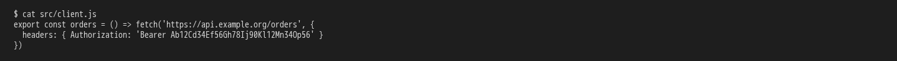
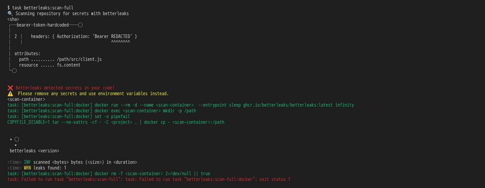

# the framework guards what reaches the repository: clean commits and no secrets

**Scenario:** the full scan blocks a token written into an Authorization header

<a name="storyboard-result"></a>

> [!tip] PASSED
> 2 steps · 2 frames

**On this page**

[Result](#storyboard-result) · [Replay and source](#storyboard-replay)

<table width="100%">
<tr>
<th width="50%">

**1. Given a generated project calls an API with a token written into its Authorization header**

</th>
<th width="50%">

**2. When the developer runs the full secret scan, it blocks the token in the Authorization header**

</th>
</tr>
<tr>
<td width="50%" valign="top">

[](../../screenshots/base/02-daily-work/bearer-token/bearer-file.webp)

A project generated from the toolbox. src/client.js calls an API with a made-up 32-character token in its Authorization header, after the word Bearer, the way the developer would paste it from the API's settings page.

<details>
<summary>Command</summary>

```shell
cat src/client.js
```

</details>

</td>
<td width="50%" valign="top">

[](../../screenshots/base/02-daily-work/bearer-token/bearer-scan.webp)

The full scan reads every file of the project. It finds the token in src/client.js, line 2, under the rule bearer-token-hardcoded, prints "REDACTED" where the value was, and fails: "❌ Betterleaks detected secrets in your code!".

<details>
<summary>Command</summary>

```shell
task betterleaks:scan-full
```

</details>

</td>
</tr>
</table>

<a name="storyboard-replay"></a>

<details>
<summary>Replay this scenario · source and checks</summary>

```shell
task test -- --grep "@bearer-token"
```

**Source**

```text
project/tests/e2e/features/02-daily-work/secret-scans.feature
```

Every frame is its own pixel baseline (tolerance: 0).

</details>
