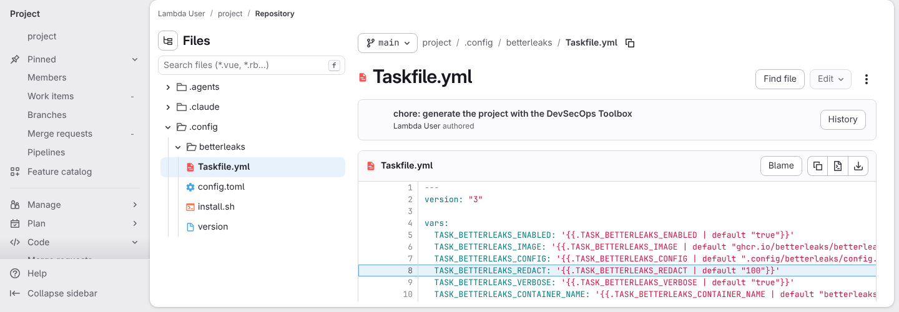
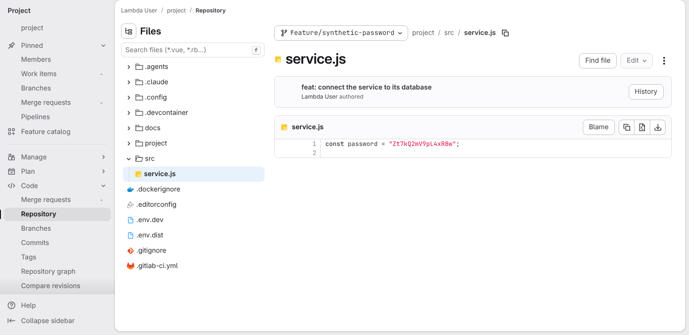
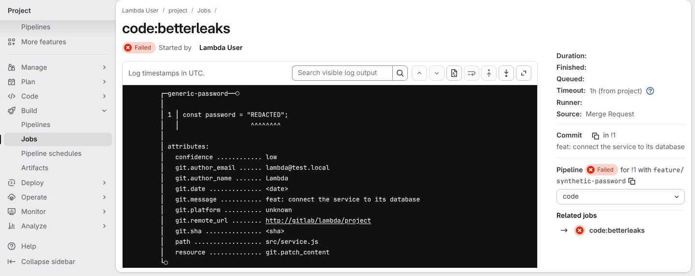
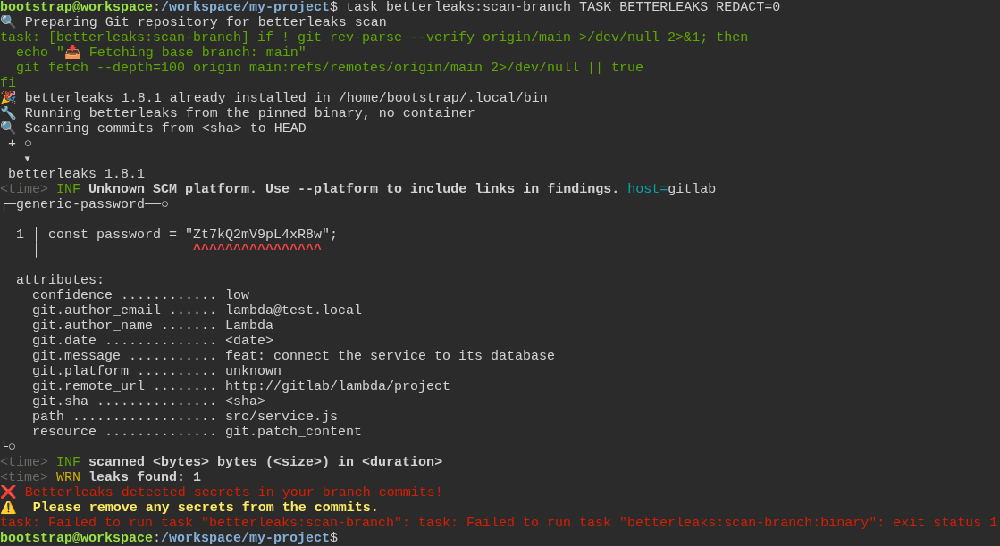

# Betterleaks keeps a detected secret out of the CI log, and shows more only on the developer's machine

**Scenario:** the CI log prints REDACTED, and the developer's own terminal shows more on request

<a name="storyboard-result"></a>

> [!tip] PASSED
> 5 steps · 5 frames

**On this page**

[Result](#storyboard-result) · [Every scan hides the whole value unless told otherwise](#storyboard-chapter-1) · [The shared CI log never prints the value](#storyboard-chapter-2) · [The developer sees more in their own terminal only](#storyboard-chapter-3) · [Replay and source](#storyboard-replay)

<a name="storyboard-chapter-1"></a>

## Every scan hides the whole value unless told otherwise

<table width="100%">
<tr>
<th width="50%">

**1. Given GitLab shows that the generated project hides 100 percent of a detected value by default**

</th>
<th width="50%">


</th>
</tr>
<tr>
<td width="50%" valign="top">

[](../../screenshots/base/02-daily-work/betterleaks-redact-config/redaction-setting.webp)

GitLab shows the generated .config/betterleaks/Taskfile.yml on the main branch. Line 8, highlighted, sets TASK\_BETTERLEAKS\_REDACT to "100" unless the developer gives another value.
The number is the share of a detected value, in percent, that a Betterleaks scan hides from its output. The test also checks that all six scans (full, staged and branch, each in a container or from the binary) receive 100.

<details>
<summary>Command</summary>

```shell
http://gitlab/<lambda-user>/<project>/-/blob/main/.config/betterleaks/Taskfile.yml#L8
```

</details>

</td>
<td width="50%" valign="top">


</td>
</tr>
</table>

<a name="storyboard-chapter-2"></a>

## The shared CI log never prints the value

<table width="100%">
<tr>
<th width="50%">

**2. When a developer pushes a branch with a synthetic password in it**

</th>
<th width="50%">

**3. Then the Betterleaks job fails on GitLab and its log prints REDACTED instead of the password**

</th>
</tr>
<tr>
<td width="50%" valign="top">

[](../../screenshots/base/02-daily-work/betterleaks-redact-config/redaction-pushed-branch.webp)

A developer commits a made-up password in src/service.js on a new branch and pushes it. GitLab shows the file on the branch feature/synthetic-password, the whole value on line 1.
Hiding a value protects what a scan prints, not the repository: the password stays in the file until someone removes it.

<details>
<summary>Command</summary>

```shell
http://gitlab/<lambda-user>/<project>/-/blob/feature/synthetic-password/src/service.js
```

</details>

</td>
<td width="50%" valign="top">

[](../../screenshots/base/02-daily-work/betterleaks-redact-config/redaction-ci-job-log.webp)

The developer opens a merge request. Its pipeline runs the generated code:betterleaks job, with no setting changed, and the job fails. GitLab shows the job page, its log scrolled to what the scan found.
The finding names the rule generic-password, the file src/service.js and line 1, and prints "REDACTED" where the password was. Everyone on the project can read this log, so the value stays out of it.

<details>
<summary>Command</summary>

```shell
http://gitlab/<lambda-user>/<project>/-/jobs/<job-id>
```

</details>

</td>
</tr>
</table>

<a name="storyboard-chapter-3"></a>

## The developer sees more in their own terminal only

<table width="100%">
<tr>
<th width="50%">

**4. Then the developer's terminal shows the first 12 characters of the password with the setting at 25**

</th>
<th width="50%">

**5. And the developer's terminal shows the whole password with the setting at 0**

</th>
</tr>
<tr>
<td width="50%" valign="top">

[](../../screenshots/base/02-daily-work/betterleaks-redact-config/redaction-environment.webp)

To see what was caught, the developer runs the same scan in their clone, with TASK\_BETTERLEAKS\_REDACT\=25 in the environment. The scan hides the last quarter of the value: line 1 shows the first 12 of its 16 characters, then "...". The scan still fails.

<details>
<summary>Command</summary>

```shell
TASK_BETTERLEAKS_REDACT=25 task betterleaks:scan-branch
```

</details>

</td>
<td width="50%" valign="top">

[](../../screenshots/base/02-daily-work/betterleaks-redact-config/redaction-zero.webp)

The same scan with TASK\_BETTERLEAKS\_REDACT\=0 after the command hides nothing: line 1 shows the whole value.
Both runs stay on this machine: nothing is committed and nothing reaches GitLab. The test also checks that all six scans accept both ways of setting the value.

<details>
<summary>Command</summary>

```shell
task betterleaks:scan-branch TASK_BETTERLEAKS_REDACT=0
```

</details>

</td>
</tr>
</table>

<a name="storyboard-replay"></a>

<details>
<summary>Replay this scenario · source and checks</summary>

```shell
task test -- --grep "@betterleaks-redact-config"
```

**Source**

```text
project/tests/e2e/features/02-daily-work/betterleaks-redact.feature
```

Every frame is its own pixel baseline (tolerance: 0).

</details>
