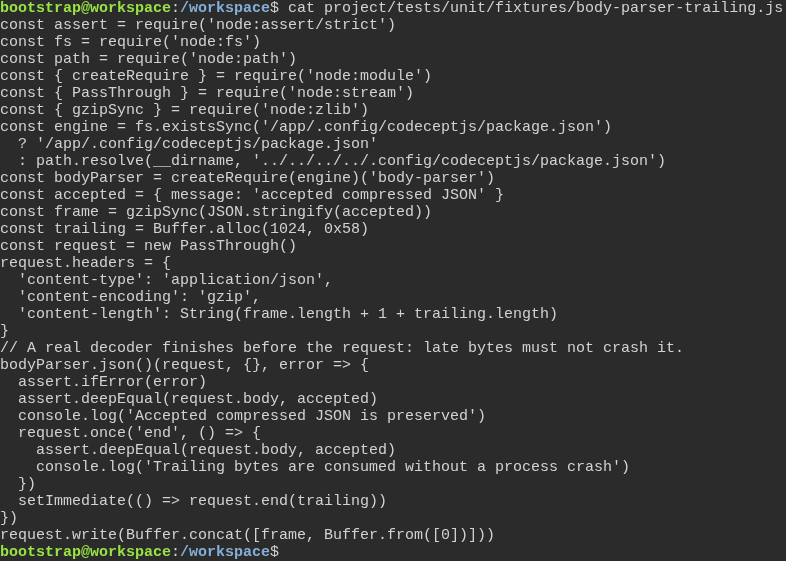
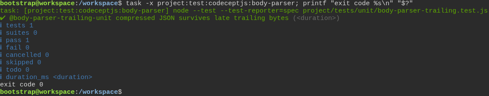

# The test engine survives late bytes after a compressed request body

**Scenario:** A compressed JSON value remains valid when late trailing bytes arrive

<a name="storyboard-result"></a>

> [!tip] PASSED
> 2 steps · 2 frames

**On this page**

[Result](#storyboard-result) · [Replay and source](#storyboard-replay)

<table width="100%">
<tr>
<th width="50%">

**1. Given the test engine has a regression for late compressed request bytes**

</th>
<th width="50%">

**2. Then the installed test engine survives the late compressed request bytes**

</th>
</tr>
<tr>
<td width="50%" valign="top">

[](../../screenshots/base/02-daily-work/body-parser-trailing/compressed-request-specification.webp)

The real parser receives a valid gzip frame and then invalid trailing bytes after parsing finishes. Assertions check that the accepted value is preserved and the entire request stream ends. An uncaught decoder error must fail the regression.

<details>
<summary>Command</summary>

```shell
cat project/tests/unit/fixtures/body-parser-trailing.js
```

</details>

</td>
<td width="50%" valign="top">

[](../../screenshots/base/02-daily-work/body-parser-trailing/compressed-request-result.webp)

The task runs the real parser in a child process and requires exit code zero, accepted JSON and consumed trailing bytes. Only measured execution times are hidden.

<details>
<summary>Command</summary>

```shell
task -x project:test:codeceptjs:body-parser
```

</details>

</td>
</tr>
</table>

<a name="storyboard-replay"></a>

<details>
<summary>Replay this scenario · source and checks</summary>

```shell
task test -- --grep "@body-parser-trailing"
```

**Source**

```text
project/tests/e2e/features/02-daily-work/compressed-request.feature
```

Every frame is its own pixel baseline (tolerance: 0).

</details>
