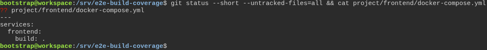
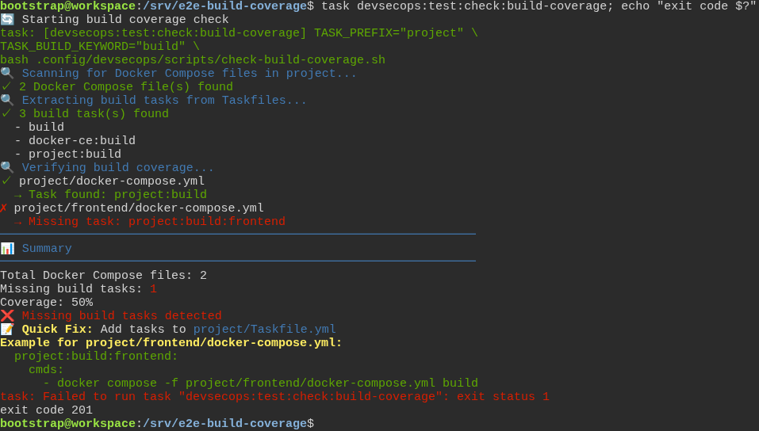
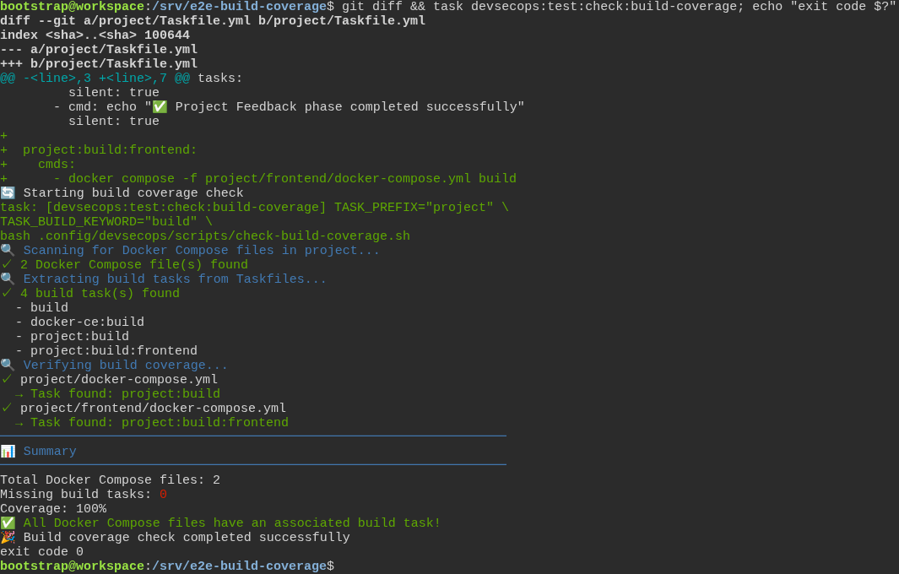

# The toolbox checks the test really failed first, instead of taking anyone's word for it

**Scenario:** The build check prints the task a new service is missing, ready to paste

<a name="storyboard-result"></a>

> [!tip] PASSED
> 3 steps · 3 frames

**On this page**

[Result](#storyboard-result) · [A new service without its build task](#storyboard-chapter-1) · [Replay and source](#storyboard-replay)

<a name="storyboard-chapter-1"></a>

## A new service without its build task

<table width="100%">
<tr>
<th width="50%">

**1. Given a generated project adds a frontend service and no task to build it**

</th>
<th width="50%">

**2. When the build check refuses the frontend service and prints the task it is missing**

</th>
</tr>
<tr>
<td width="50%" valign="top">

[](../../screenshots/base/02-daily-work/build-coverage-example/build-coverage-example-setup.webp)

A project generated by the toolbox. The developer adds a frontend service in a folder of its own, project/frontend, and writes no task to build it.
git status lists the new Compose file, and cat shows it: one service, frontend, built from its own folder.

<details>
<summary>Command</summary>

```shell
git status --short --untracked-files=all && cat project/frontend/docker-compose.yml
```

</details>

</td>
<td width="50%" valign="top">

[](../../screenshots/base/02-daily-work/build-coverage-example/build-coverage-example-refused.webp)

The build check is one of the checks task test runs first. It finds the project's own Compose file, built by project:build, and the new one, with "Missing task: project:build:frontend". It fails with the exit code 201, the code Task gives a failed command.
Under the summary, it prints the task to add to project/Taskfile.yml for that service: its name, project:build:frontend, and the path of its Compose file from the repository root, where every task runs.

<details>
<summary>Command</summary>

```shell
task devsecops:test:check:build-coverage; echo "exit code $?"
```

</details>

</td>
</tr>
</table>

<table width="100%">
<tr>
<th width="50%">

**3. Then the task pasted as printed satisfies the build check**

</th>
<th width="50%">


</th>
</tr>
<tr>
<td width="50%" valign="top">

[](../../screenshots/base/02-daily-work/build-coverage-example/build-coverage-example-pasted.webp)

The developer pastes those three lines, as printed, at the end of project/Taskfile.yml. git diff shows them under the project's last task.
The same check now reads "Task found: project:build:frontend" and ends on "All Docker Compose files have an associated build task!", with the exit code 0.

<details>
<summary>Command</summary>

```shell
git diff && task devsecops:test:check:build-coverage; echo "exit code $?"
```

</details>

</td>
<td width="50%" valign="top">


</td>
</tr>
</table>

<a name="storyboard-replay"></a>

<details>
<summary>Replay this scenario · source and checks</summary>

```shell
task test -- --grep "@build-coverage-example"
```

**Source**

```text
project/tests/e2e/features/02-daily-work/tdd-cycle.feature
```

Every frame is its own pixel baseline (tolerance: 0).

</details>
