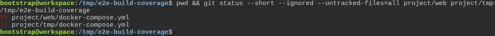
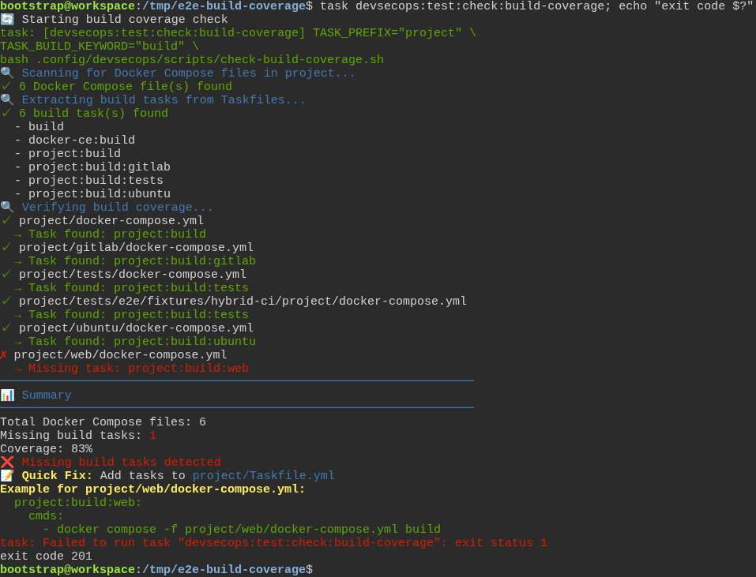

# The toolbox checks the test really failed first, instead of taking anyone's word for it

**Scenario:** The build check reads a repository that sits under /tmp, and still skips its tmp folders

<a name="storyboard-result"></a>

> [!tip] PASSED
> 2 steps · 2 frames

**On this page**

[Result](#storyboard-result) · [Replay and source](#storyboard-replay)

<table width="100%">
<tr>
<th width="50%">

**1. Given a repository under /tmp adds a web service with no build task, and keeps a scratch copy in a tmp folder**

</th>
<th width="50%">

**2. Then the build check finds the web service, refuses it without its build task, and leaves the scratch copy out**

</th>
</tr>
<tr>
<td width="50%" valign="top">

[](../../screenshots/base/02-daily-work/build-coverage-under-tmp/build-coverage-under-tmp-setup.webp)

A copy of the toolbox's own repository, placed under /tmp the way a quick clone often is: pwd prints /tmp/e2e-build-coverage. The developer adds a web service, project/web/docker-compose.yml, and writes no task to build it.
A scratch copy of that file sits in project/tmp. git status marks the new service "??", a file git does not track yet, and the scratch copy "!!", a file git ignores: the repository's .gitignore holds the line tmp/.

<details>
<summary>Command</summary>

```shell
pwd && git status --short --ignored --untracked-files=all project/web project/tmp
```

</details>

</td>
<td width="50%" valign="top">

[](../../screenshots/base/02-daily-work/build-coverage-under-tmp/build-coverage-under-tmp-verdict.webp)

The build check is one of the checks task test runs first. It prints "6 Docker Compose file(s) found": the five the toolbox already had, each with the task that builds it, project:build:gitlab for instance, and the new web service.
The web service has none: "Missing task: project:build:web", and the check fails with the exit code 201, the code Task gives a failed command. The scratch copy in project/tmp is not in the list.
The check reads each .gitignore line against paths inside the repository only. The line tmp/ leaves out project/tmp, and never the /tmp folder the repository sits in.

<details>
<summary>Command</summary>

```shell
task devsecops:test:check:build-coverage; echo "exit code $?"
```

</details>

</td>
</tr>
</table>

<a name="storyboard-replay"></a>

<details>
<summary>Replay this scenario · source and checks</summary>

```shell
task test -- --grep "@build-coverage-under-tmp"
```

**Source**

```text
project/tests/e2e/features/02-daily-work/tdd-cycle.feature
```

Every frame is its own pixel baseline (tolerance: 0).

</details>
