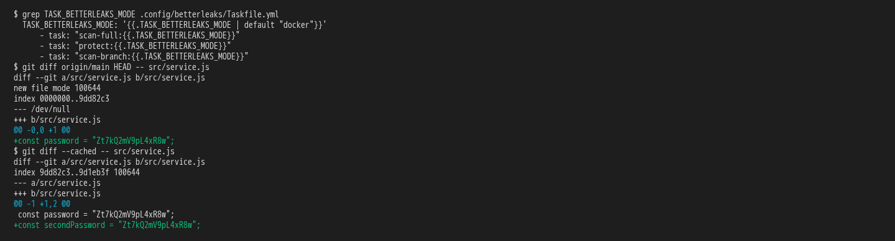
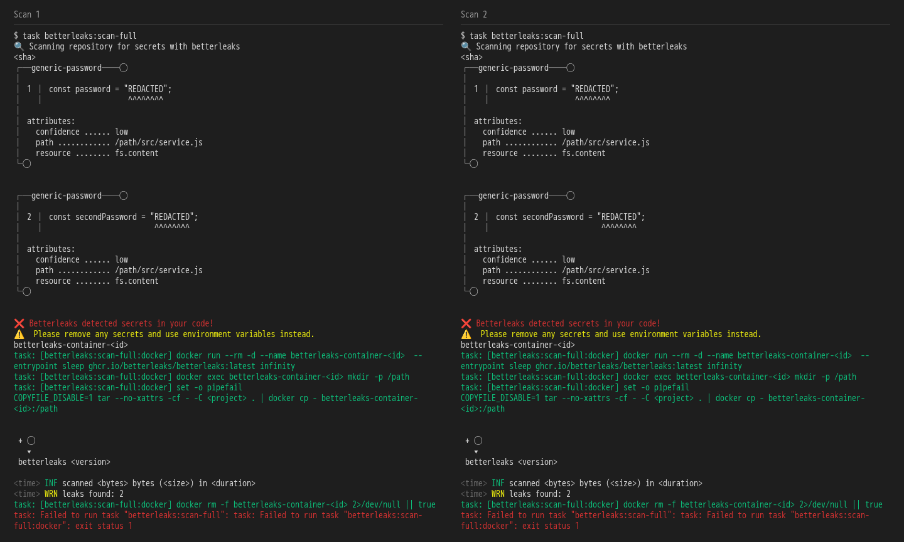

# the framework guards what reaches the repository: clean commits and no secrets

**Scenario:** two secret scans started at the same time each block the password from a container of their own

<a name="storyboard-result"></a>

> [!tip] PASSED
> 2 steps · 2 frames

**On this page**

[Result](#storyboard-result) · [Replay and source](#storyboard-replay)

<table width="100%">
<tr>
<th width="50%">

**1. Given a project that scans in Docker holds a synthetic password, committed and staged**

</th>
<th width="50%">

**2. Then two full scans started at the same time both block the password, each from its own container**

</th>
</tr>
<tr>
<td width="50%" valign="top">

[](../../screenshots/base/02-daily-work/concurrent-scans/docker-password.webp)

A project generated with the default answers. Its .config/betterleaks/Taskfile.yml keeps TASK\_BETTERLEAKS\_MODE at "docker", so every scan starts a container.
Since the main branch, a commit adds src/service.js with a synthetic password on line 1. A second line with the same password is staged.

<details>
<summary>Command</summary>

```shell
grep TASK_BETTERLEAKS_MODE .config/betterleaks/Taskfile.yml && git diff origin/main HEAD -- src/service.js && git diff --cached -- src/service.js
```

</details>

</td>
<td width="50%" valign="top">

[](../../screenshots/base/02-daily-work/concurrent-scans/full-together.webp)

Two full scans start together. Each one runs betterleaks in a container named betterleaks-container followed by an id of its own, and removes only that container when it ends.
Both find the two lines, print "REDACTED" where the password was, and fail with "❌ Betterleaks detected secrets in your code!". The test also starts two staged scans and two branch scans together, and each of them blocks the password too.

<details>
<summary>Command</summary>

```shell
task betterleaks:scan-full & task betterleaks:scan-full; wait
```

</details>

</td>
</tr>
</table>

<a name="storyboard-replay"></a>

<details>
<summary>Replay this scenario · source and checks</summary>

```shell
task test -- --grep "@concurrent-scans"
```

**Source**

```text
project/tests/e2e/features/02-daily-work/secret-scans.feature
```

Every frame is its own pixel baseline (tolerance: 0).

</details>
