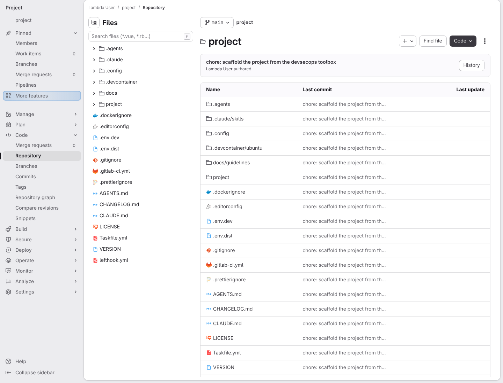
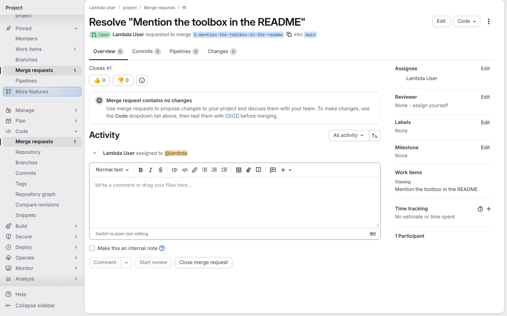
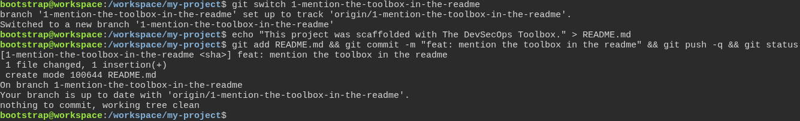
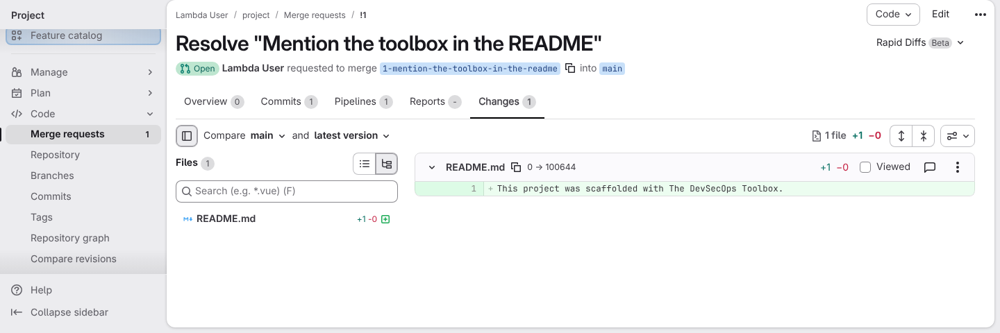
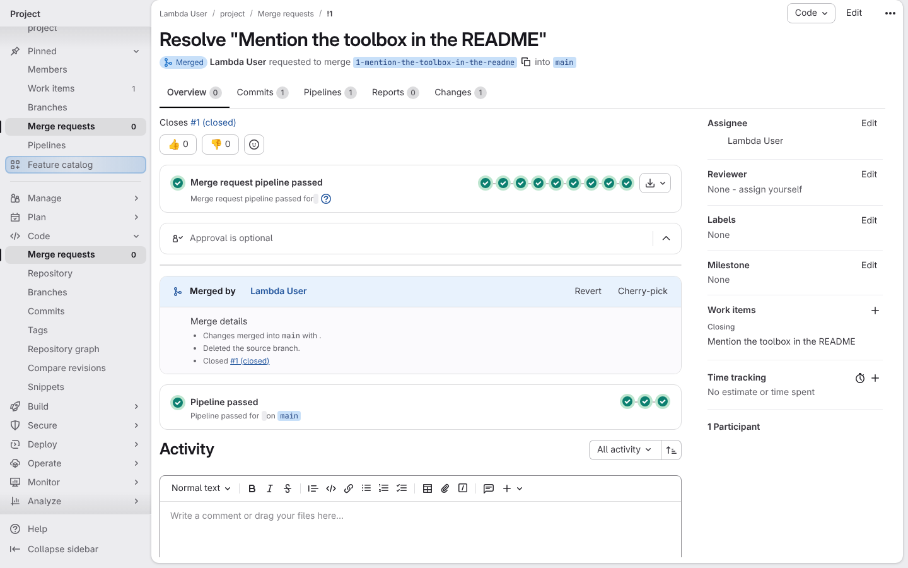
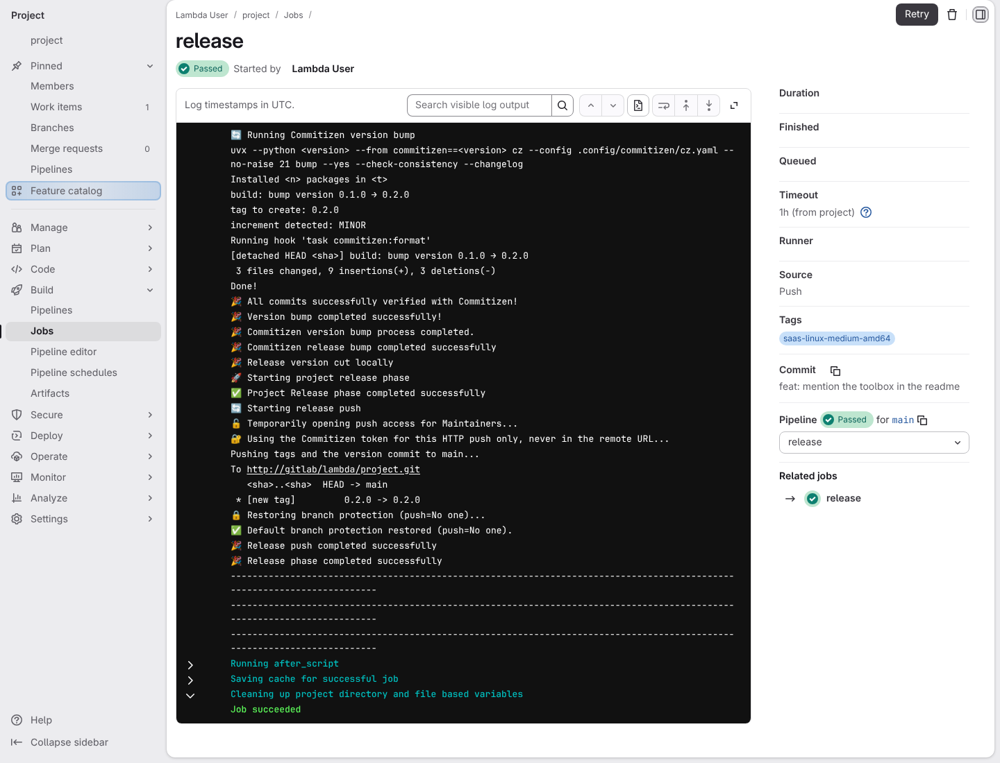
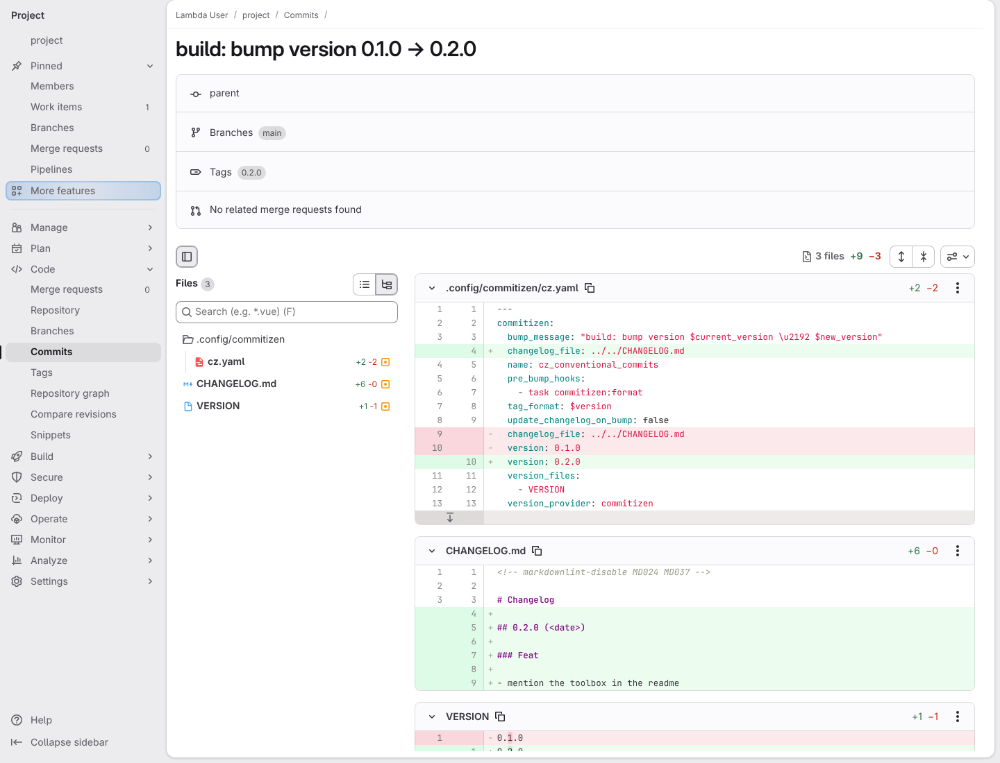

# An everyday change goes from an issue to a released version

**Scenario:** An issue becomes a merge request, and the main branch releases the change

<a name="storyboard-result"></a>

> [!tip] PASSED
> 7 steps · 7 frames

**On this page**

[Result](#storyboard-result) · [An issue starts the work](#storyboard-chapter-1) · [The change rides a merge request](#storyboard-chapter-2) · [The main branch releases it](#storyboard-chapter-3) · [Replay and source](#storyboard-replay)

<a name="storyboard-chapter-1"></a>

## An issue starts the work

<table width="100%">
<tr>
<th width="50%">

**1. Given an installed project with the framework already on its main branch**

</th>
<th width="50%">

**2. When the developer opens an issue and creates its merge request, assigned to themself**

</th>
</tr>
<tr>
<td width="50%" valign="top">

[](../../screenshots/base/02-daily-work/daily-contribution/installed-project.webp)

GitLab's page for the main branch of a project the installer already set up. The table lists the framework's files and folders, among them .agents, .claude/skills, .config, .gitlab-ci.yml, Taskfile.yml and VERSION, all on the commit "chore: scaffold the project from the devsecops toolbox". There is no README.md yet.
The project's name shows as "project", and dates and avatars are hidden, so the picture is the same on every run.

<details>
<summary>Command</summary>

```shell
http://gitlab/<lambda-user>/<project>/-/tree/main
```

</details>

</td>
<td width="50%" valign="top">

[](../../screenshots/base/02-daily-work/daily-contribution/mr-from-issue.webp)

The developer opened issue \#1, "Mention the toolbox in the README", then created its merge request the way the issue's "Create merge request" button does: the branch is named after the issue, and the description says "Closes \#1".
On the right, the developer is the Assignee, and "Work items" lists the issue under "Closing". Nothing is written yet: the tabs read Commits 0 and Changes 0, and GitLab says "Merge request contains no changes".

<details>
<summary>Command</summary>

```shell
http://gitlab/<lambda-user>/<project>/-/merge_requests/1
```

</details>

</td>
</tr>
</table>

<a name="storyboard-chapter-2"></a>

## The change rides a merge request

<table width="100%">
<tr>
<th width="50%">

**3. When the developer writes a one-line README on the issue's branch, commits it as a conventional feat and pushes it**

</th>
<th width="50%">

**4. Then the merge request shows that one-line change**

</th>
</tr>
<tr>
<td width="50%" valign="top">

[](../../screenshots/base/02-daily-work/daily-contribution/conventional-commit.webp)

The developer's clone of the project, in a terminal. Three typed lines: switch to the issue's branch, write a README of one line, then add it, commit it as "feat: mention the toolbox in the readme" and push it.
Git answers "create mode 100644 README.md", so the file is new, and "Your branch is up to date", so GitLab has the commit. The "feat:" prefix follows Conventional Commits, the format the release reads later to pick the next version.

<details>
<summary>Command</summary>

```shell
git switch 1-mention-the-toolbox-in-the-readme && echo "This project was scaffolded with The DevSecOps Toolbox." > README.md && git add README.md && git commit -m "feat: mention the toolbox in the readme" && git push -q && git status
```

</details>

</td>
<td width="50%" valign="top">

[](../../screenshots/base/02-daily-work/daily-contribution/mr-changes.webp)

The merge request's Changes tab, the page a reviewer reads. The tabs now read Commits 1, Pipelines 1 and Changes 1. The only file is README.md, a new one, and its one line shows in green, as an addition.

<details>
<summary>Command</summary>

```shell
http://gitlab/<lambda-user>/<project>/-/merge_requests/1/diffs
```

</details>

</td>
</tr>
</table>

<a name="storyboard-chapter-3"></a>

## The main branch releases it

<table width="100%">
<tr>
<th width="50%">

**5. When the merge request's pipeline passes and the developer merges it into the main branch**

</th>
<th width="50%">

**6. Then the release job on the main branch moves the version from 0.1.0 to 0.2.0**

</th>
</tr>
<tr>
<td width="50%" valign="top">

[](../../screenshots/base/02-daily-work/daily-contribution/merged-into-main.webp)

The same merge request, merged. "Merge request pipeline passed": its nine icons are the nine stages of the pipeline the project inherited, from plan to feedback, and every job in them passed. Then "Merged by Lambda User", "Deleted the source branch." and "Closed \#1 (closed)".
The last box, "Pipeline passed" on main, is the main branch's own pipeline. The merge moved the main branch to the developer's commit, and that pipeline ran on it.

<details>
<summary>Command</summary>

```shell
http://gitlab/<lambda-user>/<project>/-/merge_requests/1
```

</details>

</td>
<td width="50%" valign="top">

[](../../screenshots/base/02-daily-work/daily-contribution/release-log.webp)

The release job of that pipeline on the main branch, on its own page. In its log, Commitizen reads the feat commit: "increment detected: MINOR", "build: bump version 0.1.0 → 0.2.0", "tag to create: 0.2.0".
The job then opens push access for a moment, pushes the tag ("\[new tag\] 0.2.0 -&gt; 0.2.0") and the version commit, locks the main branch again ("push\=No one") and ends on "Job succeeded". Nobody asked for a release: every pipeline of the main branch includes this job.

<details>
<summary>Command</summary>

```shell
http://gitlab/<lambda-user>/<project>/-/pipelines?ref=main
```

</details>

</td>
</tr>
</table>

<table width="100%">
<tr>
<th width="50%">

**7. And the release commit is tagged 0.2.0 and moves VERSION, the Commitizen config and the CHANGELOG to 0.2.0**

</th>
<th width="50%">


</th>
</tr>
<tr>
<td width="50%" valign="top">

[](../../screenshots/base/02-daily-work/daily-contribution/release-commit.webp)

GitLab's page for the release commit, "build: bump version 0.1.0 → 0.2.0", the newest on the main branch. The row "Tags" shows 0.2.0, plain, with no "v" in front.
The commit changes three files. The Commitizen config .config/commitizen/cz.yaml records version 0.2.0 (Commitizen rewrites the whole file as it saves it, so two other lines change too). CHANGELOG.md gains a 0.2.0 entry listing "mention the toolbox in the readme", its date hidden so the picture is the same on every run. VERSION goes from 0.1.0 to 0.2.0.

<details>
<summary>Command</summary>

```shell
http://gitlab/<lambda-user>/<project>/-/commits/main
```

</details>

</td>
<td width="50%" valign="top">


</td>
</tr>
</table>

<a name="storyboard-replay"></a>

<details>
<summary>Replay this scenario · source and checks</summary>

```shell
task test -- --grep "@daily-contribution"
```

**Source**

```text
project/tests/e2e/features/02-daily-work/daily-contribution.feature
```

Every frame is its own pixel baseline (tolerance: 0).

</details>
