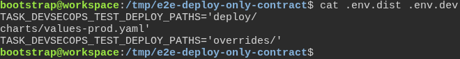
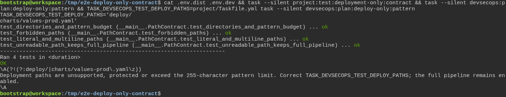

# A merge request that only changes deployment files does not wait for the test suite

**Scenario:** Deployment paths preserve configuration and test coverage

<a name="storyboard-result"></a>

> [!tip] PASSED
> 2 steps · 2 frames

**On this page**

[Result](#storyboard-result) · [Replay and source](#storyboard-replay)

<table width="100%">
<tr>
<th width="50%">

**1. Given a deployment policy with literal paths and dotenv overrides**

</th>
<th width="50%">

**2. Then unsafe paths keep the full pipeline and the effective dotenv value is read without writing YAML**

</th>
</tr>
<tr>
<td width="50%" valign="top">

[](../../screenshots/base/02-daily-work/deploy-only-paths/dotenv-paths.webp)

The development override wins over the multiline default list.

<details>
<summary>Command</summary>

```shell
cat .env.dist .env.dev
```

</details>

</td>
<td width="50%" valign="top">

[](../../screenshots/base/02-daily-work/deploy-only-paths/safe-path-contract.webp)

After checking the override and its empty value, the override file is cleared. The displayed default list produces a reduced pattern after the contract tests pass. Naming project/Taskfile.yml prints a warning and the full-pipeline fallback. Reading the effective list never edits the pipeline YAML.

<details>
<summary>Command</summary>

```shell
cat .env.dist .env.dev && task --silent project:test:deployment-only:contract && task --silent devsecops:plan:deploy-only:pattern && TASK_DEVSECOPS_TEST_DEPLOY_PATHS=project/Taskfile.yml task --silent devsecops:plan:deploy-only:pattern
```

</details>

</td>
</tr>
</table>

<a name="storyboard-replay"></a>

<details>
<summary>Replay this scenario · source and checks</summary>

```shell
task test -- --grep "@deploy-only-paths"
```

**Source**

```text
project/tests/e2e/features/02-daily-work/deploy-only.feature
```

Every frame is its own pixel baseline (tolerance: 0).

</details>
