# A merge request that only changes deployment files does not wait for the test suite

**Scenario:** GitLab creates only the checks needed for a deployment-only merge request

<a name="storyboard-result"></a>

> [!tip] PASSED
> 13 steps · 13 frames

**On this page**

[Result](#storyboard-result) · [Choose deployment files once](#storyboard-chapter-1) · [Any other change keeps the whole pipeline](#storyboard-chapter-2) · [Preview the effective setting](#storyboard-chapter-3) · [Check only the changed files](#storyboard-chapter-4) · [Replay and source](#storyboard-replay)

<a name="storyboard-chapter-1"></a>

## Choose deployment files once

<table width="100%">
<tr>
<th width="50%">

**1. Given a project whose pipeline names a deployment folder and a single deployment file**

</th>
<th width="50%">

**2. Then GitLab creates only code checks and release for the deployment-only merge request**

</th>
</tr>
<tr>
<td width="50%" valign="top">

[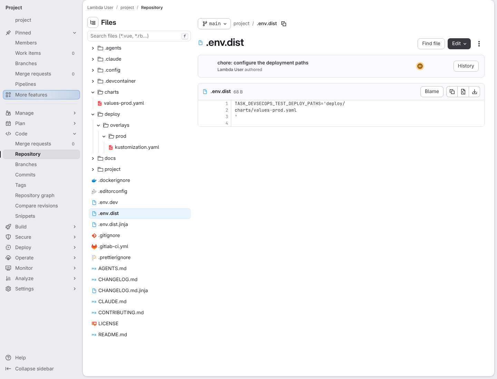](../../screenshots/base/02-daily-work/deploy-only-pipeline/deployment-paths.webp)

The dotenv file names a folder and one file. A stored project variable lets GitLab decide before starting a runner, without YAML list/source variables.

<details>
<summary>Command</summary>

```shell
cat .env.dist
```

</details>

</td>
<td width="50%" valign="top">

[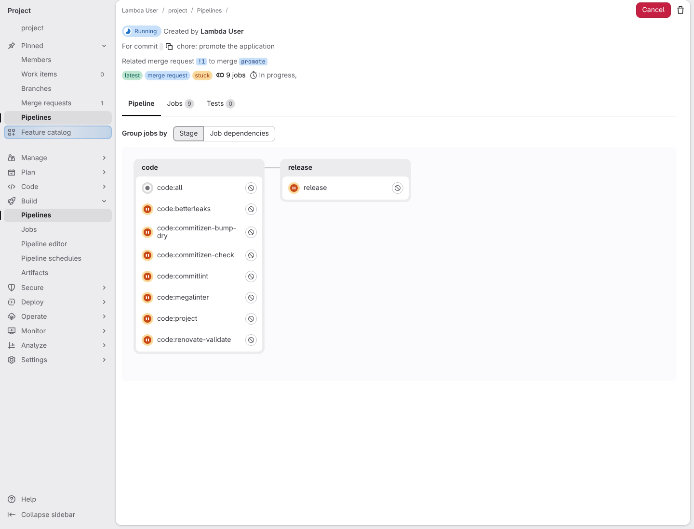](../../screenshots/base/02-daily-work/deploy-only-pipeline/deployment-only-jobs.webp)

This is the real GitLab pipeline for an image-tag change. The code checks and release remain; plan, build, test, deploy, operate, monitor and feedback were never created. No runner is registered in this fixture: the cards prove job selection, not job execution.

</td>
</tr>
</table>

<a name="storyboard-chapter-2"></a>

## Any other change keeps the whole pipeline

<table width="100%">
<tr>
<th width="50%">

**3. Then adding application code to the merge request restores the whole pipeline**

</th>
<th width="50%">

**4. Then build test and deploy actually execute when the stored policy keeps the full pipeline**

</th>
</tr>
<tr>
<td width="50%" valign="top">

[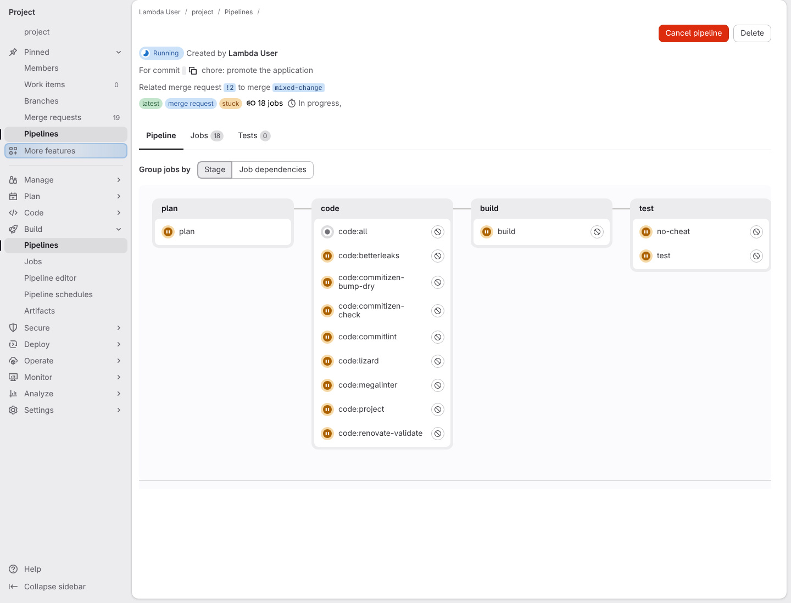](../../screenshots/base/02-daily-work/deploy-only-pipeline/mixed-change-jobs.webp)

The same merge request now changes application code too. GitLab creates all the jobs again, including code:lizard and no-cheat.

</td>
<td width="50%" valign="top">

[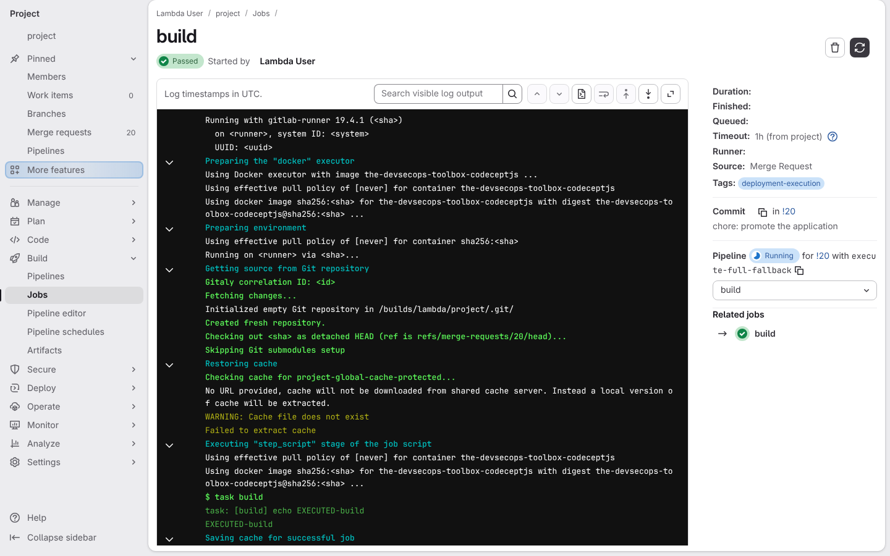](../../screenshots/base/02-daily-work/deploy-only-pipeline/full-fallback-executes.webp)

These fixture tasks print execution markers. The shipped build/test/deploy scripts must actually invoke them when the stored fallback keeps all jobs, despite a nonempty local deployment list.

</td>
</tr>
</table>

<table width="100%">
<tr>
<th width="50%">

**5. Then a failed synchronization keeps the previous policy until a later plan repairs it**

</th>
<th width="50%">


</th>
</tr>
<tr>
<td width="50%" valign="top">

[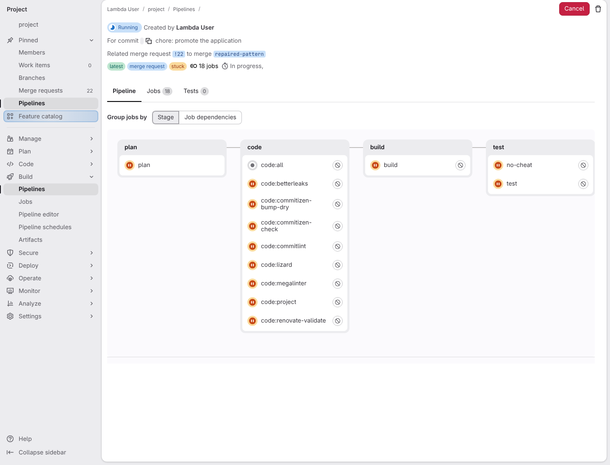](../../screenshots/base/02-daily-work/deploy-only-pipeline/stale-pattern-jobs.webp)

A failed plan leaves the previous selection active. Repair updates the project variable for new pipelines; already-created job graphs stay unchanged.

</td>
<td width="50%" valign="top">


</td>
</tr>
</table>

<a name="storyboard-chapter-3"></a>

## Preview the effective setting

<table width="100%">
<tr>
<th width="50%">

**6. Then the effective deployment setting can be previewed without editing the pipeline**

</th>
<th width="50%">


</th>
</tr>
<tr>
<td width="50%" valign="top">

[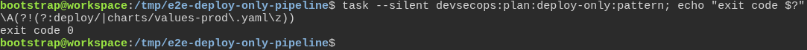](../../screenshots/base/02-daily-work/deploy-only-pipeline/generate-and-check.webp)

Task reads dotenv precedence and prints the pattern. Empty, unsupported or overlong lists preserve every job; the preview never writes YAML.

<details>
<summary>Command</summary>

```shell
task --silent devsecops:plan:deploy-only:pattern
```

</details>

</td>
<td width="50%" valign="top">


</td>
</tr>
</table>

<a name="storyboard-chapter-4"></a>

## Check only the changed files

<table width="100%">
<tr>
<th width="50%">

**7. When a merge request contains a malformed deployment file**

</th>
<th width="50%">

**8. Then MegaLinter checks only the changed deployment file**

</th>
</tr>
<tr>
<td width="50%" valign="top">

[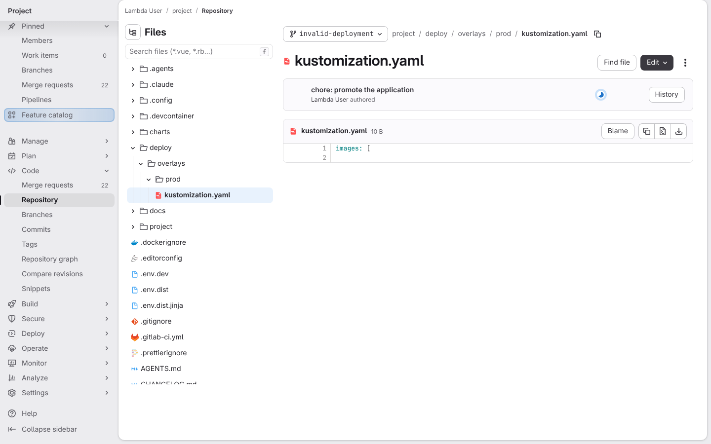](../../screenshots/base/02-daily-work/deploy-only-pipeline/invalid-deployment-yaml.webp)

The deployment file contains an unfinished YAML list. This is the only file changed by the merge request.

</td>
<td width="50%" valign="top">

[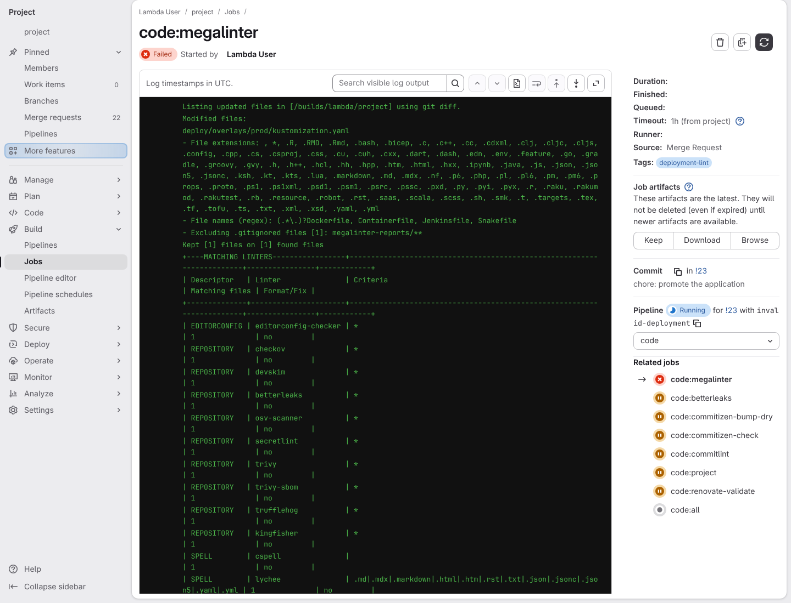](../../screenshots/base/02-daily-work/deploy-only-pipeline/megalinter-changed-files.webp)

The project now gives only code:megalinter a runner. Its real log lists one changed file; unchanged application code is not scanned.

</td>
</tr>
</table>

<table width="100%">
<tr>
<th width="50%">

**9. Then MegaLinter rejects the malformed deployment YAML**

</th>
<th width="50%">

**10. Then fixing only the deployment YAML passes without scanning unchanged Python**

</th>
</tr>
<tr>
<td width="50%" valign="top">

[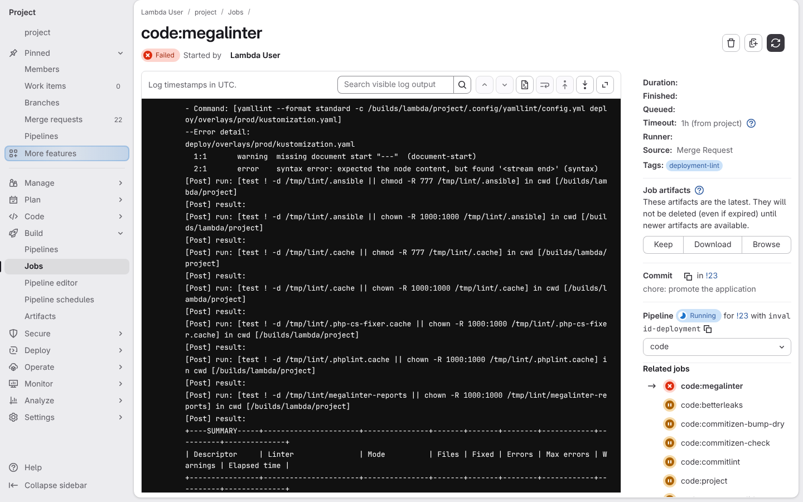](../../screenshots/base/02-daily-work/deploy-only-pipeline/megalinter-yaml-error.webp)

The YAML validator names the deployment file and its syntax error. The job fails: checking fewer files still rejects invalid deployment configuration.

</td>
<td width="50%" valign="top">

[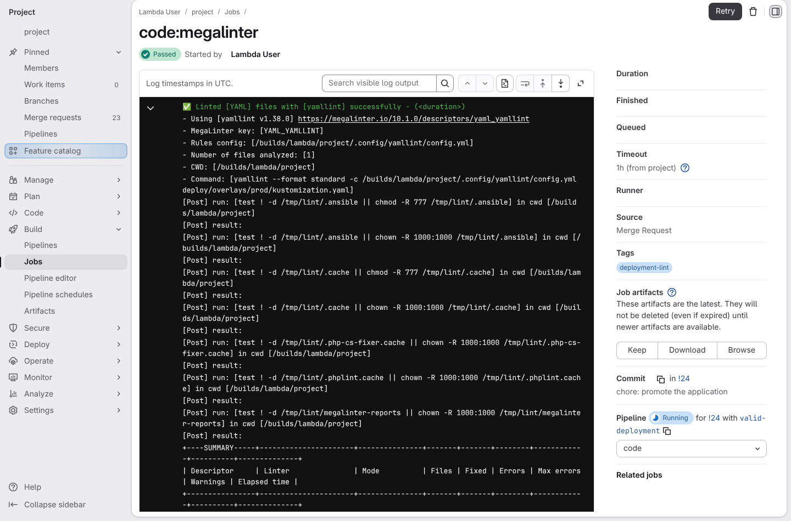](../../screenshots/base/02-daily-work/deploy-only-pipeline/valid-deployment-yaml.webp)

Fixing the changed YAML passes despite the unchanged broken Python file. The same job log now shows successful YAML validation.

</td>
</tr>
</table>

<table width="100%">
<tr>
<th width="50%">

**11. Then a mixed Python change restores its syntax check**

</th>
<th width="50%">

**12. Then the reduced security scan rejects a privileged container**

</th>
</tr>
<tr>
<td width="50%" valign="top">

[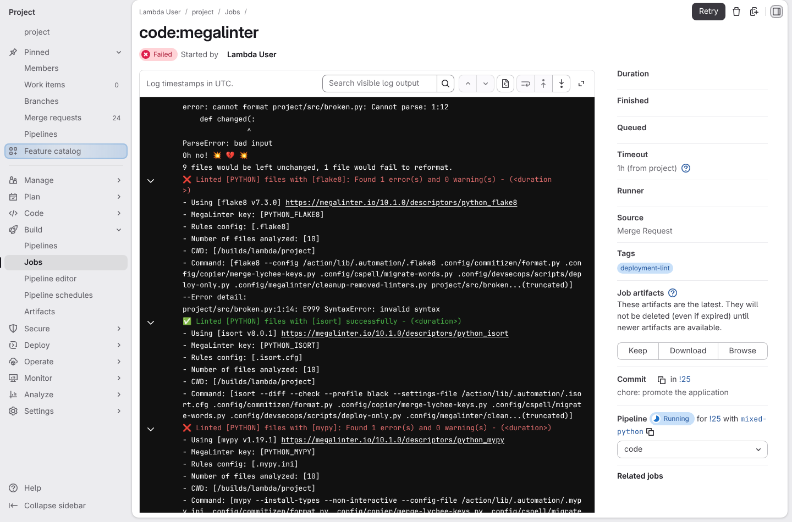](../../screenshots/base/02-daily-work/deploy-only-pipeline/mixed-python-error.webp)

A mixed MR brings the Python file back into the full scan and reports its syntax error.

</td>
<td width="50%" valign="top">

[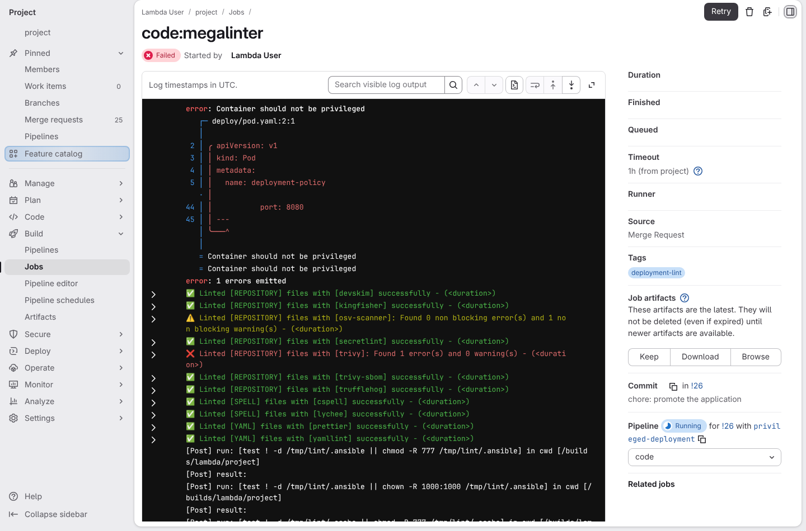](../../screenshots/base/02-daily-work/deploy-only-pipeline/privileged-container-error.webp)

Checkov reports "Container should not be privileged" for the changed Pod. Its SARIF report identifies CKV\_K8S\_16 and the deployment file.

</td>
</tr>
</table>

<table width="100%">
<tr>
<th width="50%">

**13. Then correcting the privileged container passes the reduced security scan**

</th>
<th width="50%">


</th>
</tr>
<tr>
<td width="50%" valign="top">

[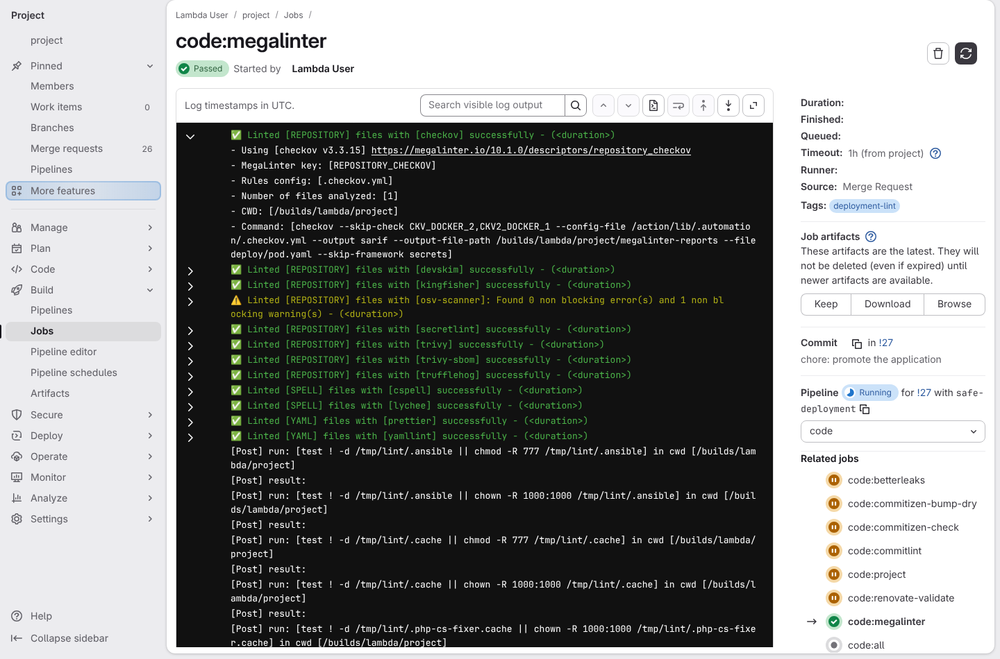](../../screenshots/base/02-daily-work/deploy-only-pipeline/safe-container.webp)

Changing privileged to false removes the finding and the whole reduced security job succeeds. The same scanner policies remain enabled.

</td>
<td width="50%" valign="top">


</td>
</tr>
</table>

<a name="storyboard-replay"></a>

<details>
<summary>Replay this scenario · source and checks</summary>

```shell
task test -- --grep "@deploy-only-pipeline"
```

**Source**

```text
project/tests/e2e/features/02-daily-work/deploy-only.feature
```

Every frame is its own pixel baseline (tolerance: 0).

</details>
