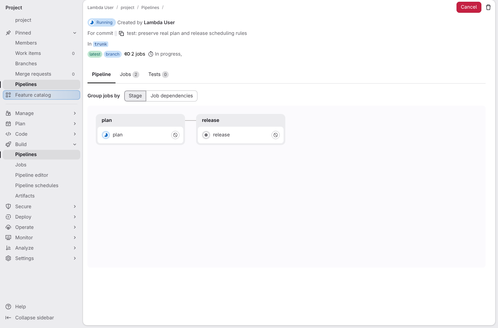
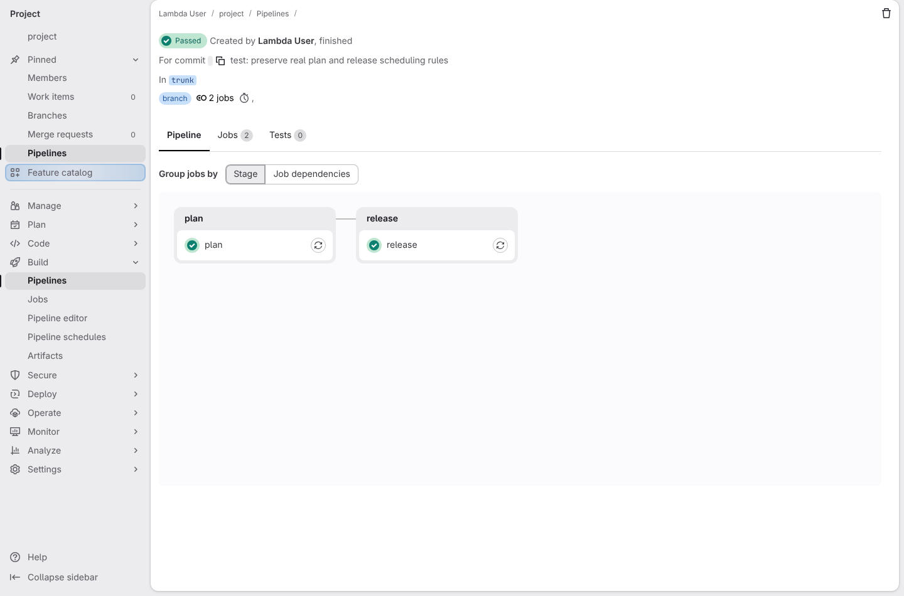
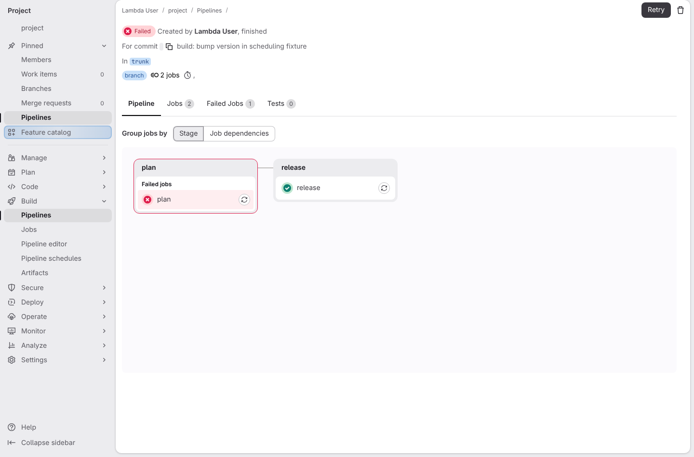
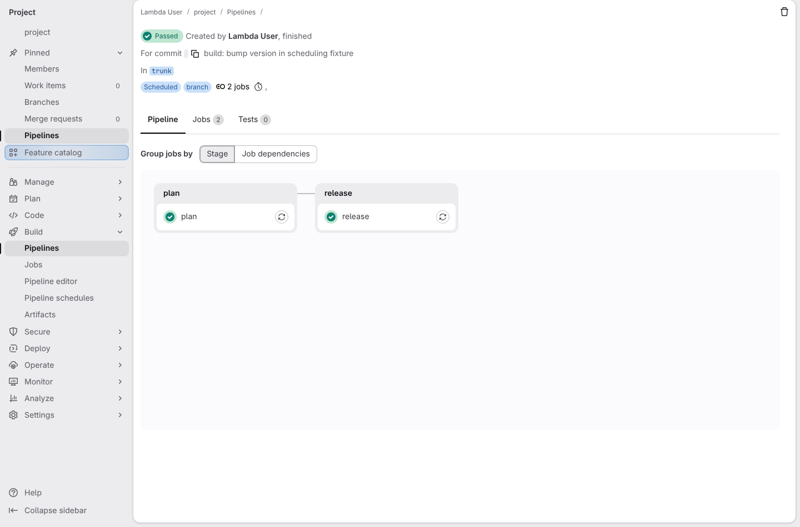
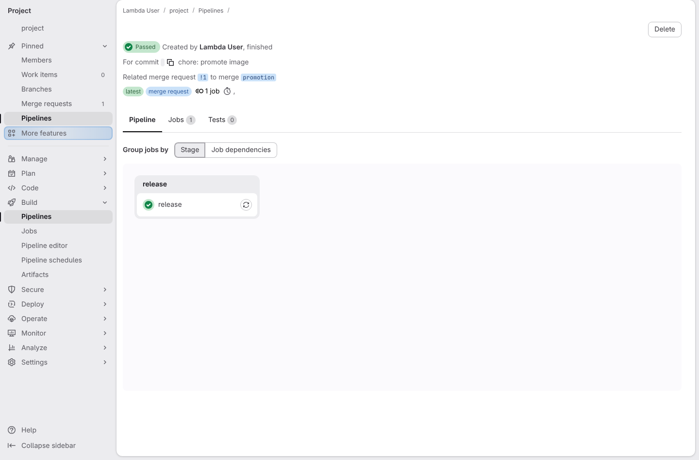

# A merge request that only changes deployment files does not wait for the test suite

**Scenario:** Default branch release waits for plan even when plan fails

<a name="storyboard-result"></a>

> [!tip] PASSED
> 5 steps · 5 frames

**On this page**

[Result](#storyboard-result) · [Replay and source](#storyboard-replay)

<table width="100%">
<tr>
<th width="50%">

**1. Given a default branch pipeline with independent plan and release runners**

</th>
<th width="50%">

**2. Then release advances the branch only after plan succeeds**

</th>
</tr>
<tr>
<td width="50%" valign="top">

[](../../screenshots/base/02-daily-work/deploy-only-release-order/release-waits.webp)

These real GitLab jobs preserve the shipped scheduling rules. A controlled barrier replaces plan's work; a fixture release writes a version marker. Two separate runners prevent an accidental queue from proving the wait.

</td>
<td width="50%" valign="top">

[](../../screenshots/base/02-daily-work/deploy-only-release-order/plan-succeeded.webp)

The branch stays at the pipeline commit until plan finishes; the version marker then advances it. Retrying an obsolete plan is refused.

</td>
</tr>
</table>

<table width="100%">
<tr>
<th width="50%">

**3. Then release also runs after plan fails without hiding that failure**

</th>
<th width="50%">

**4. Then web and scheduled pipelines wait too and concurrent plans are serialized**

</th>
</tr>
<tr>
<td width="50%" valign="top">

[](../../screenshots/base/02-daily-work/deploy-only-release-order/plan-failed.webp)

Plan remains failed. Release still starts after it finishes, preserving when: always.

</td>
<td width="50%" valign="top">

[](../../screenshots/base/02-daily-work/deploy-only-release-order/scheduled-release.webp)

The real web pipeline mutation and both existing schedule flags retain the wait. A second plan waits for its resource group, then its obsolete commit cannot synchronize.

</td>
</tr>
</table>

<table width="100%">
<tr>
<th width="50%">

**5. Then release keeps its behavior for merge requests without plan and staging tags**

</th>
<th width="50%">


</th>
</tr>
<tr>
<td width="50%" valign="top">

[](../../screenshots/base/02-daily-work/deploy-only-release-order/release-without-plan.webp)

An image-only MR has release without plan. A staging tag still excludes release.

</td>
<td width="50%" valign="top">


</td>
</tr>
</table>

<a name="storyboard-replay"></a>

<details>
<summary>Replay this scenario · source and checks</summary>

```shell
task test -- --grep "@deploy-only-release-order"
```

**Source**

```text
project/tests/e2e/features/02-daily-work/deploy-only.feature
```

Every frame is its own pixel baseline (tolerance: 0).

</details>
