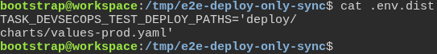
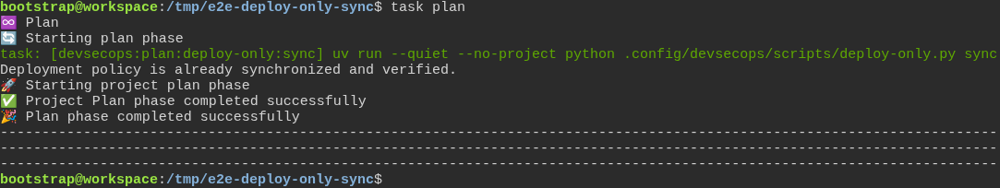
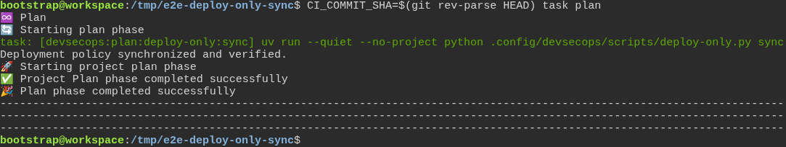
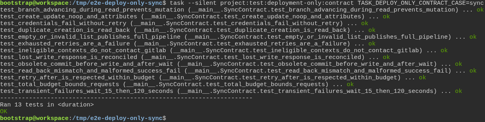

# A merge request that only changes deployment files does not wait for the test suite

**Scenario:** Plan synchronizes the deployment policy with bounded recovery

<a name="storyboard-result"></a>

> [!tip] PASSED
> 4 steps · 4 frames

**On this page**

[Result](#storyboard-result) · [Replay and source](#storyboard-replay)

<table width="100%">
<tr>
<th width="50%">

**1. Given a default branch plan with a project API token and deployment paths**

</th>
<th width="50%">

**2. Then plan publishes and verifies the deployment policy in GitLab**

</th>
</tr>
<tr>
<td width="50%" valign="top">

[](../../screenshots/base/02-daily-work/deploy-only-sync/sync-configuration.webp)

This isolated GitLab project uses trunk as its default branch and an API-scoped project token.

<details>
<summary>Command</summary>

```shell
cat .env.dist
```

</details>

</td>
<td width="50%" valign="top">

[](../../screenshots/base/02-daily-work/deploy-only-sync/verified-policy.webp)

The project variable exists, is raw, and is available to merge request pipelines. Repeating plan is a verified no-op.

<details>
<summary>Command</summary>

```shell
task plan
```

</details>

</td>
</tr>
</table>

<table width="100%">
<tr>
<th width="50%">

**3. Then a later default branch plan repairs the policy even without a configuration change**

</th>
<th width="50%">

**4. Then temporary failures retry within bounds while obsolete or unauthorized plans cannot write**

</th>
</tr>
<tr>
<td width="50%" valign="top">

[](../../screenshots/base/02-daily-work/deploy-only-sync/repaired-policy.webp)

Synchronization runs on every eligible plan, including after a temporary stale value.

<details>
<summary>Command</summary>

```shell
CI_COMMIT_SHA=$(git rev-parse HEAD) task plan
```

</details>

</td>
<td width="50%" valign="top">

[](../../screenshots/base/02-daily-work/deploy-only-sync/bounded-retries.webp)

A controlled transport and clock exercise API outages, credentials failures and concurrent branch movement. Live API compatibility is proved above.

<details>
<summary>Command</summary>

```shell
task --silent project:test:deployment-only:contract TASK_DEPLOY_ONLY_CONTRACT_CASE=sync
```

</details>

</td>
</tr>
</table>

<a name="storyboard-replay"></a>

<details>
<summary>Replay this scenario · source and checks</summary>

```shell
task test -- --grep "@deploy-only-sync"
```

**Source**

```text
project/tests/e2e/features/02-daily-work/deploy-only.feature
```

Every frame is its own pixel baseline (tolerance: 0).

</details>
