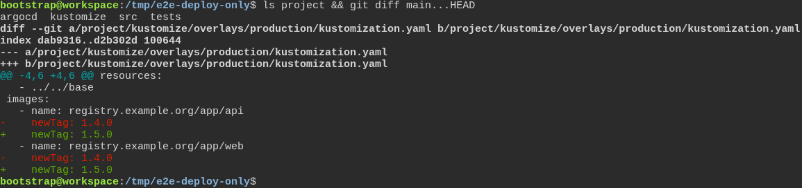
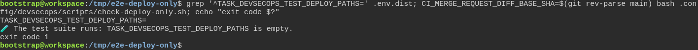
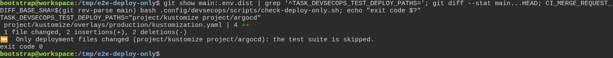
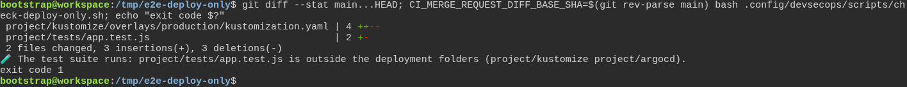
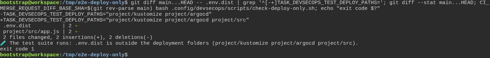
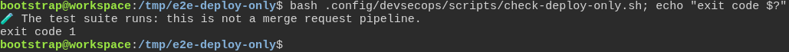
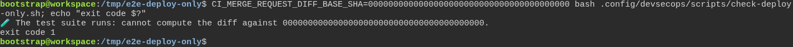
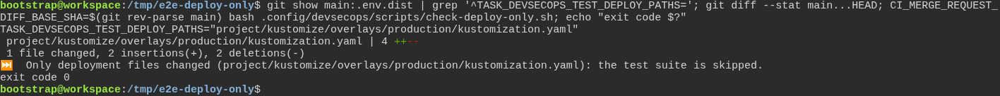
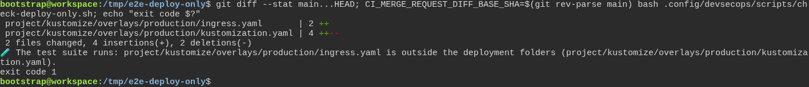
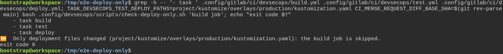

# A merge request that only changes deployment files does not wait for the test suite

**Scenario:** The test suite is skipped only when every changed file is a deployment file

<a name="storyboard-result"></a>

> [!tip] PASSED
> 10 steps · 10 frames

**On this page**

[Result](#storyboard-result) · [A release that only moves image tags](#storyboard-chapter-1) · [Anything else still runs the test suite](#storyboard-chapter-2) · [When in doubt, the test suite runs](#storyboard-chapter-3) · [A single file, not a whole folder](#storyboard-chapter-4) · [Legacy callers and current CI](#storyboard-chapter-5) · [Replay and source](#storyboard-replay)

<a name="storyboard-chapter-1"></a>

## A release that only moves image tags

<table width="100%">
<tr>
<th width="50%">

**1. Given a merge request that changes nothing but an image tag in a deployment folder**

</th>
<th width="50%">

**2. Then with no deployment folder named, the test suite runs as before**

</th>
</tr>
<tr>
<td width="50%" valign="top">

[](../../screenshots/base/02-daily-work/deploy-only/a-release-moves-image-tags.webp)

A project keeps its deployment in two folders, project/kustomize and project/argocd, next to its code in project/src and its test in project/tests. The terminal lists them first.
This merge request ships version 1.5.0. git diff shows the whole change: the two image tags of the production overlay move from 1.4.0 to 1.5.0, and nothing else.

<details>
<summary>Command</summary>

```shell
ls project && git diff main...HEAD
```

</details>

</td>
<td width="50%" valign="top">

[](../../screenshots/base/02-daily-work/deploy-only/no-folder-named-tests-run.webp)

The setting ships empty in .env.dist, so a project that never heard of it keeps its pipeline as it was. The grep shows the empty line.
The script says "The test suite runs: TASK\_DEVSECOPS\_TEST\_DEPLOY\_PATHS is empty." and ends on exit code 1, which tells a legacy caller to run the suite.

<details>
<summary>Command</summary>

```shell
grep '^TASK_DEVSECOPS_TEST_DEPLOY_PATHS=' .env.dist; CI_MERGE_REQUEST_DIFF_BASE_SHA=$(git rev-parse main) bash .config/devsecops/scripts/check-deploy-only.sh; echo "exit code $?"
```

</details>

</td>
</tr>
</table>

<table width="100%">
<tr>
<th width="50%">

**3. Then once the main branch names the deployment folders, the same merge request skips the test suite**

</th>
<th width="50%">


</th>
</tr>
<tr>
<td width="50%" valign="top">

[](../../screenshots/base/02-daily-work/deploy-only/deployment-only-skips-tests.webp)

The main branch now names the two folders in .env.dist, as the first line shows. The same merge request still changes one file, the production overlay.
This time the script says "Only deployment files changed (project/kustomize project/argocd): the test suite is skipped." and ends on exit code 0. A legacy caller can stop there.

<details>
<summary>Command</summary>

```shell
git show main:.env.dist | grep '^TASK_DEVSECOPS_TEST_DEPLOY_PATHS='; git diff --stat main...HEAD; CI_MERGE_REQUEST_DIFF_BASE_SHA=$(git rev-parse main) bash .config/devsecops/scripts/check-deploy-only.sh; echo "exit code $?"
```

</details>

</td>
<td width="50%" valign="top">


</td>
</tr>
</table>

<a name="storyboard-chapter-2"></a>

## Anything else still runs the test suite

<table width="100%">
<tr>
<th width="50%">

**4. Then a merge request that also changes a test runs the test suite**

</th>
<th width="50%">

**5. Then a merge request that changes the setting itself runs the test suite**

</th>
</tr>
<tr>
<td width="50%" valign="top">

[](../../screenshots/base/02-daily-work/deploy-only/a-test-changed-tests-run.webp)

The same release also touches a test: git diff lists two files. One of them, project/tests/app.test.js, is outside the deployment folders, and that is enough.
The script names that file and the suite runs: exit code 1.

<details>
<summary>Command</summary>

```shell
git diff --stat main...HEAD; CI_MERGE_REQUEST_DIFF_BASE_SHA=$(git rev-parse main) bash .config/devsecops/scripts/check-deploy-only.sh; echo "exit code $?"
```

</details>

</td>
<td width="50%" valign="top">

[](../../screenshots/base/02-daily-work/deploy-only/the-setting-changed-tests-run.webp)

A merge request cannot use the setting to skip its own tests. Here it adds project/src to the deployment folders, as the two diff lines show, and changes project/src/app.js in the same push.
The script reads the change against the main branch. .env.dist is one of the changed files and sits outside the deployment folders, so the script names it and the suite runs: exit code 1.

<details>
<summary>Command</summary>

```shell
git diff main...HEAD -- .env.dist | grep '^[-+]TASK_DEVSECOPS_TEST_DEPLOY_PATHS='; git diff --stat main...HEAD; CI_MERGE_REQUEST_DIFF_BASE_SHA=$(git rev-parse main) bash .config/devsecops/scripts/check-deploy-only.sh; echo "exit code $?"
```

</details>

</td>
</tr>
</table>

<a name="storyboard-chapter-3"></a>

## When in doubt, the test suite runs

<table width="100%">
<tr>
<th width="50%">

**6. Then outside a merge request the test suite always runs**

</th>
<th width="50%">

**7. Then when the change cannot be computed the test suite runs**

</th>
</tr>
<tr>
<td width="50%" valign="top">

[](../../screenshots/base/02-daily-work/deploy-only/outside-a-merge-request-tests-run.webp)

GitLab sets CI\_MERGE\_REQUEST\_DIFF\_BASE\_SHA only on a merge request pipeline. Without it, on the main branch, on a tag or on a schedule, there is no merge request to compare.
This is the same change that skipped the suite two chapters ago. Run without a merge request around it, the script says "this is not a merge request pipeline." and the suite runs: exit code 1.

<details>
<summary>Command</summary>

```shell
bash .config/devsecops/scripts/check-deploy-only.sh; echo "exit code $?"
```

</details>

</td>
<td width="50%" valign="top">

[](../../screenshots/base/02-daily-work/deploy-only/unknown-diff-tests-run.webp)

The diff base points to a commit this clone does not hold, so git cannot say what changed. The script does not guess: it says "cannot compute the diff" and the suite runs, exit code 1.

<details>
<summary>Command</summary>

```shell
CI_MERGE_REQUEST_DIFF_BASE_SHA=0000000000000000000000000000000000000000 bash .config/devsecops/scripts/check-deploy-only.sh; echo "exit code $?"
```

</details>

</td>
</tr>
</table>

<a name="storyboard-chapter-4"></a>

## A single file, not a whole folder

<table width="100%">
<tr>
<th width="50%">

**8. Then once the main branch names a single file, a merge request that only changes that file skips the test suite**

</th>
<th width="50%">

**9. Then a new file next to the named file runs the test suite**

</th>
</tr>
<tr>
<td width="50%" valign="top">

[](../../screenshots/base/02-daily-work/deploy-only/a-single-file-skips-tests.webp)

The main branch now names one file instead of two folders: the production overlay, as the first line shows. The merge request is the same release, one file.
The script says "Only deployment files changed (project/kustomize/overlays/production/kustomization.yaml): the test suite is skipped." and ends on exit code 0.

<details>
<summary>Command</summary>

```shell
git show main:.env.dist | grep '^TASK_DEVSECOPS_TEST_DEPLOY_PATHS='; git diff --stat main...HEAD; CI_MERGE_REQUEST_DIFF_BASE_SHA=$(git rev-parse main) bash .config/devsecops/scripts/check-deploy-only.sh; echo "exit code $?"
```

</details>

</td>
<td width="50%" valign="top">

[](../../screenshots/base/02-daily-work/deploy-only/a-new-file-next-to-it-tests-run.webp)

The same release also adds a file next to the overlay, project/kustomize/overlays/production/ingress.yaml. The setting names the overlay, not its folder, so the new file is not a deployment file.
The script names the new file and the suite runs: exit code 1.

<details>
<summary>Command</summary>

```shell
git diff --stat main...HEAD; CI_MERGE_REQUEST_DIFF_BASE_SHA=$(git rev-parse main) bash .config/devsecops/scripts/check-deploy-only.sh; echo "exit code $?"
```

</details>

</td>
</tr>
</table>

<a name="storyboard-chapter-5"></a>

## Legacy callers and current CI

<table width="100%">
<tr>
<th width="50%">

**10. Then legacy callers can skip while current CI jobs execute their tasks**

</th>
<th width="50%">


</th>
</tr>
<tr>
<td width="50%" valign="top">

[](../../screenshots/base/02-daily-work/deploy-only/build-and-deploy-skip-too.webp)

The standalone helper still accepts an exported deployment list and can skip a legacy/local caller. Current build, test and deploy jobs execute their tasks whenever GitLab creates them.

<details>
<summary>Command</summary>

```shell
grep -h -- '- task ' .config/gitlab/ci/devsecops/build.yml .config/gitlab/ci/devsecops/test.yml .config/gitlab/ci/devsecops/deploy.yml
```

</details>

</td>
<td width="50%" valign="top">


</td>
</tr>
</table>

<a name="storyboard-replay"></a>

<details>
<summary>Replay this scenario · source and checks</summary>

```shell
task test -- --grep "@deploy-only"
```

**Source**

```text
project/tests/e2e/features/02-daily-work/deploy-only.feature
```

Every frame is its own pixel baseline (tolerance: 0).

</details>
