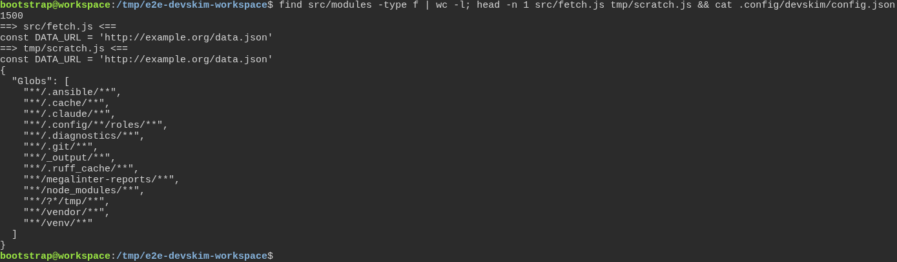
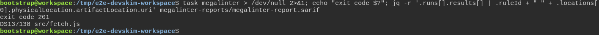

# a freshly generated project passes its own quality gate

**Scenario:** DevSkim scans a large project on a developer's machine as in CI, and still skips the project's tmp folder

<a name="storyboard-result"></a>

> [!tip] PASSED
> 2 steps · 2 frames

**On this page**

[Result](#storyboard-result) · [Replay and source](#storyboard-replay)

<table width="100%">
<tr>
<th width="50%">

**1. Given a generated project holds 1500 ordinary source files, an http:// address and a copy in its own tmp folder**

</th>
<th width="50%">

**2. Then on the developer's machine DevSkim flags the address in the source and skips the copy in tmp**

</th>
</tr>
<tr>
<td width="50%" valign="top">

[](../../screenshots/base/02-daily-work/devskim-workspace/devskim-fixture.webp)

A project generated from the toolbox holds 1,500 ordinary source files, counted on the first line. src/fetch.js reads its data from an http:// address, and tmp/scratch.js, a scratch file in the project's own tmp folder, is a copy of it.
Below them, DevSkim's settings: the folders it skips. The tmp entry, \*\*/?\*/tmp/\*\*, wants a folder name before tmp: it matches the project's own tmp folder, never a tmp folder the project sits in.

<details>
<summary>Command</summary>

```shell
find src/modules -type f | wc -l; head -n 1 src/fetch.js tmp/scratch.js && cat .config/devskim/config.json
```

</details>

</td>
<td width="50%" valign="top">

[](../../screenshots/base/02-daily-work/devskim-workspace/devskim-flags-source.webp)

The developer runs MegaLinter with DevSkim alone, then reads the findings back from the report that run wrote. MegaLinter mounts the project under /tmp/lint, a path that starts with tmp.
The finding fails the run, so task ends on "exit code 201". The report holds one finding: DS137138, an insecure URL, in src/fetch.js, and nothing in tmp/scratch.js. The test also runs task megalinter:ci under /builds with an initial limit of 1,024 open files: its new report must flag the same source file.

<details>
<summary>Command</summary>

```shell
task megalinter > /dev/null 2>&1; echo "exit code $?"; jq -r '.runs[].results[] | .ruleId + " " + .locations[0].physicalLocation.artifactLocation.uri' megalinter-reports/megalinter-report.sarif
```

</details>

</td>
</tr>
</table>

<a name="storyboard-replay"></a>

<details>
<summary>Replay this scenario · source and checks</summary>

```shell
task test -- --grep "@devskim-workspace"
```

**Source**

```text
project/tests/e2e/features/02-daily-work/quality-gate.feature
```

Every frame is its own pixel baseline (tolerance: 0).

</details>
