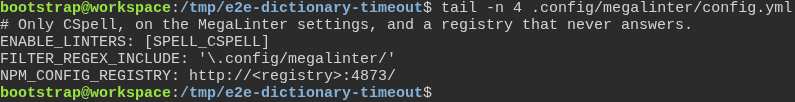
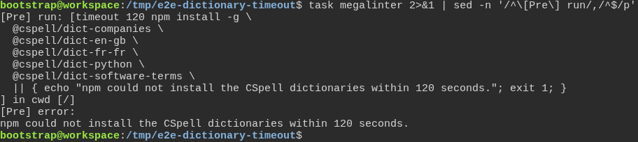

# a freshly generated project passes its own quality gate

**Scenario:** MegaLinter stops waiting for the spelling dictionaries after two minutes

<a name="storyboard-result"></a>

> [!tip] PASSED
> 2 steps · 2 frames

**On this page**

[Result](#storyboard-result) · [Replay and source](#storyboard-replay)

<table width="100%">
<tr>
<th width="50%">

**1. Given a generated project whose MegaLinter settings send npm to a registry that never answers**

</th>
<th width="50%">

**2. Then task megalinter stops the dictionary install after 120 seconds and says why**

</th>
</tr>
<tr>
<td width="50%" valign="top">

[](../../screenshots/base/02-daily-work/dictionary-timeout/registry-never-answers.webp)

The last lines of the project's MegaLinter settings keep one check, CSpell, on the MegaLinter settings files only, so that the run stays short. NPM\_CONFIG\_REGISTRY sends npm to a test server that accepts the connection and never answers. Its address changes with every run.
MegaLinter passes its settings as environment variables to the commands it runs before the checks, so the npm install of the spelling dictionaries asks that server.

<details>
<summary>Command</summary>

```shell
tail -n 4 .config/megalinter/config.yml
```

</details>

</td>
<td width="50%" valign="top">

[](../../screenshots/base/02-daily-work/dictionary-timeout/install-stops-in-time.webp)

task megalinter runs MegaLinter in Docker, and sed keeps the part of its log about the command it runs first: timeout 120 npm install -g, with the five spelling dictionaries.
After 120 seconds, timeout stops npm. MegaLinter prints "\[Pre\] error:" and the reason: "npm could not install the CSpell dictionaries within 120 seconds." The test also checks that the whole run took less than five minutes.

<details>
<summary>Command</summary>

```shell
task megalinter 2>&1 | sed -n '/^\[Pre\] run/,/^$/p'
```

</details>

</td>
</tr>
</table>

<a name="storyboard-replay"></a>

<details>
<summary>Replay this scenario · source and checks</summary>

```shell
task test -- --grep "@dictionary-timeout"
```

**Source**

```text
project/tests/e2e/features/02-daily-work/quality-gate.feature
```

Every frame is its own pixel baseline (tolerance: 0).

</details>
