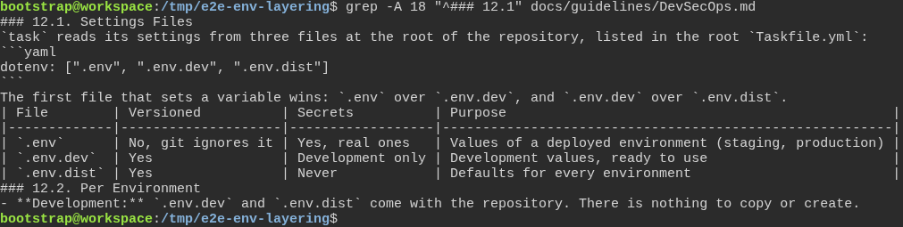
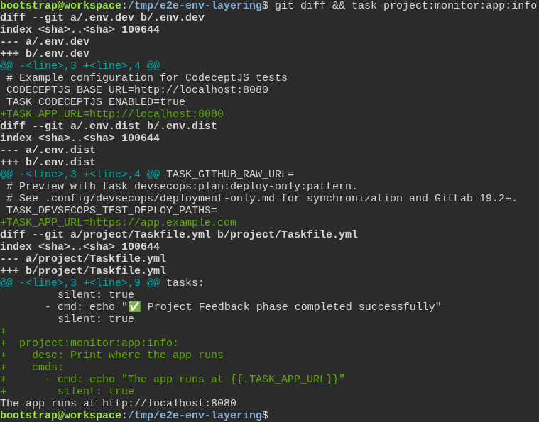
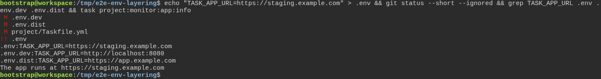

# A generated project reads each setting from the file its guide names

**Scenario:** A development value in .env.dev wins over the default in .env.dist, and a .env file wins over both

<a name="storyboard-result"></a>

> [!tip] PASSED
> 3 steps · 3 frames

**On this page**

[Result](#storyboard-result) · [Replay and source](#storyboard-replay)

<table width="100%">
<tr>
<th width="50%">

**1. Given the project's guide lists its three settings files in the order task reads them**

</th>
<th width="50%">

**2. When the developer adds a setting with a default in .env.dist and a development value in .env.dev, task uses the development value**

</th>
</tr>
<tr>
<td width="50%" valign="top">

[](../../screenshots/base/02-daily-work/env-layering/the-guide-names-the-files.webp)

A project freshly generated by the toolbox, with every default answer. Section 12.1 of its guide, docs/guidelines/DevSecOps.md, lists the three settings files in the order task reads them, .env, then .env.dev, then .env.dist, and says "The first file that sets a variable wins."
Its table says .env holds the real values of a deployed environment and git ignores it. Section 12.2 says that for development "There is nothing to copy or create."

<details>
<summary>Command</summary>

```shell
grep -A 18 "^### 12.1" docs/guidelines/DevSecOps.md
```

</details>

</td>
<td width="50%" valign="top">

[](../../screenshots/base/02-daily-work/env-layering/env-dev-wins.webp)

The developer adds a setting, TASK\_APP\_URL, the way the guide says: its default, https://app.example.com, at the end of .env.dist, and its development value, http://localhost:8080, at the end of .env.dev. A small task in project/Taskfile.yml prints it.
Below the diff, task project:monitor:app:info prints "The app runs at http://localhost:8080". That is the value from .env.dev.

<details>
<summary>Command</summary>

```shell
git diff && task project:monitor:app:info
```

</details>

</td>
</tr>
</table>

<table width="100%">
<tr>
<th width="50%">

**3. Then a .env file, which git ignores, wins over both**

</th>
<th width="50%">


</th>
</tr>
<tr>
<td width="50%" valign="top">

[](../../screenshots/base/02-daily-work/env-layering/env-wins.webp)

The same project, set up the way a staging server would be: a .env file with the real value, https://staging.example.com. git status lists it with "!!", which means git ignores it, so it can never be committed.
grep shows the setting in the three files, in the order task reads them. task now prints "The app runs at https://staging.example.com": .env wins over both.

<details>
<summary>Command</summary>

```shell
echo "TASK_APP_URL=https://staging.example.com" > .env && git status --short --ignored && grep TASK_APP_URL .env .env.dev .env.dist && task project:monitor:app:info
```

</details>

</td>
<td width="50%" valign="top">


</td>
</tr>
</table>

<a name="storyboard-replay"></a>

<details>
<summary>Replay this scenario · source and checks</summary>

```shell
task test -- --grep "@env-layering"
```

**Source**

```text
project/tests/e2e/features/02-daily-work/env-layering.feature
```

Every frame is its own pixel baseline (tolerance: 0).

</details>
