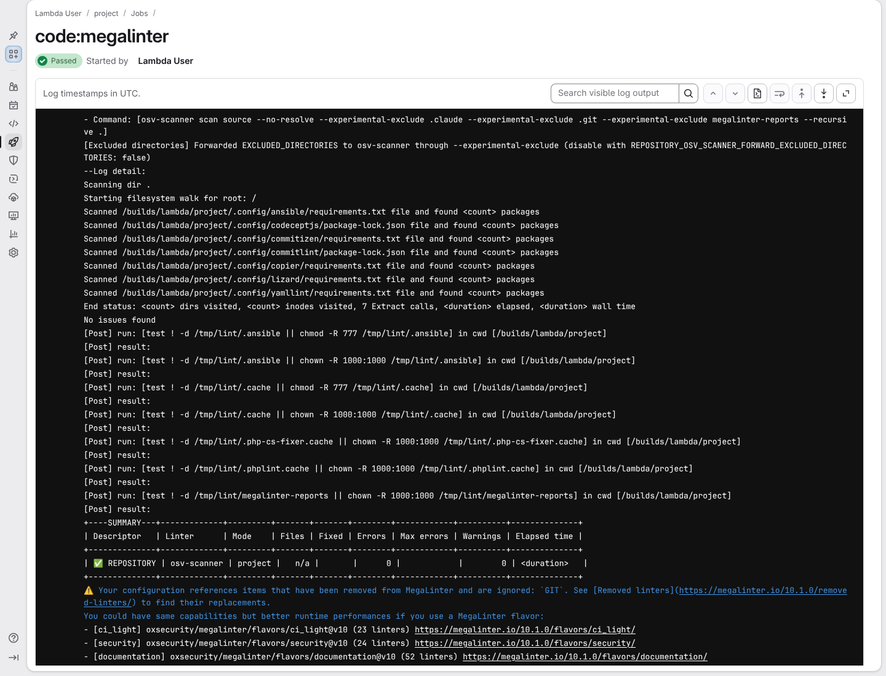

# a freshly generated project passes its own quality gate

**Scenario:** the toolbox ships dependencies that pass its own OSV scan

<a name="storyboard-result"></a>

> [!tip] PASSED
> 1 steps · 1 frames

**On this page**

[Result](#storyboard-result) · [Replay and source](#storyboard-replay)

<table width="100%">
<tr>
<th width="50%">

**1. Then the toolbox's own OSV scan reads the lockfile or requirements file of every tool that has one and finds no known vulnerability**

</th>
<th width="50%">


</th>
</tr>
<tr>
<td width="50%" valign="top">

[](../../screenshots/base/02-daily-work/framework-dependencies/framework-dependencies-clean.webp)

GitLab's page for the toolbox's own code:megalinter job, with OSV as its only scanner, checked against the live vulnerability database. The scanner's command leaves no .config folder out.
The Scanned lines name seven files: the requirements.txt of ansible, commitizen, copier, lizard and yamllint, and the package-lock.json of codeceptjs and commitlint. The .config/megalinter folder ships only a package.json, which OSV does not read without a lockfile.
OSV answers "No issues found", the summary marks osv-scanner green, and GitLab marks the job Passed. Package counts show as &lt;count&gt;: they change with every dependency update.

<details>
<summary>Command</summary>

```shell
task megalinter
```

</details>

</td>
<td width="50%" valign="top">


</td>
</tr>
</table>

<a name="storyboard-replay"></a>

<details>
<summary>Replay this scenario · source and checks</summary>

```shell
task test -- --grep "@framework-dependencies"
```

**Source**

```text
project/tests/e2e/features/02-daily-work/megalinter-reports.feature
```

Every frame is its own pixel baseline (tolerance: 0).

</details>
