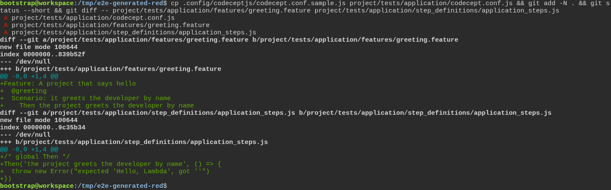
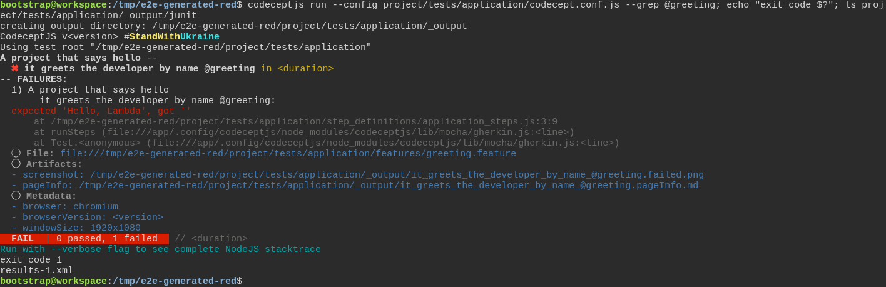
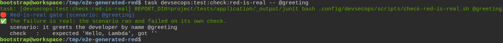

# The toolbox checks the test really failed first, instead of taking anyone's word for it

**Scenario:** A project generated by the toolbox can prove its own failing test

<a name="storyboard-result"></a>

> [!tip] PASSED
> 3 steps · 3 frames

**On this page**

[Result](#storyboard-result) · [The same proof, in a generated project](#storyboard-chapter-1) · [Replay and source](#storyboard-replay)

<a name="storyboard-chapter-1"></a>

## The same proof, in a generated project

<table width="100%">
<tr>
<th width="50%">

**1. Given a generated project copies the CodeceptJS sample and writes a test that cannot pass yet**

</th>
<th width="50%">

**2. When the generated project runs that test and it fails on what it checks**

</th>
</tr>
<tr>
<td width="50%" valign="top">

[](../../screenshots/base/02-daily-work/generated-project-red/generated-project-writes-its-test.webp)

This is a project generated by the toolbox, not the toolbox itself. The developer copies the CodeceptJS sample it ships into project/tests/application/, the folder its CodeceptJS tasks point at, and writes a first test.
git status lists the three new files: the copied sample and the two test files, shown line by line below it. The test asks for a greeting the project cannot give yet, so it is meant to fail.

<details>
<summary>Command</summary>

```shell
cp .config/codeceptjs/codecept.conf.sample.js project/tests/application/codecept.conf.js && git add -N . && git status --short && git diff -- project/tests/application/features/greeting.feature project/tests/application/step_definitions/application_steps.js
```

</details>

</td>
<td width="50%" valign="top">

[](../../screenshots/base/02-daily-work/generated-project-red/generated-project-test-fails.webp)

The test runs with the copied sample and fails on what it checks: "expected 'Hello, Lambda', got ''", exit code 1.
The sample also writes a report of that run: the report folder now holds results-1.xml.

<details>
<summary>Command</summary>

```shell
codeceptjs run --config project/tests/application/codecept.conf.js --grep @greeting; echo "exit code $?"; ls project/tests/application/_output/junit
```

</details>

</td>
</tr>
</table>

<table width="100%">
<tr>
<th width="50%">

**3. Then the generated project's own check accepts that failure as proof**

</th>
<th width="50%">


</th>
</tr>
<tr>
<td width="50%" valign="top">

[](../../screenshots/base/02-daily-work/generated-project-red/generated-project-gate-accepts.webp)

The same check as in the toolbox's own loop, typed in the generated project with no folder to point it at. The line task prints shows where it looks by default: REPORT\_DIR\=project/tests/application/\_output/junit, the folder the sample writes to.
It finds the report there and accepts the failure: "The failure is real", and it quotes the check that failed.

<details>
<summary>Command</summary>

```shell
task devsecops:test:check:red-is-real -- @greeting
```

</details>

</td>
<td width="50%" valign="top">


</td>
</tr>
</table>

<a name="storyboard-replay"></a>

<details>
<summary>Replay this scenario · source and checks</summary>

```shell
task test -- --grep "@generated-project-red"
```

**Source**

```text
project/tests/e2e/features/02-daily-work/tdd-cycle-reports.feature
```

Every frame is its own pixel baseline (tolerance: 0).

</details>
