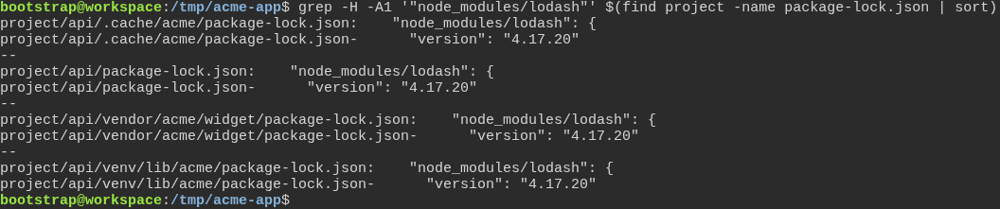
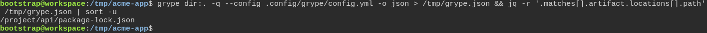
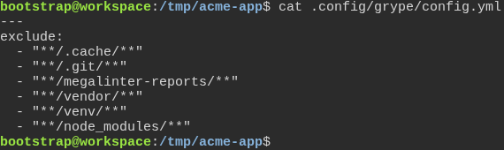

# a freshly generated project passes its own quality gate

**Scenario:** Grype skips the folders its settings list at any depth and still reports the project's own dependencies

<a name="storyboard-result"></a>

> [!tip] PASSED
> 3 steps · 3 frames

**On this page**

[Result](#storyboard-result) · [Replay and source](#storyboard-replay)

<table width="100%">
<tr>
<th width="50%">

**1. Given a generated project's API holds the same vulnerable lockfile in its own folder and in its .cache, vendor and venv folders**

</th>
<th width="50%">

**2. When the developer scans the project with Grype's settings, it reports the API's own lockfile only**

</th>
</tr>
<tr>
<td width="50%" valign="top">

[](../../screenshots/base/02-daily-work/grype-excludes/grype-lockfiles.webp)

A project generated from the toolbox, with an API under project/api. Its own lockfile, project/api/package-lock.json, pins lodash 4.17.20, a version with a known vulnerability.
The same lockfile sits in three folders of the API that hold none of its code: .cache, where package managers keep their downloads, and vendor and venv, where they install libraries.

<details>
<summary>Command</summary>

```shell
grep -H -A1 '"node_modules/lodash"' $(find project -name package-lock.json | sort)
```

</details>

</td>
<td width="50%" valign="top">

[](../../screenshots/base/02-daily-work/grype-excludes/grype-scan.webp)

Grype scans the project with its settings file and saves what it finds as JSON. jq, a JSON reader, then lists the files those findings come from.
There is one: /project/api/package-lock.json, the API's own lockfile. Nothing comes from .cache, vendor or venv.

<details>
<summary>Command</summary>

```shell
grype dir:. -q --config .config/grype/config.yml -o json > /tmp/grype.json && jq -r '.matches[].artifact.locations[].path' /tmp/grype.json | sort -u
```

</details>

</td>
</tr>
</table>

<table width="100%">
<tr>
<th width="50%">

**3. Then Grype's settings file skips every folder of its list at any depth**

</th>
<th width="50%">


</th>
</tr>
<tr>
<td width="50%" valign="top">

[](../../screenshots/base/02-daily-work/grype-excludes/grype-settings.webp)

The settings file MegaLinter hands Grype. Every folder of its exclude list starts with \*\*/ and ends with /\*\*, like the node\_modules line: Grype skips that folder wherever it sits, at the root or deeper.

<details>
<summary>Command</summary>

```shell
cat .config/grype/config.yml
```

</details>

</td>
<td width="50%" valign="top">


</td>
</tr>
</table>

<a name="storyboard-replay"></a>

<details>
<summary>Replay this scenario · source and checks</summary>

```shell
task test -- --grep "@grype-excludes"
```

**Source**

```text
project/tests/e2e/features/02-daily-work/quality-gate.feature
```

Every frame is its own pixel baseline (tolerance: 0).

</details>
