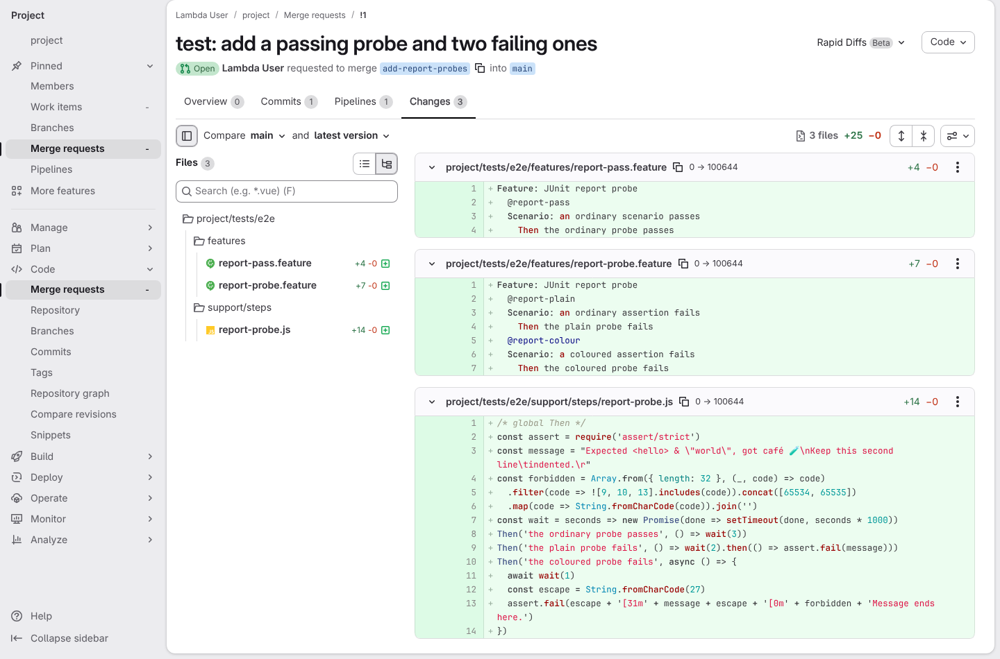
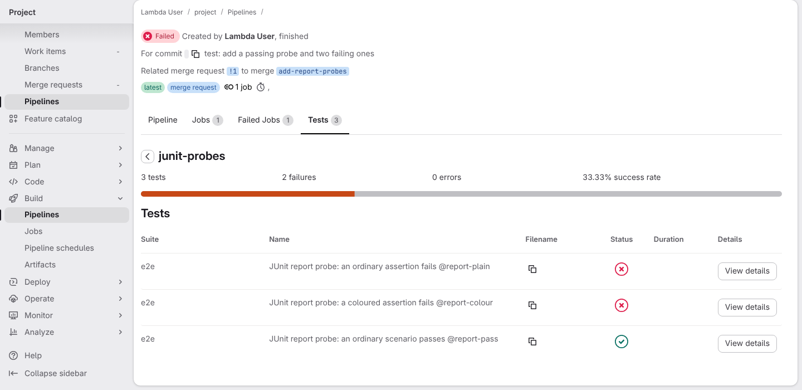
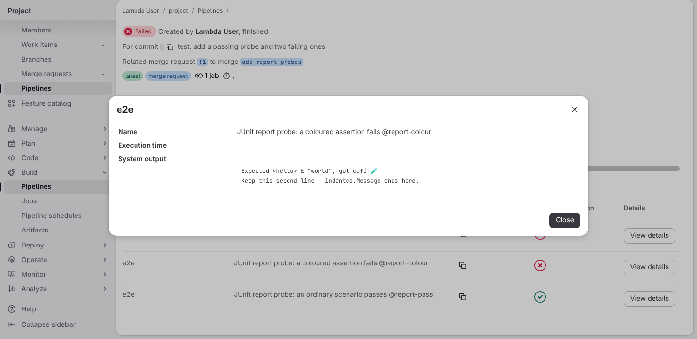
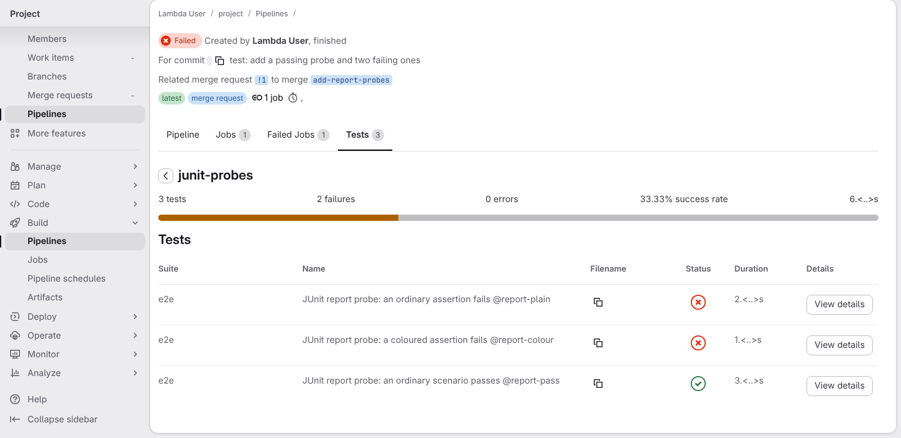
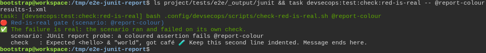

# The toolbox checks the test really failed first, instead of taking anyone's word for it

**Scenario:** GitLab can read a real failure report even when assertions contain terminal colours

<a name="storyboard-result"></a>

> [!tip] PASSED
> 5 steps · 5 frames

**On this page**

[Result](#storyboard-result) · [GitLab reads the report of a merge request](#storyboard-chapter-1) · [The RED gate reads the same report](#storyboard-chapter-2) · [Replay and source](#storyboard-replay)

<a name="storyboard-chapter-1"></a>

## GitLab reads the report of a merge request

<table width="100%">
<tr>
<th width="50%">

**1. Given a merge request adds one passing scenario, one plain failure and one failure in terminal colours**

</th>
<th width="50%">

**2. When its pipeline runs the three scenarios, and GitLab counts one pass and two failures**

</th>
</tr>
<tr>
<td width="50%" valign="top">

[](../../screenshots/base/02-daily-work/junit-control-characters/probes-merge-request.webp)

A merge request adds three probe scenarios to a throwaway copy of the toolbox, with the steps behind them. One passes. Two fail with the same message: quotes, an accent, an emoji, a tab and a line break included.
The last step also wraps its message in terminal colours, the escape code before \[31m, and adds every control character XML forbids: the kind of text a test tool really prints.
Each probe first waits a known time with the wait helper: three seconds for the one that passes, two and one for the two that fail. The passing one has a file of its own, report-pass.feature: the test engine hands whole files to its workers, so two files keep two workers busy.

<details>
<summary>Command</summary>

```shell
http://gitlab/<user>/<project>/-/merge_requests/1/diffs
```

</details>

</td>
<td width="50%" valign="top">

[](../../screenshots/base/02-daily-work/junit-control-characters/gitlab-test-report.webp)

The merge request's pipeline runs the three scenarios with the toolbox's own test engine and JUnit reporter, on the very image the test suite runs in, and hands the report to GitLab.
GitLab reads it without a complaint: 3 tests, 2 failures, 0 errors, and one line per scenario on the junit-probes suite.

<details>
<summary>Command</summary>

```shell
http://gitlab/<user>/<project>/-/pipelines/<id>/test_report
```

</details>

</td>
</tr>
</table>

<table width="100%">
<tr>
<th width="50%">

**3. Then GitLab shows the coloured failure as readable text, without the terminal colours**

</th>
<th width="50%">

**4. And GitLab shows the time each scenario took, though two workers ran them side by side**

</th>
</tr>
<tr>
<td width="50%" valign="top">

[](../../screenshots/base/02-daily-work/junit-control-characters/gitlab-coloured-failure.webp)

The details of the coloured failure, as a reviewer opens them on that tab. The message reads as it was written, with no escape code and none of the forbidden characters.

<details>
<summary>Command</summary>

```shell
http://gitlab/<user>/<project>/-/pipelines/<id>/test_report
```

</details>

</td>
<td width="50%" valign="top">

[](../../screenshots/base/02-daily-work/junit-control-characters/gitlab-test-durations.webp)

The job runs the three scenarios on two workers, the way the toolbox's own pipeline does, so two of them run at the same time.
On the same tab, the Duration column reads 2, 1 and 3 seconds: each scenario gets the time it waited, not the time of its worker. The 6 at the top right is their sum. The hundredths change from one run to the next, so they are hidden behind &lt;..&gt;.

<details>
<summary>Command</summary>

```shell
http://gitlab/<user>/<project>/-/pipelines/<id>/test_report
```

</details>

</td>
</tr>
</table>

<a name="storyboard-chapter-2"></a>

## The RED gate reads the same report

<table width="100%">
<tr>
<th width="50%">

**5. And the RED guard still accepts the coloured assertion as a genuine failure**

</th>
<th width="50%">


</th>
</tr>
<tr>
<td width="50%" valign="top">

[](../../screenshots/base/02-daily-work/junit-control-characters/real-red-proof.webp)

The same three scenarios, run on the developer's machine on one worker, leave their report in project/tests/e2e/\_output/junit. The RED gate reads it and accepts the coloured failure as real: the scenario ran and failed on its own check.
It quotes that check on one readable line: the line break and the tab become spaces, and nothing of the colours is left.

<details>
<summary>Command</summary>

```shell
ls project/tests/e2e/_output/junit && task devsecops:test:check:red-is-real -- @report-colour
```

</details>

</td>
<td width="50%" valign="top">


</td>
</tr>
</table>

<a name="storyboard-replay"></a>

<details>
<summary>Replay this scenario · source and checks</summary>

```shell
task test -- --grep "@junit-control-characters"
```

**Source**

```text
project/tests/e2e/features/02-daily-work/tdd-cycle-reports.feature
```

Every frame is its own pixel baseline (tolerance: 0).

</details>
