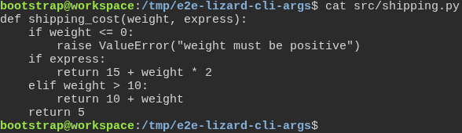
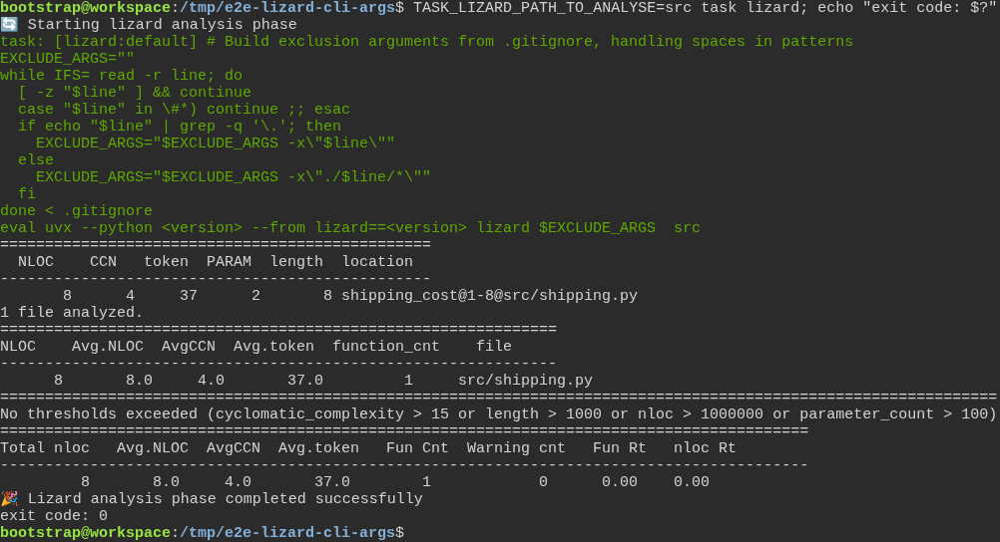
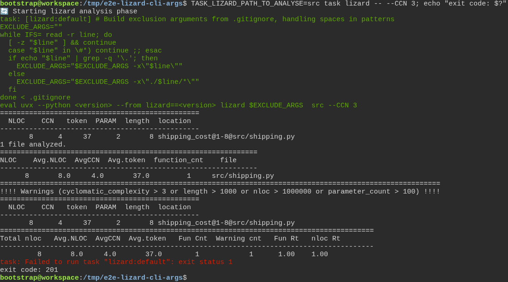

# a freshly generated project passes its own quality gate

**Scenario:** Lizard receives the options a developer types after task lizard --

<a name="storyboard-result"></a>

> [!tip] PASSED
> 3 steps · 3 frames

**On this page**

[Result](#storyboard-result) · [Replay and source](#storyboard-replay)

<table width="100%">
<tr>
<th width="50%">

**1. Given a generated project holds a function with four paths through it**

</th>
<th width="50%">

**2. When the developer runs task lizard, the function stays under Lizard's default limit of 15**

</th>
</tr>
<tr>
<td width="50%" valign="top">

[](../../screenshots/base/02-daily-work/lizard-cli-args/lizard-function.webp)

A project generated from the toolbox, with one file of the developer's own: src/shipping.py. Its function shipping\_cost has two if lines and one elif, so there are four paths through it.
Lizard counts those paths as the function's cyclomatic complexity, CCN in its tables.

<details>
<summary>Command</summary>

```shell
cat src/shipping.py
```

</details>

</td>
<td width="50%" valign="top">

[](../../screenshots/base/02-daily-work/lizard-cli-args/lizard-default.webp)

The developer runs Lizard through the toolbox. TASK\_LIZARD\_PATH\_TO\_ANALYSE\=src points it at the developer's own code. Task first prints the script it runs, and that script's last line starts Lizard.
The table gives shipping\_cost a CCN of 4. Lizard answers "No thresholds exceeded (cyclomatic\_complexity &gt; 15 ...)": 15 is its default limit. The run ends with exit code 0. Versions show as &lt;version&gt;: they move with each update.

<details>
<summary>Command</summary>

```shell
TASK_LIZARD_PATH_TO_ANALYSE=src task lizard; echo "exit code: $?"
```

</details>

</td>
</tr>
</table>

<table width="100%">
<tr>
<th width="50%">

**3. Then with --CCN 3 after the two dashes, Lizard flags the function and the run fails**

</th>
<th width="50%">


</th>
</tr>
<tr>
<td width="50%" valign="top">

[](../../screenshots/base/02-daily-work/lizard-cli-args/lizard-ccn-3.webp)

The same command with --CCN 3 after the two dashes. The last line of the script now ends with --CCN 3: Task hands the option to Lizard.
Lizard lists shipping\_cost under "Warnings (cyclomatic\_complexity &gt; 3 ...)" and fails, so Task stops with exit code 201, the code it gives a failed command.

<details>
<summary>Command</summary>

```shell
TASK_LIZARD_PATH_TO_ANALYSE=src task lizard -- --CCN 3; echo "exit code: $?"
```

</details>

</td>
<td width="50%" valign="top">


</td>
</tr>
</table>

<a name="storyboard-replay"></a>

<details>
<summary>Replay this scenario · source and checks</summary>

```shell
task test -- --grep "@lizard-cli-args"
```

**Source**

```text
project/tests/e2e/features/02-daily-work/quality-gate.feature
```

Every frame is its own pixel baseline (tolerance: 0).

</details>
