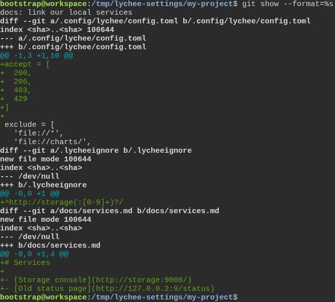
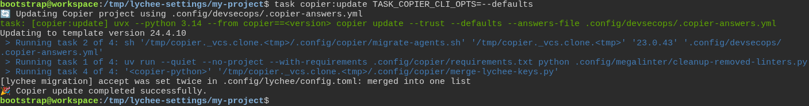
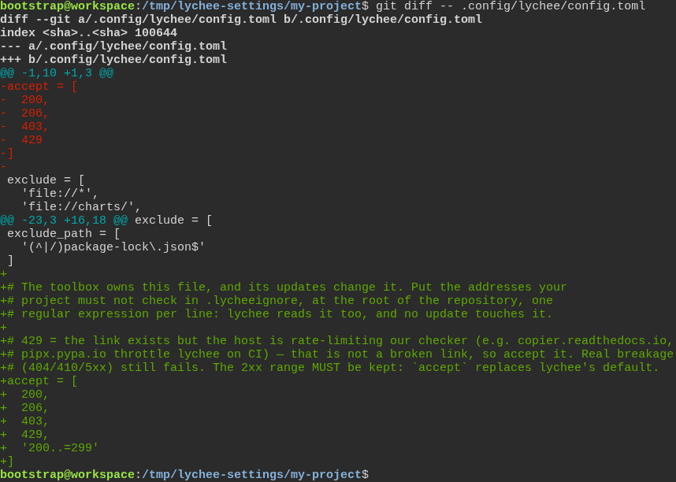
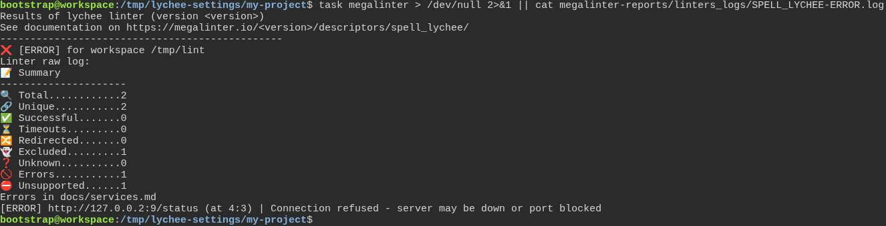

# a freshly generated project passes its own quality gate

**Scenario:** a framework update keeps lychee reading its settings, and the project's own addresses stay in a file of their own

<a name="storyboard-result"></a>

> [!tip] PASSED
> 4 steps · 4 frames

**On this page**

[Result](#storyboard-result) · [Replay and source](#storyboard-replay)

<table width="100%">
<tr>
<th width="50%">

**1. Given the developer kept their own accepted status codes in the toolbox's lychee settings, and their own address in .lycheeignore**

</th>
<th width="50%">

**2. When the developer updates the project to the release that adds the toolbox's own accept list**

</th>
</tr>
<tr>
<td width="50%" valign="top">

[](../../screenshots/base/02-daily-work/lychee-settings/own-settings.webp)

Off camera, the project was generated from release 23.0.43 of a test toolbox, whose lychee settings, .config/lychee/config.toml, end on the exclude\_path list. Its MegaLinter settings run lychee alone, on docs/services.md, so the run stays short.
On screen, the developer's commit, "docs: link our local services". At the top of the toolbox's lychee settings, an accept list names the status codes lychee must count as a working link: 200 (OK), 206, 403 (forbidden) and 429 (too many requests). The storage console address goes in .lycheeignore, a file of the project's own. docs/services.md links to that console and to http://127.0.0.2:9/status, where nothing answers.

<details>
<summary>Command</summary>

```shell
git show --format=%s
```

</details>

</td>
<td width="50%" valign="top">

[](../../screenshots/base/02-daily-work/lychee-settings/update.webp)

Release 24.4.10 of the test toolbox adds its own accept list at the end of the same file. Copier says "Updating to template version 24.4.10" and merges it without a conflict, so the file now sets accept twice, which TOML refuses.
Copier then runs the release's migration, merge-lychee-keys.py, which prints "\[lychee migration\] accept was set twice in .config/lychee/config.toml: merged into one list".

<details>
<summary>Command</summary>

```shell
task copier:update TASK_COPIER_CLI_OPTS=--defaults
```

</details>

</td>
</tr>
</table>

<table width="100%">
<tr>
<th width="50%">

**3. Then the lychee settings keep one accept list, with the developer's codes and the toolbox's**

</th>
<th width="50%">

**4. And lychee reads its settings, skips the address in .lycheeignore and reports the dead link**

</th>
</tr>
<tr>
<td width="50%" valign="top">

[](../../screenshots/base/02-daily-work/lychee-settings/one-accept-list.webp)

What the update changed in the lychee settings. The developer's list leaves the top of the file. At the end, under the toolbox's explanation, one list holds the developer's 200, 206, 403 and 429 and the toolbox's '200..\=299'.
Just above, the release says where a project's own addresses go from now on: .lycheeignore, a file no update touches.

<details>
<summary>Command</summary>

```shell
git diff -- .config/lychee/config.toml
```

</details>

</td>
<td width="50%" valign="top">

[](../../screenshots/base/02-daily-work/lychee-settings/lychee-report.webp)

The developer runs MegaLinter and, as it fails, reads lychee's own report. lychee read its settings and checked the two links of docs/services.md: Excluded counts 1, the storage console that .lycheeignore lists, and Errors counts 1.
That error is the dead link, http://127.0.0.2:9/status, refused because nothing answers there. lychee checks links again, and the project's own address stays out of the check.

<details>
<summary>Command</summary>

```shell
task megalinter > /dev/null 2>&1 || cat megalinter-reports/linters_logs/SPELL_LYCHEE-ERROR.log
```

</details>

</td>
</tr>
</table>

<a name="storyboard-replay"></a>

<details>
<summary>Replay this scenario · source and checks</summary>

```shell
task test -- --grep "@lychee-settings"
```

**Source**

```text
project/tests/e2e/features/02-daily-work/quality-gate.feature
```

Every frame is its own pixel baseline (tolerance: 0).

</details>
