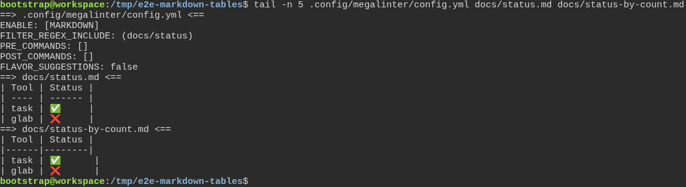
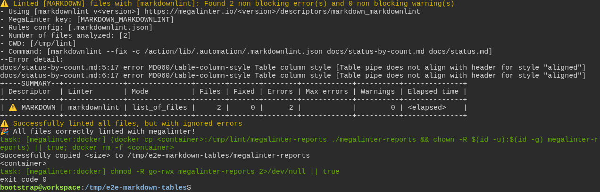

# a freshly generated project passes its own quality gate

**Scenario:** MegaLinter keeps a table with emoji the way markdownlint reads it

<a name="storyboard-result"></a>

> [!tip] PASSED
> 2 steps · 2 frames

**On this page**

[Result](#storyboard-result) · [Replay and source](#storyboard-replay)

<table width="100%">
<tr>
<th width="50%">

**1. Given a generated project holds a status table with emoji, its pipes lined up on screen, and a copy padded by character count**

</th>
<th width="50%">

**2. Then MegaLinter leaves both tables as they are, run after run, and markdownlint flags only the copy padded by character count**

</th>
</tr>
<tr>
<td width="50%" valign="top">

[](../../screenshots/base/02-daily-work/markdown-tables/tables-committed.webp)

A project generated by the toolbox, with two Markdown files committed. In docs/status.md the pipes of the table line up on screen: an emoji such as ✅ takes two columns, so its cell gets one space less.
docs/status-by-count.md holds the same table the way markdown-table-formatter rewrote it. That tool counts ✅ as one column, so both emoji rows end one column too far right.
The last five lines of the project's MegaLinter settings, on top, limit the run to the Markdown checks on these two files.

<details>
<summary>Command</summary>

```shell
tail -n 5 .config/megalinter/config.yml docs/status.md docs/status-by-count.md
```

</details>

</td>
<td width="50%" valign="top">

[](../../screenshots/base/02-daily-work/markdown-tables/second-run-same-verdict.webp)

The developer runs MegaLinter twice. This is the second run. Like the first one, it fixes nothing, the summary says 0 under Fixed: both tables stay as they were, and both runs give the same verdict.
The summary lists markdownlint alone. It flags lines 5 and 6 of docs/status-by-count.md, the two emoji rows, with MD060 "Table pipe does not align with header", and nothing in docs/status.md.
MegaLinter counts these Markdown findings as non-blocking, so the run ends with "exit code 0".

<details>
<summary>Command</summary>

```shell
task megalinter; echo "exit code $?"
```

</details>

</td>
</tr>
</table>

<a name="storyboard-replay"></a>

<details>
<summary>Replay this scenario · source and checks</summary>

```shell
task test -- --grep "@markdown-tables"
```

**Source**

```text
project/tests/e2e/features/02-daily-work/quality-gate.feature
```

Every frame is its own pixel baseline (tolerance: 0).

</details>
