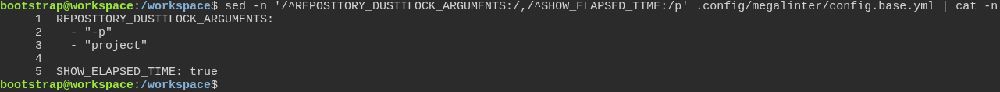
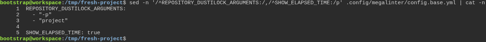

# a freshly generated project passes its own quality gate

**Scenario:** a generated project receives the MegaLinter base settings in the shape MegaLinter keeps them

<a name="storyboard-result"></a>

> [!tip] PASSED
> 2 steps · 2 frames

**On this page**

[Result](#storyboard-result) · [Replay and source](#storyboard-replay)

<table width="100%">
<tr>
<th width="50%">

**1. Given the toolbox's own MegaLinter base settings keep one blank line before SHOW\_ELAPSED\_TIME**

</th>
<th width="50%">

**2. Then a freshly generated project gets the same lines, with the same single blank line**

</th>
</tr>
<tr>
<td width="50%" valign="top">

[](../../screenshots/base/02-daily-work/megalinter-base-render/toolbox-lines.webp)

A terminal in the toolbox itself. .config/megalinter/config.base.yml holds the MegaLinter settings the toolbox ships to every project, and its first lines say "DO NOT EDIT THIS FILE".
sed prints that file from REPOSITORY\_DUSTILOCK\_ARGUMENTS down to SHOW\_ELAPSED\_TIME, and cat -n numbers the lines. Line 4 is the one blank line between the two settings.

<details>
<summary>Command</summary>

```shell
sed -n '/^REPOSITORY_DUSTILOCK_ARGUMENTS:/,/^SHOW_ELAPSED_TIME:/p' .config/megalinter/config.base.yml | cat -n
```

</details>

</td>
<td width="50%" valign="top">

[](../../screenshots/base/02-daily-work/megalinter-base-render/generated-lines.webp)

The same command in a project the test has just generated from the toolbox, with every default answer. The same five lines, with the one blank line at line 4.
Prettier, the YAML formatter MegaLinter runs, never leaves two blank lines in a row, and these settings ask MegaLinter to apply its fixes. A second blank line here made \`task code\` rewrite a file that says "DO NOT EDIT".
The test also checks that these lines are the toolbox's byte for byte, and that the whole file never has two blank lines in a row.

<details>
<summary>Command</summary>

```shell
sed -n '/^REPOSITORY_DUSTILOCK_ARGUMENTS:/,/^SHOW_ELAPSED_TIME:/p' .config/megalinter/config.base.yml | cat -n
```

</details>

</td>
</tr>
</table>

<a name="storyboard-replay"></a>

<details>
<summary>Replay this scenario · source and checks</summary>

```shell
task test -- --grep "@megalinter-base-render"
```

**Source**

```text
project/tests/e2e/features/02-daily-work/quality-gate.feature
```

Every frame is its own pixel baseline (tolerance: 0).

</details>
