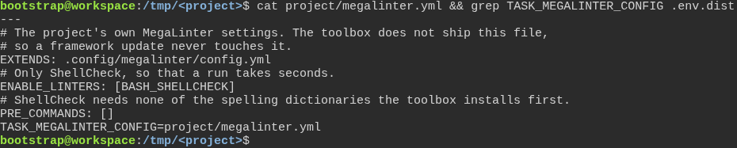
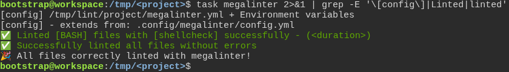
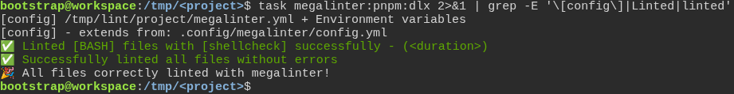

# a freshly generated project passes its own quality gate

**Scenario:** every local MegaLinter task reads the settings file the project chose

<a name="storyboard-result"></a>

> [!tip] PASSED
> 3 steps · 3 frames

**On this page**

[Result](#storyboard-result) · [Replay and source](#storyboard-replay)

<table width="100%">
<tr>
<th width="50%">

**1. Given the project names its own MegaLinter settings file in TASK\_MEGALINTER\_CONFIG**

</th>
<th width="50%">

**2. Then task megalinter loads the project's settings file**

</th>
</tr>
<tr>
<td width="50%" valign="top">

[](../../screenshots/base/02-daily-work/megalinter-config/project-settings-file.webp)

The project keeps its own MegaLinter settings in project/megalinter.yml. The toolbox does not ship that file, so a framework update never touches it. It builds on the toolbox's own file, .config/megalinter/config.yml, and keeps only ShellCheck, so that a run takes seconds.
The last line comes from .env.dist: TASK\_MEGALINTER\_CONFIG\=project/megalinter.yml tells the MegaLinter tasks which file to read.

<details>
<summary>Command</summary>

```shell
cat project/megalinter.yml && grep TASK_MEGALINTER_CONFIG .env.dist
```

</details>

</td>
<td width="50%" valign="top">

[](../../screenshots/base/02-daily-work/megalinter-config/task-megalinter-loads-project-settings.webp)

task megalinter, the usual way to run MegaLinter on a machine, starts it in Docker, where the project sits in /tmp/lint. MegaLinter's own \[config\] line names the file it loaded: /tmp/lint/project/megalinter.yml, the project's file. The next line shows that file builds on .config/megalinter/config.yml.
Only ShellCheck runs, as that file asks, and the task ends on "All files correctly linted with megalinter!".

<details>
<summary>Command</summary>

```shell
task megalinter 2>&1 | grep -E '\[config\]|Linted|linted'
```

</details>

</td>
</tr>
</table>

<table width="100%">
<tr>
<th width="50%">

**3. And task megalinter:pnpm:dlx loads the same settings file**

</th>
<th width="50%">


</th>
</tr>
<tr>
<td width="50%" valign="top">

[](../../screenshots/base/02-daily-work/megalinter-config/pnpm-dlx-loads-project-settings.webp)

task megalinter:pnpm:dlx starts MegaLinter another way: pnpm downloads mega-linter-runner, and the runner starts MegaLinter's image. MegaLinter's \[config\] line names the same file, and the same single check runs with the same verdict.

<details>
<summary>Command</summary>

```shell
task megalinter:pnpm:dlx 2>&1 | grep -E '\[config\]|Linted|linted'
```

</details>

</td>
<td width="50%" valign="top">


</td>
</tr>
</table>

<a name="storyboard-replay"></a>

<details>
<summary>Replay this scenario · source and checks</summary>

```shell
task test -- --grep "@megalinter-config"
```

**Source**

```text
project/tests/e2e/features/02-daily-work/megalinter-reports.feature
```

Every frame is its own pixel baseline (tolerance: 0).

</details>
