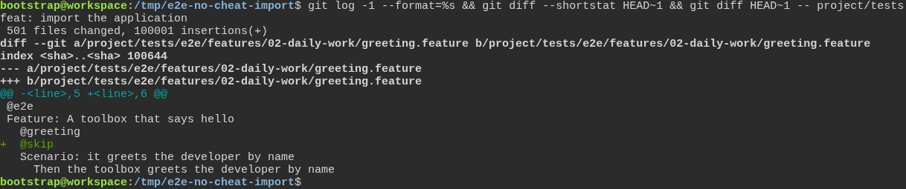
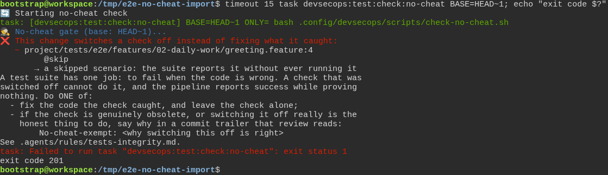

# The toolbox checks the test really failed first, instead of taking anyone's word for it

**Scenario:** The guard reads a merge request that imports a whole application, and still names the one test it switches off

<a name="storyboard-result"></a>

> [!tip] PASSED
> 2 steps · 2 frames

**On this page**

[Result](#storyboard-result) · [Replay and source](#storyboard-replay)

<table width="100%">
<tr>
<th width="50%">

**1. Given a merge request imports 500 files of 200 lines, and switches one test off among them**

</th>
<th width="50%">

**2. Then the guard reads all 100,001 lines within 15 seconds and names the line that switches the test off**

</th>
</tr>
<tr>
<td width="50%" valign="top">

[](../../screenshots/base/02-daily-work/no-cheat-whole-import/no-cheat-whole-import-setup.webp)

A copy of the toolbox under /tmp, and one commit on top of it that imports an application: git diff --shortstat counts 501 files changed and 100,001 lines added. On a real project, one merge request imported 2,602 files and 2 million lines at once.
Among all those lines, one switches a test off: @skip, added above the scenario of greeting.feature. The diff of the tests folder shows that single line.

<details>
<summary>Command</summary>

```shell
git log -1 --format=%s && git diff --shortstat HEAD~1 && git diff HEAD~1 -- project/tests
```

</details>

</td>
<td width="50%" valign="top">

[](../../screenshots/base/02-daily-work/no-cheat-whole-import/no-cheat-whole-import-verdict.webp)

The guard reads every line the commit adds, all 100,001 of them. timeout 15 stops it if it is still reading after 15 seconds, with the exit code 124. On that real project, the guard was still reading after an hour, and GitLab killed the job before it said anything.
Here it finishes well inside the 15 seconds. It names greeting.feature:4, quotes @skip, and refuses the change with the exit code 201, the code Task gives a failed command. An import that size no longer hides a test switched off.

<details>
<summary>Command</summary>

```shell
timeout 15 task devsecops:test:check:no-cheat BASE=HEAD~1; echo "exit code $?"
```

</details>

</td>
</tr>
</table>

<a name="storyboard-replay"></a>

<details>
<summary>Replay this scenario · source and checks</summary>

```shell
task test -- --grep "@no-cheat-whole-import"
```

**Source**

```text
project/tests/e2e/features/02-daily-work/tdd-cycle.feature
```

Every frame is its own pixel baseline (tolerance: 0).

</details>
