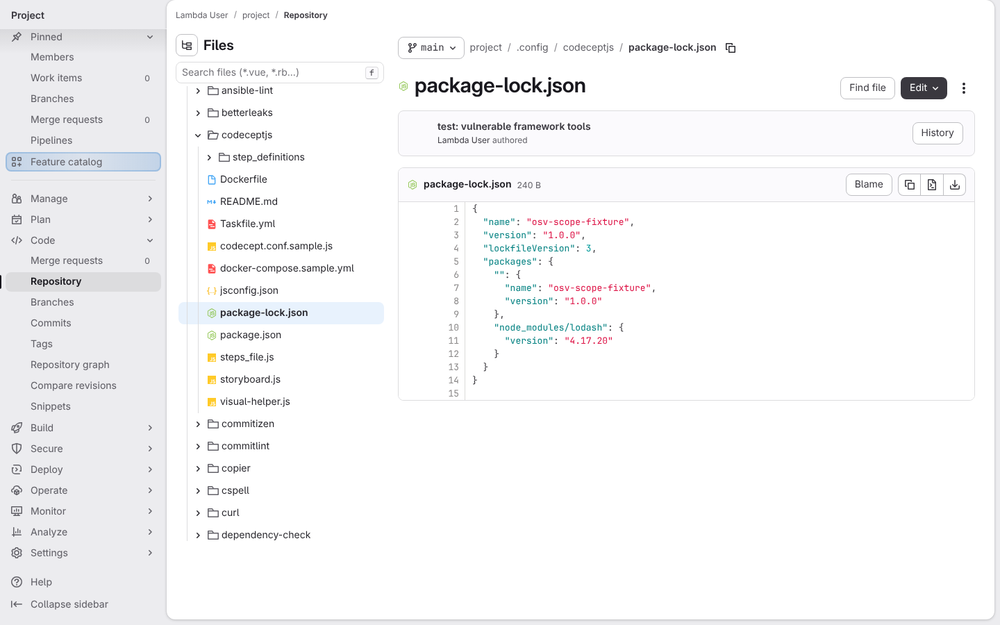
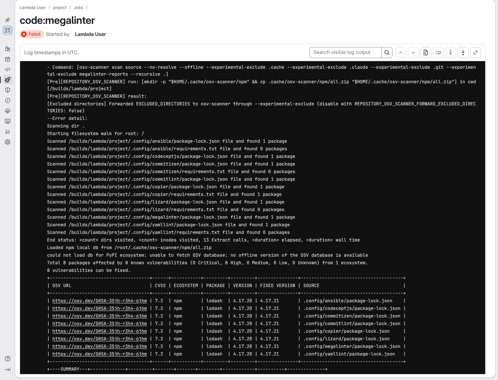
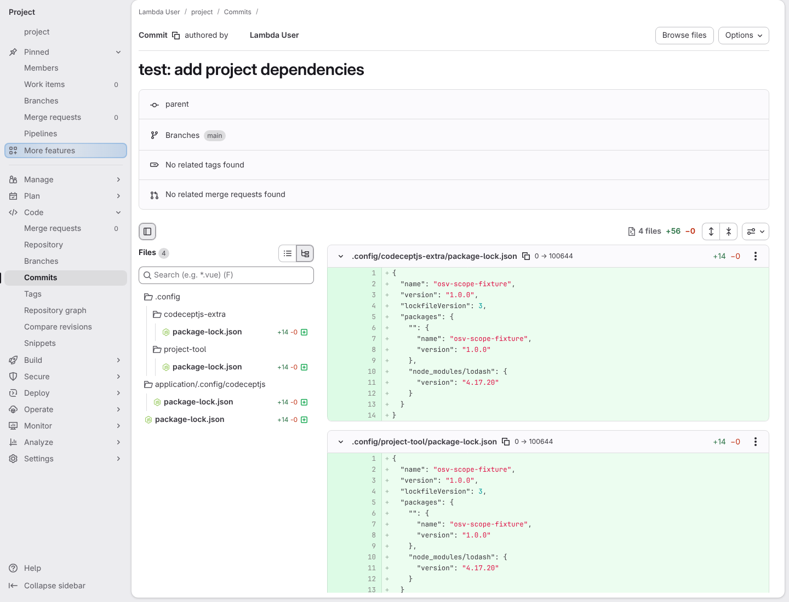
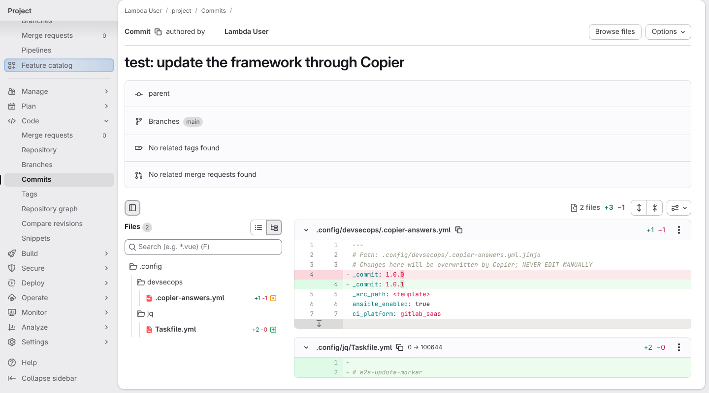
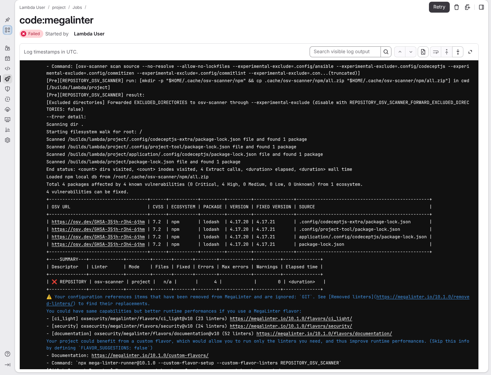
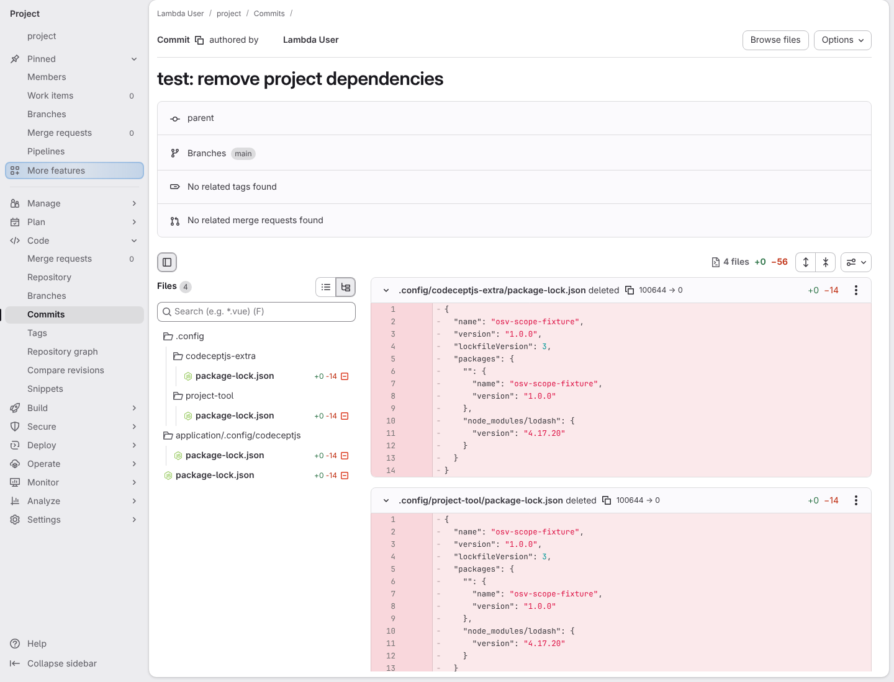
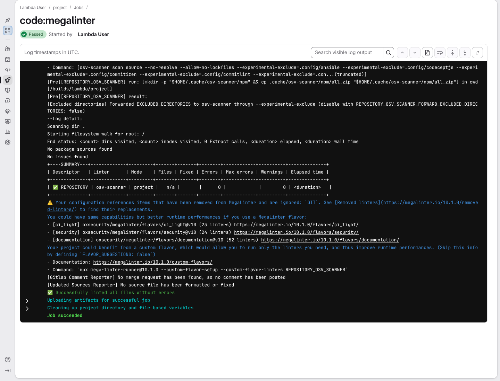

# a freshly generated project passes its own quality gate

**Scenario:** OSV checks dependencies where their owner can fix them

<a name="storyboard-result"></a>

> [!tip] PASSED
> 7 steps · 7 frames

**On this page**

[Result](#storyboard-result) · [The toolbox answers for its own tools](#storyboard-chapter-1) · [The project answers for its own dependencies](#storyboard-chapter-2) · [Without vulnerable dependencies of its own, the project passes](#storyboard-chapter-3) · [Replay and source](#storyboard-replay)

<a name="storyboard-chapter-1"></a>

## The toolbox answers for its own tools

<table width="100%">
<tr>
<th width="50%">

**1. Given every framework tool in a generated project contains the same vulnerable package**

</th>
<th width="50%">

**2. Then the toolbox's OSV scan reports the same vulnerable framework tools**

</th>
</tr>
<tr>
<td width="50%" valign="top">

[](../../screenshots/base/02-daily-work/osv-scope/framework-lockfiles.webp)

GitLab shows lodash 4.17.20, a version with a known vulnerability, in the CodeceptJS lockfile the project inherits from the toolbox. Every framework tool under .config gets the same vulnerable lockfile.

</td>
<td width="50%" valign="top">

[](../../screenshots/base/02-daily-work/osv-scope/toolbox-tools-reported.webp)

The same project, scanned once with the toolbox's own scanner configuration: the scanner's command, printed first, leaves no .config folder out. GitLab's code:megalinter job fails.
OSV reads every framework tool and lists each lockfile with lodash 4.17.20 and advisory GHSA-35jh-r3h4-6jhm. The toolbox catches the tools it ships.

<details>
<summary>Command</summary>

```shell
task megalinter
```

</details>

</td>
</tr>
</table>

<a name="storyboard-chapter-2"></a>

## The project answers for its own dependencies

<table width="100%">
<tr>
<th width="50%">

**3. When the developer adds vulnerable dependencies in project-owned locations**

</th>
<th width="50%">

**4. And the developer updates the framework through Copier**

</th>
</tr>
<tr>
<td width="50%" valign="top">

[](../../screenshots/base/02-daily-work/osv-scope/project-lockfiles.webp)

GitLab's page for the commit "test: add project dependencies". Its Files list shows four new lockfiles: one at the root, one under application/.config, and two in .config folders the project created itself, codeceptjs-extra and project-tool. The two diffs in view show lodash 4.17.20 inside.

</td>
<td width="50%" valign="top">

[](../../screenshots/base/02-daily-work/osv-scope/copier-keeps-osv-scope.webp)

GitLab's page for the Copier update commit. It changes two files: .copier-answers.yml moves from 1.0.0 to 1.0.1, and .config/jq/Taskfile.yml is the one marker file the test release 1.0.1 adds.
The project's scanner settings and its four lockfiles are not in the commit: the update leaves them alone.

<details>
<summary>Command</summary>

```shell
task copier:update
```

</details>

</td>
</tr>
</table>

<table width="100%">
<tr>
<th width="50%">

**5. Then OSV reports every project-owned copy of the vulnerable package**

</th>
<th width="50%">


</th>
</tr>
<tr>
<td width="50%" valign="top">

[](../../screenshots/base/02-daily-work/osv-scope/project-tools-reported.webp)

After the update, the project's code:megalinter job fails. The scanner's command still leaves the framework tools out, with --experimental-exclude\=.config/ansible, .config/codeceptjs and the others.
OSV reads only the four lockfiles the project owns, .config/project-tool included, and reports lodash 4.17.20 and advisory GHSA-35jh-r3h4-6jhm in each one.

<details>
<summary>Command</summary>

```shell
task megalinter
```

</details>

</td>
<td width="50%" valign="top">


</td>
</tr>
</table>

<a name="storyboard-chapter-3"></a>

## Without vulnerable dependencies of its own, the project passes

<table width="100%">
<tr>
<th width="50%">

**6. When the developer removes the vulnerable dependencies from the project's own locations**

</th>
<th width="50%">

**7. Then the project's OSV scan leaves the framework tools to the toolbox and passes**

</th>
</tr>
<tr>
<td width="50%" valign="top">

[](../../screenshots/base/02-daily-work/osv-scope/project-lockfiles-removed.webp)

GitLab's page for the commit "test: remove project dependencies". It deletes the four project lockfiles and nothing else: the lockfiles of the framework tools are not in the commit.

</td>
<td width="50%" valign="top">

[](../../screenshots/base/02-daily-work/osv-scope/empty-project-scan.webp)

The same job now passes. OSV still leaves the framework tools out, says "No package sources found" for the project, then "No issues found". MegaLinter ends on "Successfully linted all files without errors" and GitLab marks the job Passed.
The framework tools are still vulnerable: as the first chapter showed, that is the toolbox's job.

<details>
<summary>Command</summary>

```shell
task megalinter
```

</details>

</td>
</tr>
</table>

<a name="storyboard-replay"></a>

<details>
<summary>Replay this scenario · source and checks</summary>

```shell
task test -- --grep "@osv-scope"
```

**Source**

```text
project/tests/e2e/features/02-daily-work/osv-scope.feature
```

Every frame is its own pixel baseline (tolerance: 0).

</details>
