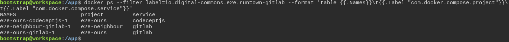
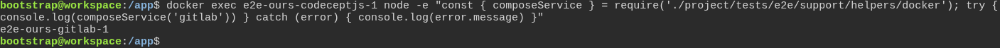
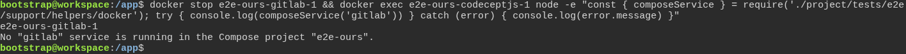

# The toolbox checks the test really failed first, instead of taking anyone's word for it

**Scenario:** The test suite works only with the GitLab of its own project, and stops when that GitLab is missing

<a name="storyboard-result"></a>

> [!tip] PASSED
> 3 steps · 3 frames

**On this page**

[Result](#storyboard-result) · [Two GitLabs on one machine](#storyboard-chapter-1) · [No GitLab of its own, no GitLab at all](#storyboard-chapter-2) · [Replay and source](#storyboard-replay)

<a name="storyboard-chapter-1"></a>

## Two GitLabs on one machine

<table width="100%">
<tr>
<th width="50%">

**1. Given two Docker Compose projects on the same machine each run a service called gitlab**

</th>
<th width="50%">

**2. When the test suite asks for its GitLab, it gets the one of its own project**

</th>
</tr>
<tr>
<td width="50%" valign="top">

[](../../screenshots/base/02-daily-work/own-gitlab/own-gitlab-two-projects.webp)

One machine can run several Docker Compose projects at once: this toolbox, a project made from it, or an unrelated one. Docker Compose labels each container with its project and its service, and two projects can both have a service called gitlab.
Three throwaway containers set that scene. e2e-ours-gitlab-1 and e2e-neighbour-gitlab-1 stand in for the GitLabs of two projects. e2e-ours-codeceptjs-1 stands in for the container that runs the test suite, in the project e2e-ours.

<details>
<summary>Command</summary>

```shell
docker ps --filter label=io.digital-commons.e2e.run=own-gitlab --format 'table {{.Names}}\t{{.Label "com.docker.compose.project"}}\t{{.Label "com.docker.compose.service"}}'
```

</details>

</td>
<td width="50%" valign="top">

[](../../screenshots/base/02-daily-work/own-gitlab/own-gitlab-found.webp)

The test suite finds its GitLab with one helper, composeService, in project/tests/e2e/support/helpers/docker.js. The helper reads the project of its own container, then asks Docker for the gitlab service of that project only.
Run in the suite's container, it answers e2e-ours-gitlab-1: the GitLab of its own project, not the neighbour's.

<details>
<summary>Command</summary>

```shell
docker exec e2e-ours-codeceptjs-1 node -e "const { composeService } = require('./project/tests/e2e/support/helpers/docker'); try { console.log(composeService('gitlab')) } catch (error) { console.log(error.message) }"
```

</details>

</td>
</tr>
</table>

<a name="storyboard-chapter-2"></a>

## No GitLab of its own, no GitLab at all

<table width="100%">
<tr>
<th width="50%">

**3. Then with its own GitLab stopped, the test suite refuses to use the neighbour's**

</th>
<th width="50%">


</th>
</tr>
<tr>
<td width="50%" valign="top">

[](../../screenshots/base/02-daily-work/own-gitlab/own-gitlab-refused.webp)

docker stop prints the name of our GitLab, e2e-ours-gitlab-1, and only the neighbour's is still running. The same question now gets a refusal instead of a name, in the helper's words: No "gitlab" service is running in the Compose project "e2e-ours".
Stopping is the safe answer. The suite creates an admin token and registers runners on the GitLab it is given, so the neighbour's would get them.
Off camera, a suite container whose project label is empty is refused too: the helper cannot tell which project is its own, and it does not guess.

<details>
<summary>Command</summary>

```shell
docker stop e2e-ours-gitlab-1 && docker exec e2e-ours-codeceptjs-1 node -e "const { composeService } = require('./project/tests/e2e/support/helpers/docker'); try { console.log(composeService('gitlab')) } catch (error) { console.log(error.message) }"
```

</details>

</td>
<td width="50%" valign="top">


</td>
</tr>
</table>

<a name="storyboard-replay"></a>

<details>
<summary>Replay this scenario · source and checks</summary>

```shell
task test -- --grep "@own-gitlab"
```

**Source**

```text
project/tests/e2e/features/02-daily-work/tdd-cycle.feature
```

Every frame is its own pixel baseline (tolerance: 0).

</details>
