# the framework guards what reaches the repository: clean commits and no secrets

**Scenario:** the commit checks accept clean work and secrets never reach the main branch

<a name="storyboard-result"></a>

> [!tip] PASSED
> 14 steps · 14 frames

**On this page**

[Result](#storyboard-result) · [The hooks come with the setup, not with the clone](#storyboard-chapter-1) · [Every commit message is checked](#storyboard-chapter-2) · [A key is stopped on the laptop](#storyboard-chapter-3) · [Getting out of a secret block](#storyboard-chapter-4) · [GitLab is the gate nobody can skip](#storyboard-chapter-5) · [Replay and source](#storyboard-replay)

<a name="storyboard-chapter-1"></a>

## The hooks come with the setup, not with the clone

<table width="100%">
<tr>
<th width="50%">

**1. Given a project generated from the toolbox sits on GitLab, its commit hooks declared in lefthook.yml on the main branch**

</th>
<th width="50%">

**2. When a teammate clones it, task dev:setup-environment turns on the commit hooks git never copies**

</th>
</tr>
<tr>
<td width="50%" valign="top">

[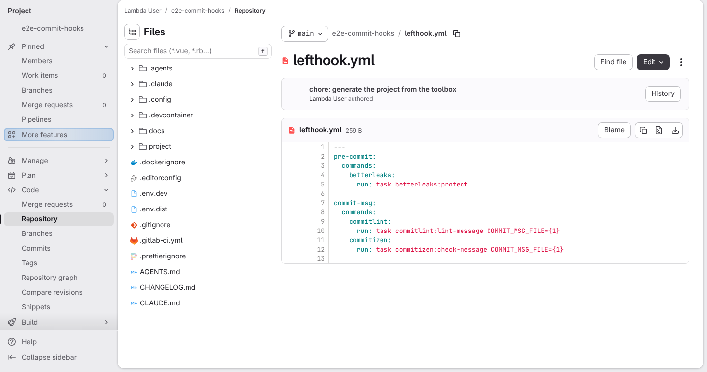](../../screenshots/base/02-daily-work/protected-commits/hooks-on-gitlab.webp)

GitLab's page for lefthook.yml on the main branch of a project generated from the toolbox. It declares the commit hooks.
Before each commit, pre-commit runs task betterleaks:protect, a secret scan of the staged files. On each commit message, commit-msg runs task commitlint:lint-message and task commitizen:check-message.

<details>
<summary>Command</summary>

```shell
http://gitlab/lambda/e2e-commit-hooks/-/blob/main/lefthook.yml
```

</details>

</td>
<td width="50%" valign="top">

[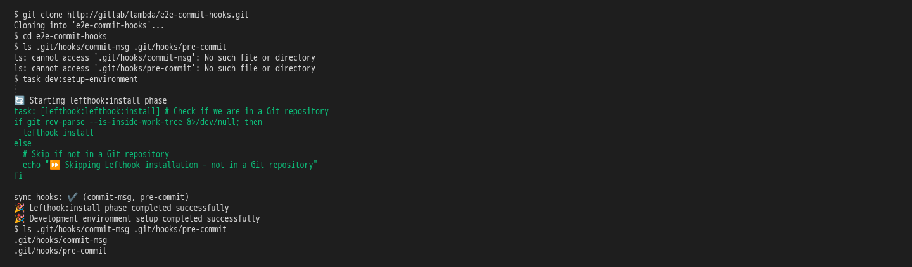](../../screenshots/base/02-daily-work/protected-commits/clone-hooks-on.webp)

A teammate clones the project. Git never copies hooks, so ls finds no commit-msg and no pre-commit file in .git/hooks.
task dev:setup-environment is the one-time setup every clone runs, and the dev container runs it on build. The ⋮ stands for its toolchain checks. Its last phase installs the hooks: lefthook says "sync hooks: ✔️ (commit-msg, pre-commit)", and ls now finds both files.

<details>
<summary>Command</summary>

```shell
git clone http://gitlab/lambda/e2e-commit-hooks.git && cd e2e-commit-hooks && task dev:setup-environment
```

</details>

</td>
</tr>
</table>

<a name="storyboard-chapter-2"></a>

## Every commit message is checked

<table width="100%">
<tr>
<th width="50%">

**3. Then the hooks refuse the teammate's first commit, the deploy notes under a sloppy message, with their own explanation**

</th>
<th width="50%">

**4. And the same commit goes through once its message follows the convention, with the gitignored deploy key left out**

</th>
</tr>
<tr>
<td width="50%" valign="top">

[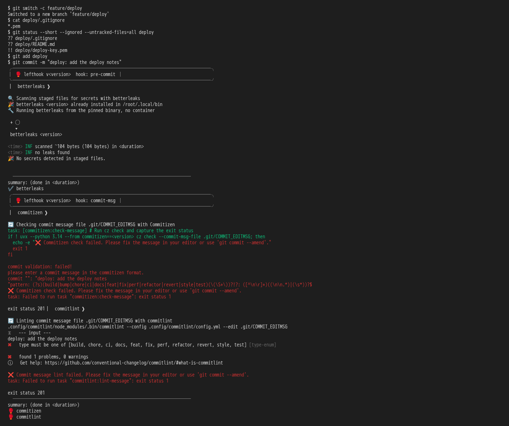](../../screenshots/base/02-daily-work/protected-commits/commit-refused.webp)

The teammate writes deploy notes on a new branch. deploy/.gitignore ignores \*.pem, so git status marks the deploy key "!!", ignored, and git add stages only the two notes files.
The message starts with "deploy:", a type the convention does not know. The pre-commit scan passes with "No secrets detected in staged files.", then commitizen and commitlint both refuse the message. Commitlint lists the types it accepts: "type must be one of \[build, chore, ...\]". No commit is made.

<details>
<summary>Command</summary>

```shell
git commit -m "deploy: add the deploy notes"
```

</details>

</td>
<td width="50%" valign="top">

[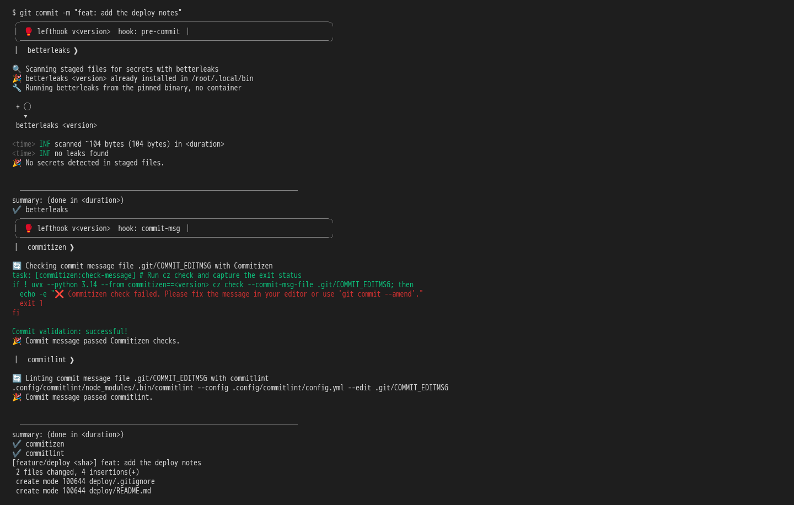](../../screenshots/base/02-daily-work/protected-commits/commit-accepted.webp)

The same staged files, with a message that starts with the type "feat:". The scan, commitizen and commitlint all pass, and git records the commit with its 2 files. The key is not one of them.

<details>
<summary>Command</summary>

```shell
git commit -m "feat: add the deploy notes"
```

</details>

</td>
</tr>
</table>

<a name="storyboard-chapter-3"></a>

## A key is stopped on the laptop

<table width="100%">
<tr>
<th width="50%">

**5. When the teammate stages the deploy key outside its ignored folder, the pre-commit scan refuses the commit**

</th>
<th width="50%">

**6. When the teammate forces the key past the hook, the branch scan blocks the branch and names the commit**

</th>
</tr>
<tr>
<td width="50%" valign="top">

[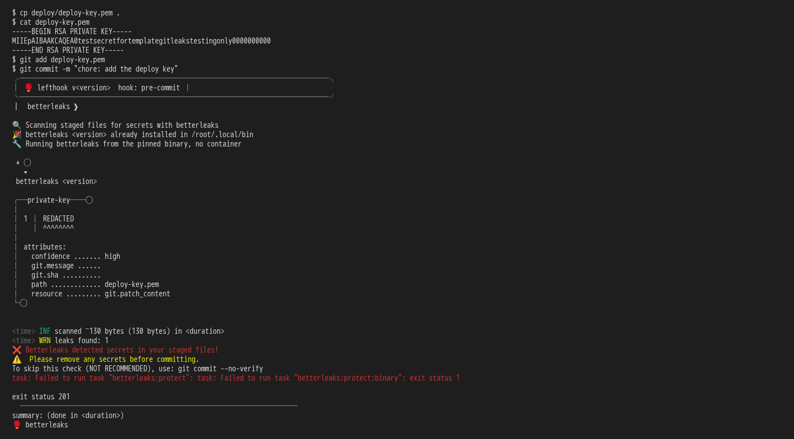](../../screenshots/base/02-daily-work/protected-commits/hook-refuses-key.webp)

The teammate copies the key to the root of the project, out of the folder that ignores it, and stages it. cat shows the fake key in clear.
The pre-commit scan finds a private-key in deploy-key.pem and prints "REDACTED" where the key would be. The commit is refused: "❌ Betterleaks detected secrets in your staged files!".

<details>
<summary>Command</summary>

```shell
cp deploy/deploy-key.pem . && git add deploy-key.pem && git commit -m "chore: add the deploy key"
```

</details>

</td>
<td width="50%" valign="top">

[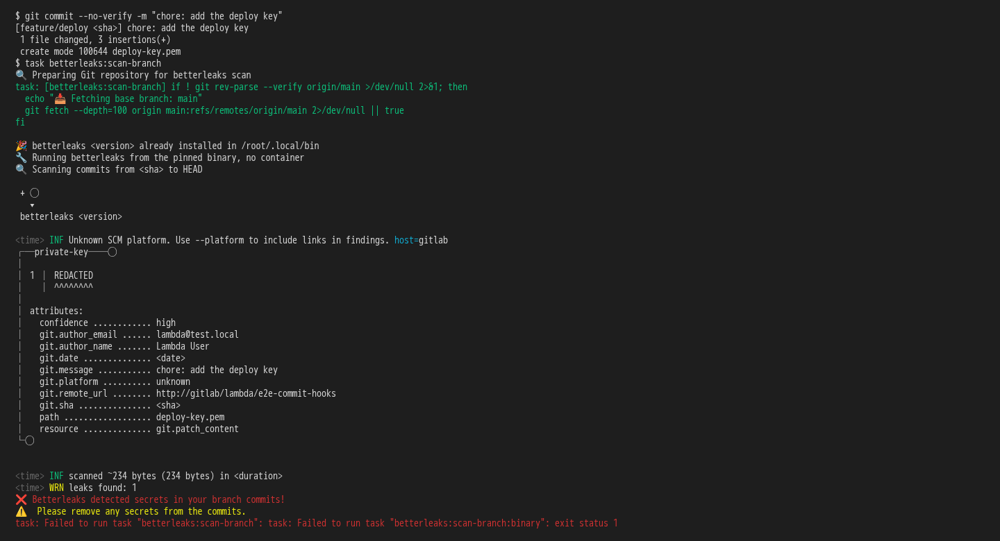](../../screenshots/base/02-daily-work/protected-commits/branch-scan-blocks.webp)

git commit --no-verify skips the hooks, as the refusal itself pointed out, and the key is committed.
The branch scan reads every commit since the main branch. It names the file and the commit, "chore: add the deploy key", still prints "REDACTED" instead of the key, and blocks the branch.

<details>
<summary>Command</summary>

```shell
git commit --no-verify -m "chore: add the deploy key" && task betterleaks:scan-branch
```

</details>

</td>
</tr>
</table>

<a name="storyboard-chapter-4"></a>

## Getting out of a secret block

<table width="100%">
<tr>
<th width="50%">

**7. When the teammate only deletes the key file, the hooks let the deletion through**

</th>
<th width="50%">

**8. Then the branch scan still finds the key in the commit that added it**

</th>
</tr>
<tr>
<td width="50%" valign="top">

[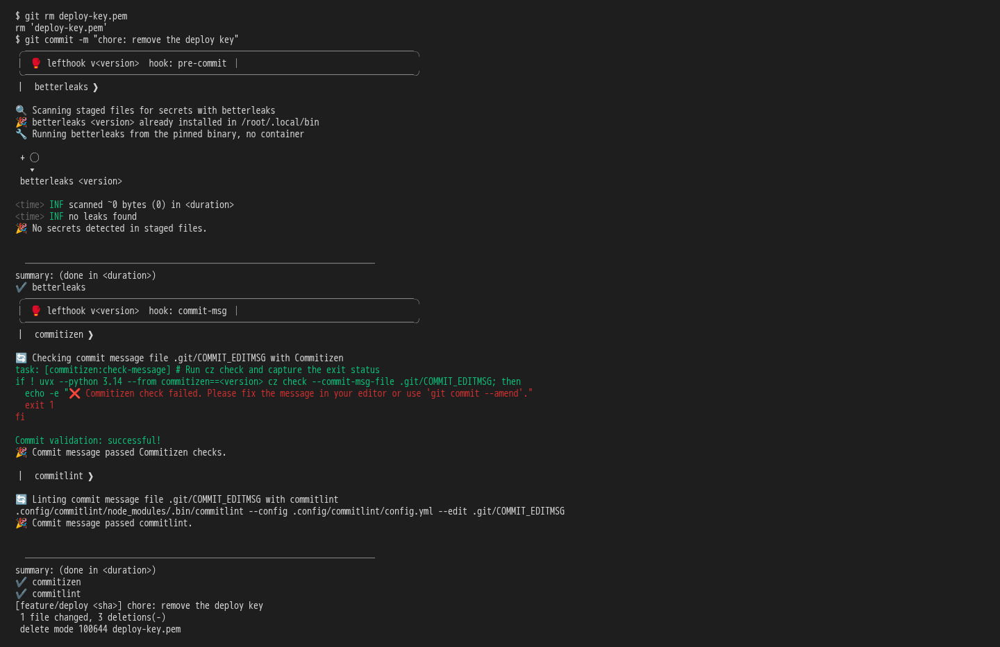](../../screenshots/base/02-daily-work/protected-commits/key-deleted.webp)

The first reflex: delete the key in a new commit. The pre-commit scan reads only what is staged, and a deletion leaves nothing to read ("scanned \~0 bytes"), so the hooks let the commit through.

<details>
<summary>Command</summary>

```shell
git rm deploy-key.pem && git commit -m "chore: remove the deploy key"
```

</details>

</td>
<td width="50%" valign="top">

[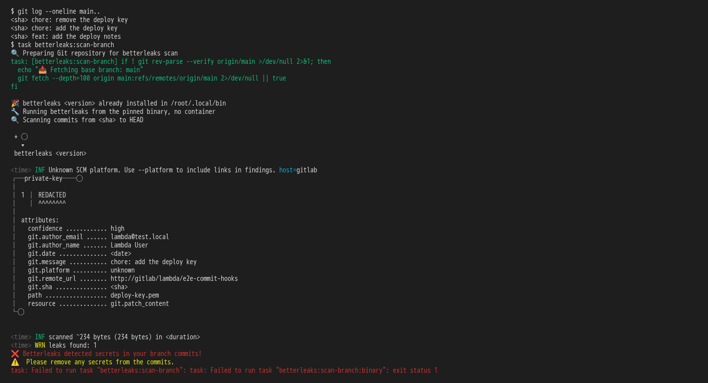](../../screenshots/base/02-daily-work/protected-commits/deletion-still-blocked.webp)

The branch has three commits now, and its last version holds no key. The scan still finds it, in the commit "chore: add the deploy key": deleting a file does not take it out of the history.

<details>
<summary>Command</summary>

```shell
git log --oneline main.. && task betterleaks:scan-branch
```

</details>

</td>
</tr>
</table>

<table width="100%">
<tr>
<th width="50%">

**9. When the teammate rewrites the history with the framework's clean-secrets task**

</th>
<th width="50%">

**10. Then the branch scan comes back clean with the deploy notes still on the branch**

</th>
</tr>
<tr>
<td width="50%" valign="top">

[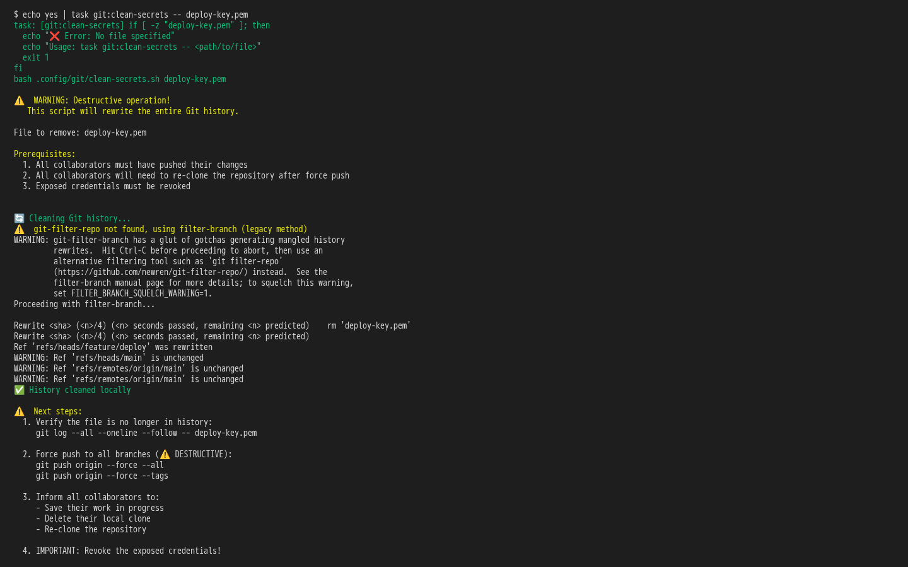](../../screenshots/base/02-daily-work/protected-commits/history-cleaned.webp)

task git:clean-secrets removes the file from every commit of the history, not only from the last one. It warns that the operation is destructive and lists its prerequisites. The yes piped into it answers its confirmation question.
The branch is rewritten: "Ref 'refs/heads/feature/deploy' was rewritten". The key never left this laptop, so nothing on GitLab needs a force push.

<details>
<summary>Command</summary>

```shell
task git:clean-secrets -- deploy-key.pem
```

</details>

</td>
<td width="50%" valign="top">

[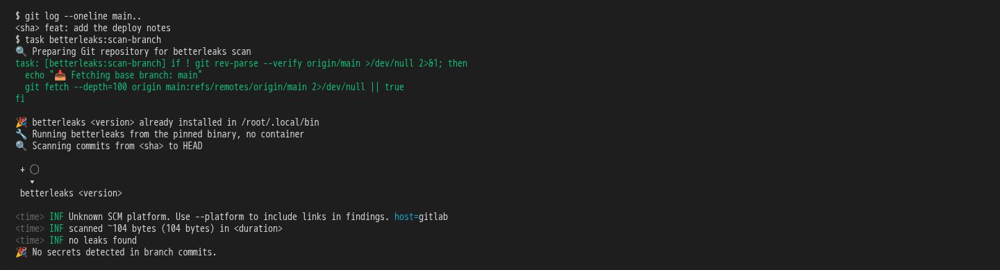](../../screenshots/base/02-daily-work/protected-commits/branch-scan-clean.webp)

One commit is left on the branch, the deploy notes. The same scan as two cards before now passes: "No secrets detected in branch commits."

<details>
<summary>Command</summary>

```shell
git log --oneline main.. && task betterleaks:scan-branch
```

</details>

</td>
</tr>
</table>

<a name="storyboard-chapter-5"></a>

## GitLab is the gate nobody can skip

<table width="100%">
<tr>
<th width="50%">

**11. Then the cleaned branch, pushed as a merge request, passes the same scan on GitLab and is ready to merge**

</th>
<th width="50%">

**12. When another branch skips every local check and pushes the key inside a secrets.yaml, a file the scanner used to skip**

</th>
</tr>
<tr>
<td width="50%" valign="top">

[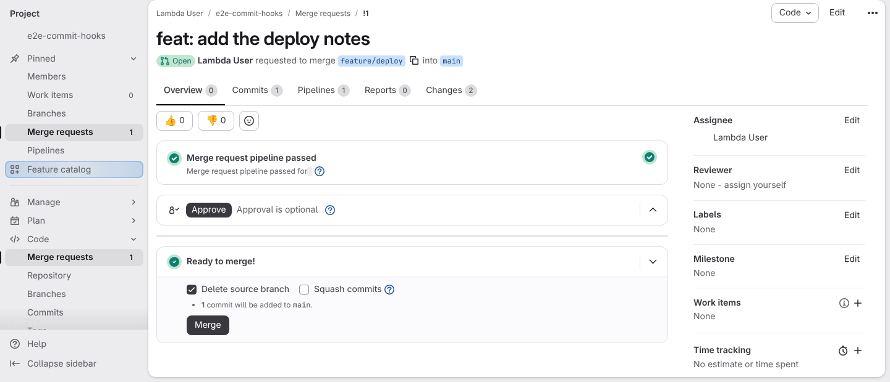](../../screenshots/base/02-daily-work/protected-commits/merge-ready.webp)

The teammate pushes the branch, which opens merge request !1. Its pipeline runs the same branch scan, from the same pinned binary. GitLab shows "Merge request pipeline passed" and "Ready to merge!".

<details>
<summary>Command</summary>

```shell
git push -o merge_request.create -o merge_request.target=main origin feature/deploy
```

</details>

</td>
<td width="50%" valign="top">

[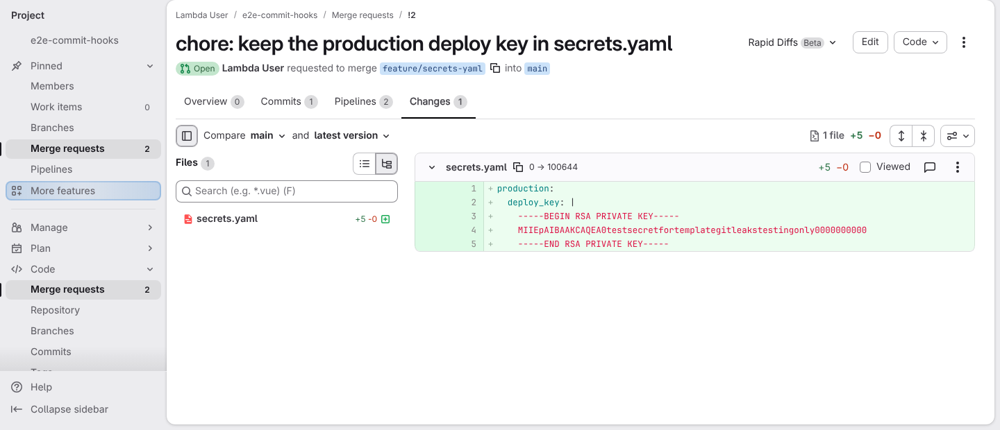](../../screenshots/base/02-daily-work/protected-commits/secrets-yaml-changes.webp)

Another branch, started from the main branch, puts the same fake key in secrets.yaml. The scanner used to skip any file with that name (issue \#182). The commit skips the hooks with --no-verify, and the push opens merge request !2.
Its Changes tab shows the key in clear: this is what the pipeline has to catch. The test project is deleted when the story ends.

<details>
<summary>Command</summary>

```shell
git commit --no-verify -m "chore: keep the production deploy key in secrets.yaml" && git push -o merge_request.create -o merge_request.target=main origin feature/secrets-yaml
```

</details>

</td>
</tr>
</table>

<table width="100%">
<tr>
<th width="50%">

**13. Then the pipeline of that merge request blocks the key from the pinned binary and never prints it**

</th>
<th width="50%">

**14. And GitLab refuses to merge it, so the key never reaches the main branch**

</th>
</tr>
<tr>
<td width="50%" valign="top">

[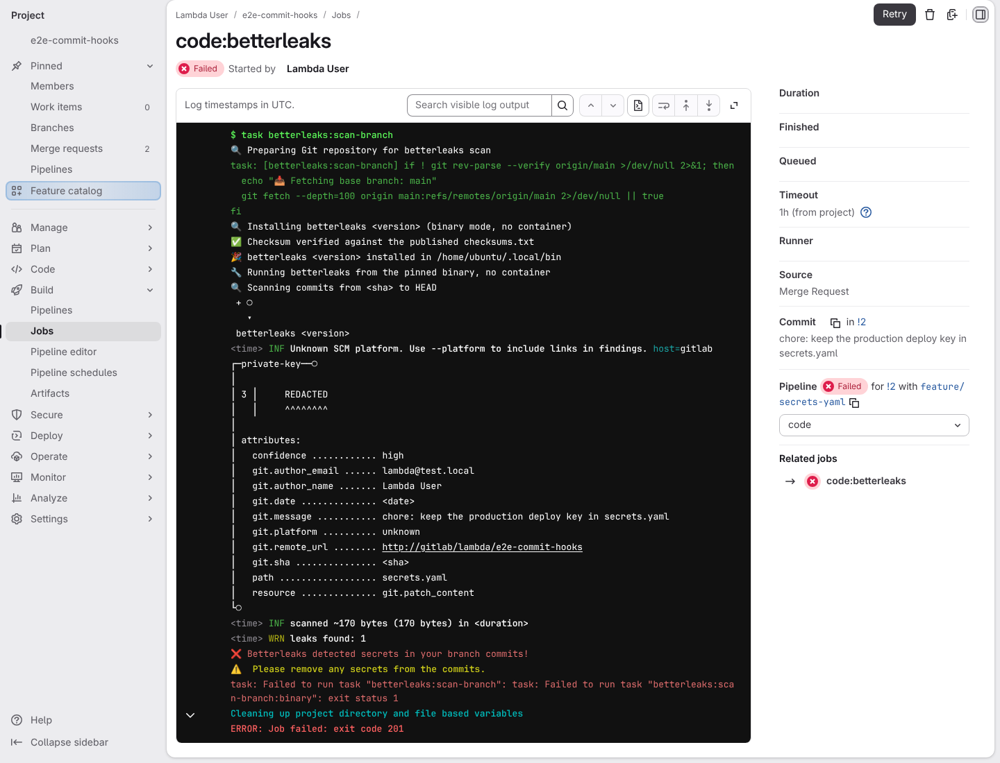](../../screenshots/base/02-daily-work/protected-commits/ci-scan-blocks.webp)

The code:betterleaks job of merge request !2, from "$ task betterleaks:scan-branch" on. The job downloads the pinned binary, checks it ("✅ Checksum verified against the published checksums.txt") and runs it with no container.
It finds the private-key in secrets.yaml and prints "REDACTED" where the key would be. Every member of the project can read this log, and the key is not in it.

<details>
<summary>Command</summary>

```shell
http://gitlab/lambda/e2e-commit-hooks/-/merge_requests/2/pipelines
```

</details>

</td>
<td width="50%" valign="top">

[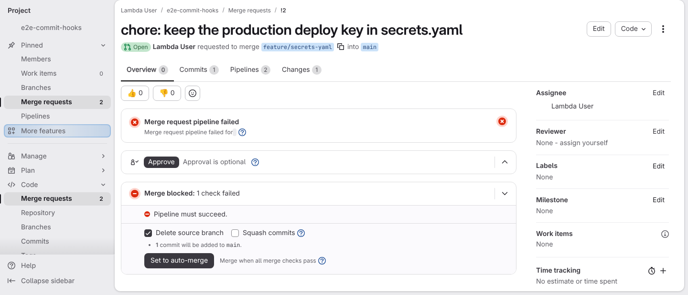](../../screenshots/base/02-daily-work/protected-commits/merge-blocked.webp)

The same page as for merge request !1. The pipeline failed, and GitLab says "Merge blocked": this project merges a merge request only when its pipeline passed. The key cannot reach the main branch.

<details>
<summary>Command</summary>

```shell
http://gitlab/lambda/e2e-commit-hooks/-/merge_requests/2
```

</details>

</td>
</tr>
</table>

<a name="storyboard-replay"></a>

<details>
<summary>Replay this scenario · source and checks</summary>

```shell
task test -- --grep "@protected-commits"
```

**Source**

```text
project/tests/e2e/features/02-daily-work/protected-commits.feature
```

Every frame is its own pixel baseline (tolerance: 0).

</details>
