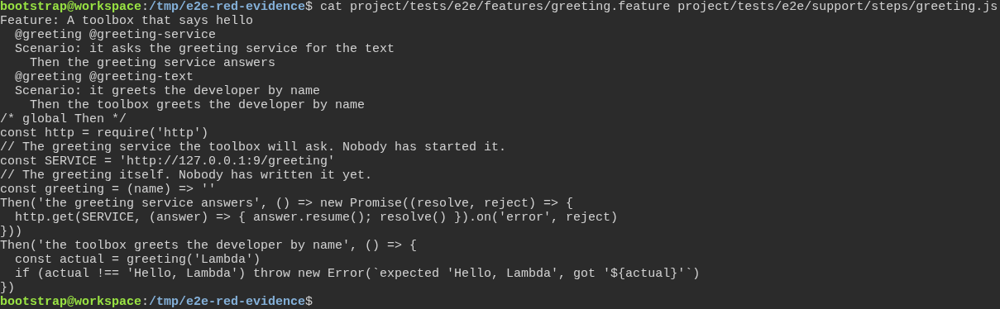
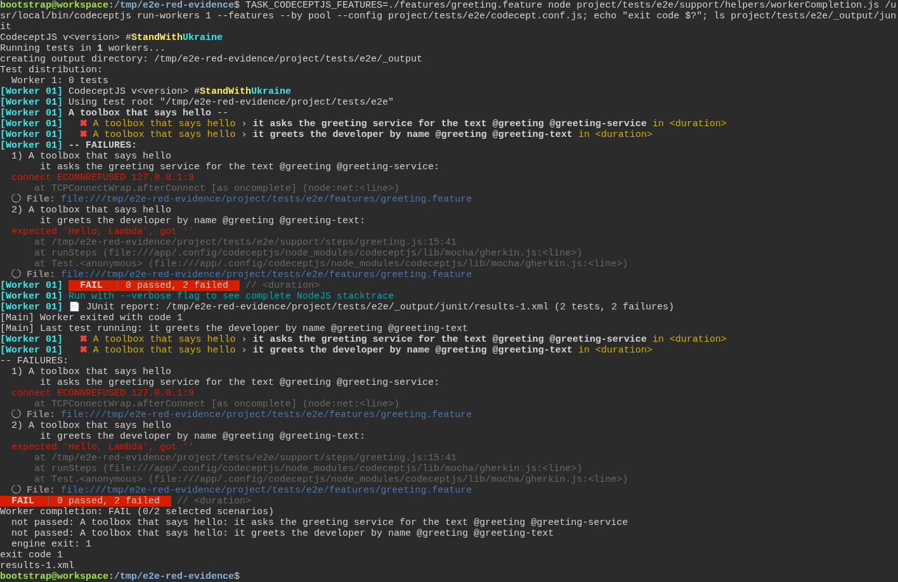
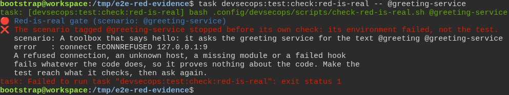
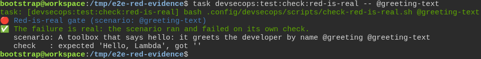
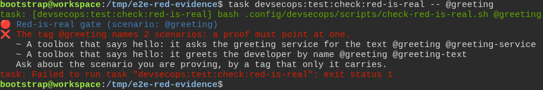
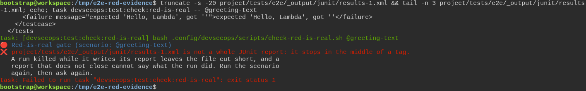

# The toolbox checks the test really failed first, instead of taking anyone's word for it

**Scenario:** The RED gate counts only a failure that reached the test's own check

<a name="storyboard-result"></a>

> [!tip] PASSED
> 6 steps · 6 frames

**On this page**

[Result](#storyboard-result) · [A refused connection is not a failing test](#storyboard-chapter-1) · [One scenario, in one whole report](#storyboard-chapter-2) · [Replay and source](#storyboard-replay)

<a name="storyboard-chapter-1"></a>

## A refused connection is not a failing test

<table width="100%">
<tr>
<th width="50%">

**1. Given a developer writes one test that needs a service nobody started, and one that checks a greeting nobody wrote**

</th>
<th width="50%">

**2. When both tests run and fail, one on the refused connection and one on its own check**

</th>
</tr>
<tr>
<td width="50%" valign="top">

[](../../screenshots/base/02-daily-work/red-evidence/red-evidence-two-tests.webp)

A developer writes two tests for one greeting and tags both @greeting. The first asks a greeting service at 127.0.0.1:9 for the text, but nobody started that service. The second checks the greeting the toolbox gives, and nobody has written that greeting yet.
Only the second test can show that code is missing. The first one fails whatever the code does, because the service it needs is not there.

<details>
<summary>Command</summary>

```shell
cat project/tests/e2e/features/greeting.feature project/tests/e2e/support/steps/greeting.js
```

</details>

</td>
<td width="50%" valign="top">

[](../../screenshots/base/02-daily-work/red-evidence/red-evidence-both-fail.webp)

One run of both tests, with the line task project:test:e2e runs inside its test container. The first test stops on "connect ECONNREFUSED 127.0.0.1:9": nothing answered at that address. The second fails on its own check: "expected 'Hello, Lambda', got ''".
The run exits with the code 1 and leaves results-1.xml in the report folder, with both failures in it. From the exit code alone, nobody can tell the two failures apart.

<details>
<summary>Command</summary>

```shell
TASK_E2E_WORKERS=1 TASK_CODECEPTJS_FEATURES=./features/greeting.feature task project:test:e2e; echo "exit code $?"; ls project/tests/e2e/_output/junit
```

</details>

</td>
</tr>
</table>

<table width="100%">
<tr>
<th width="50%">

**3. Then the toolbox refuses the failure caused by the refused connection**

</th>
<th width="50%">

**4. And the toolbox accepts the failure on the test's own check**

</th>
</tr>
<tr>
<td width="50%" valign="top">

[](../../screenshots/base/02-daily-work/red-evidence/red-evidence-connection-refused.webp)

The RED gate reads that report for @greeting-service. It finds the failure, sees a refused connection in it, and refuses it: the test stopped before it checked anything.

<details>
<summary>Command</summary>

```shell
task devsecops:test:check:red-is-real -- @greeting-service
```

</details>

</td>
<td width="50%" valign="top">

[](../../screenshots/base/02-daily-work/red-evidence/red-evidence-own-check.webp)

The same command for @greeting-text, on the same report. This test ran up to its check and failed there, so the gate accepts the failure and quotes that check.

<details>
<summary>Command</summary>

```shell
task devsecops:test:check:red-is-real -- @greeting-text
```

</details>

</td>
</tr>
</table>

<a name="storyboard-chapter-2"></a>

## One scenario, in one whole report

<table width="100%">
<tr>
<th width="50%">

**5. Then a tag that names both tests is refused**

</th>
<th width="50%">

**6. And a report cut short is refused, even though the failure is still in it**

</th>
</tr>
<tr>
<td width="50%" valign="top">

[](../../screenshots/base/02-daily-work/red-evidence/red-evidence-ambiguous-tag.webp)

The tag @greeting is on both tests. The gate cannot know which of the two the developer means, so it refuses and lists them. Each test already has a tag of its own for that.

<details>
<summary>Command</summary>

```shell
task devsecops:test:check:red-is-real -- @greeting
```

</details>

</td>
<td width="50%" valign="top">

[](../../screenshots/base/02-daily-work/red-evidence/red-evidence-report-cut-short.webp)

A run killed while it writes its report leaves the file cut in the middle. truncate removes the last 20 bytes of results-1.xml, and tail shows its last three lines: the failure of @greeting-text is still there, word for word, but the file now ends in the middle of a tag.
The gate refuses it anyway. A report that does not close is not the record of a whole run.

<details>
<summary>Command</summary>

```shell
truncate -s -20 project/tests/e2e/_output/junit/results-1.xml && tail -n 3 project/tests/e2e/_output/junit/results-1.xml; echo; task devsecops:test:check:red-is-real -- @greeting-text
```

</details>

</td>
</tr>
</table>

<a name="storyboard-replay"></a>

<details>
<summary>Replay this scenario · source and checks</summary>

```shell
task test -- --grep "@red-evidence"
```

**Source**

```text
project/tests/e2e/features/02-daily-work/tdd-cycle.feature
```

Every frame is its own pixel baseline (tolerance: 0).

</details>
