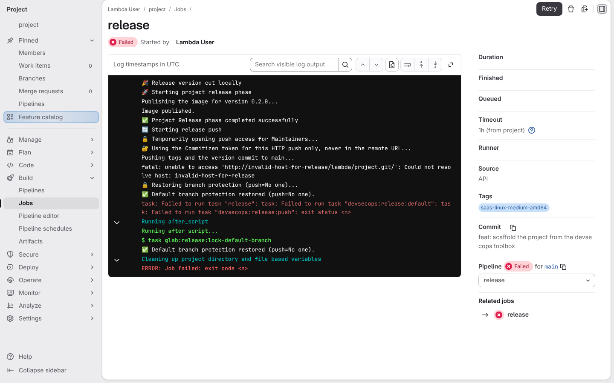
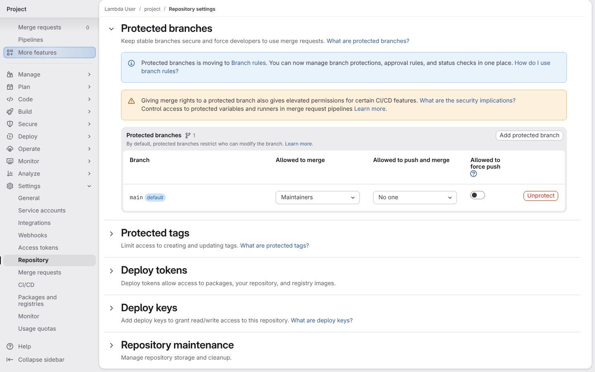
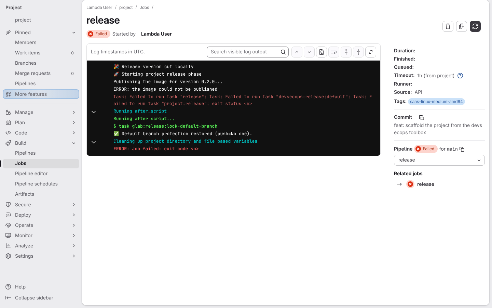
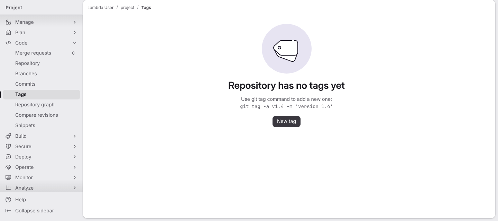
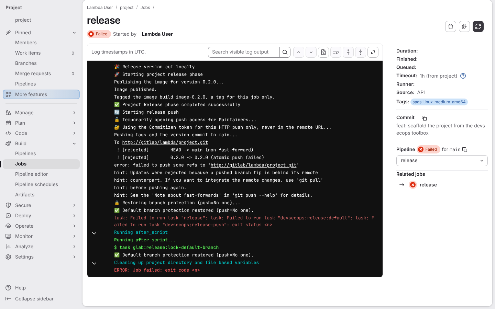
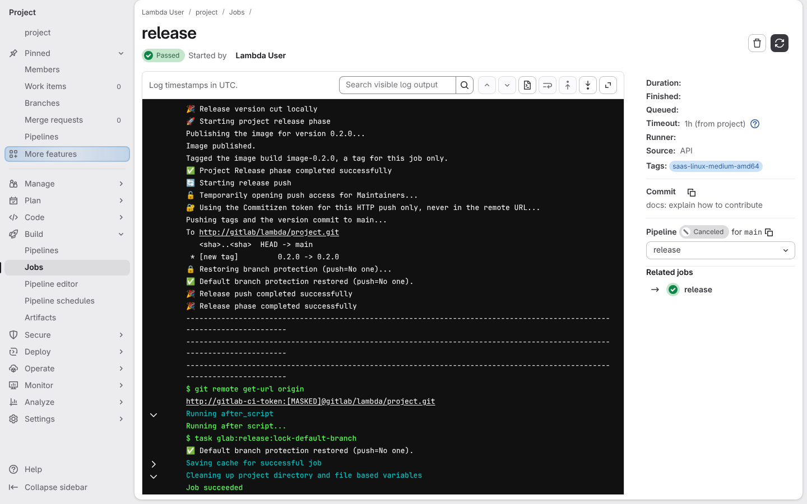
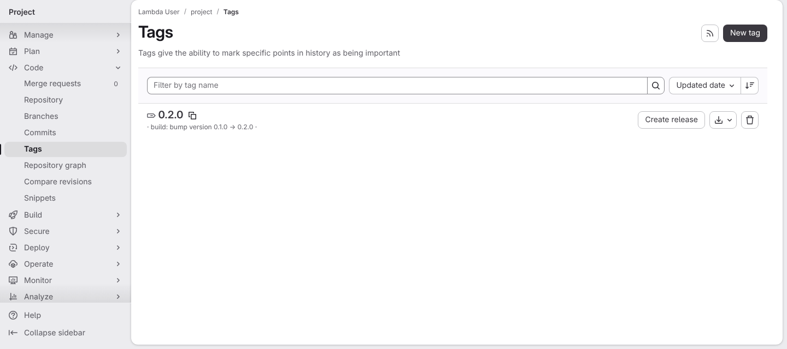
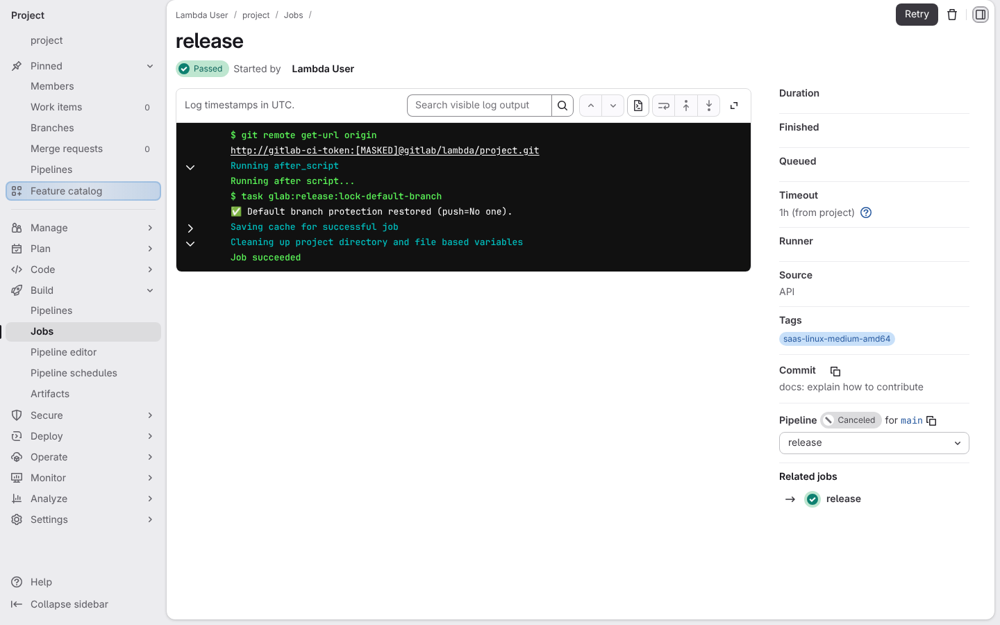

# A release that fails leaves nothing broken behind

**Scenario:** a crashed release leaves the main branch locked, pushes no tag on its own, and its relaunch publishes the version commit with its tag without leaving its push token behind

<a name="storyboard-result"></a>

> [!tip] PASSED
> 9 steps · 9 frames

**On this page**

[Result](#storyboard-result) · [The push window always closes](#storyboard-chapter-1) · [A release that cannot publish its image pushes nothing](#storyboard-chapter-2) · [A rejected push publishes nothing](#storyboard-chapter-3) · [The relaunched release pushes its version commit and its tag together](#storyboard-chapter-4) · [The push token is not left behind](#storyboard-chapter-5) · [Replay and source](#storyboard-replay)

<a name="storyboard-chapter-1"></a>

## The push window always closes

<table width="100%">
<tr>
<th width="50%">

**1. Given a release job on the main branch crashes mid-push while it still holds push access, then locks the main branch again on its way out**

</th>
<th width="50%">

**2. Then the main branch is locked again even though the release crashed**

</th>
</tr>
<tr>
<td width="50%" valign="top">

[](../../screenshots/base/02-daily-work/release-window/after-script-relock.webp)

Nobody may push straight to the main branch: every change goes through a reviewed merge request. The release job is the one exception, and this is its real log on GitLab, from the moment its new version is ready.
The release job opens that exception, "Temporarily opening push access for Maintainers", and dies on "Could not resolve host" right after "Pushing tags and the version commit to main...". On its way out the release job takes the push access back itself, "Default branch protection restored (push\=No one).", and GitLab's after\_script, a cleanup step that runs on every outcome, runs task glab:release:lock-default-branch and takes it back a second time. The job still ends on a red Failed pill.

<details>
<summary>Command</summary>

```shell
http://gitlab/<lambda-user>/<project>/-/jobs/<id>
```

</details>

</td>
<td width="50%" valign="top">

[](../../screenshots/base/02-daily-work/release-window/door-locked-after.webp)

GitLab's own settings for the main branch, opened after the crash. In the "Protected branches" table the main branch reads "Allowed to merge: Maintainers" and "Allowed to push and merge: No one".
The crash left no push access behind: every change to the main branch goes through a reviewed merge request again.

<details>
<summary>Command</summary>

```shell
http://gitlab/<lambda-user>/<project>/-/settings/repository
```

</details>

</td>
</tr>
</table>

<a name="storyboard-chapter-2"></a>

## A release that cannot publish its image pushes nothing

<table width="100%">
<tr>
<th width="50%">

**3. When the image of a second release cannot be published, so the release job stops before its push**

</th>
<th width="50%">

**4. Then the project has no tag at all, so the main branch never points at a missing image**

</th>
</tr>
<tr>
<td width="50%" valign="top">

[](../../screenshots/base/02-daily-work/release-window/publish-failed.webp)

A release publishes two things that must stay in step: the container image every later pipeline runs on, and the tag plus version commit on the main branch that names it. The same release job page as the first card, for a second release.
This second release starts the same way, "Release version cut locally", then "Publishing the image for version 0.2.0...", and stops on "ERROR: the image could not be published". No "Pushing tags" line follows: the release gave up before touching the main branch.

<details>
<summary>Command</summary>

```shell
http://gitlab/<lambda-user>/<project>/-/jobs/<id>
```

</details>

</td>
<td width="50%" valign="top">

[](../../screenshots/base/02-daily-work/release-window/no-tag-without-its-image.webp)

The tags page of the project reads "Repository has no tags yet". No tag names an image that was never published, so relaunching this release starts from a clean project instead of stopping on a tag that already exists.

<details>
<summary>Command</summary>

```shell
http://gitlab/<lambda-user>/<project>/-/tags
```

</details>

</td>
</tr>
</table>

<a name="storyboard-chapter-3"></a>

## A rejected push publishes nothing

<table width="100%">
<tr>
<th width="50%">

**5. When a teammate's change moves the main branch while a third release waits, so the release job's push is rejected and sends neither the version commit nor its tag**

</th>
<th width="50%">

**6. Then the project still has no tag after the rejected push**

</th>
</tr>
<tr>
<td width="50%" valign="top">

[](../../screenshots/base/02-daily-work/release-window/push-rejected.webp)

A third release starts on the commit "feat: scaffold the project from the devsecops toolbox", in the Commit box on the right. While it waits for its runner, a teammate's change lands on the main branch, so the main branch has moved on before the release job starts.
The release job cuts version 0.2.0 on top of that older commit, and the project's own publish step keeps a tag of its own, "Tagged the image build image-0.2.0, a tag for this job only.". Git rejects the version commit, "HEAD -&gt; main (non-fast-forward)", because the main branch moved on, and rejects its tag with it, "0.2.0 -&gt; 0.2.0 (atomic push failed)": the push sends both or nothing. image-0.2.0 is not part of the push at all.

<details>
<summary>Command</summary>

```shell
http://gitlab/<lambda-user>/<project>/-/jobs/<id>
```

</details>

</td>
<td width="50%" valign="top">

[](../../screenshots/base/02-daily-work/release-window/no-tag-after-rejected-push.webp)

The tags page of the project still reads "Repository has no tags yet". No tag points at a version commit the main branch never received, so version 0.2.0 is still free for the next release.

<details>
<summary>Command</summary>

```shell
http://gitlab/<lambda-user>/<project>/-/tags
```

</details>

</td>
</tr>
</table>

<a name="storyboard-chapter-4"></a>

## The relaunched release pushes its version commit and its tag together

<table width="100%">
<tr>
<th width="50%">

**7. When the release is relaunched on the updated main branch and pushes its version commit and its tag together**

</th>
<th width="50%">

**8. Then the project has exactly one tag, 0.2.0, on the version commit at the tip of the main branch**

</th>
</tr>
<tr>
<td width="50%" valign="top">

[](../../screenshots/base/02-daily-work/release-window/relaunch-pushed.webp)

The same release job page, for the release relaunched on the updated main branch: its Commit box now reads "docs: explain how to contribute", the teammate's change. It cuts version 0.2.0 again, and one push carries "HEAD -&gt; main" and "\[new tag\] 0.2.0 -&gt; 0.2.0", nothing else: image-0.2.0 stays in the job.
The release job ends on "Job succeeded" and a green Passed pill. Its pipeline reads Canceled only because the story stops the other jobs of that pipeline, which it does not need.

<details>
<summary>Command</summary>

```shell
http://gitlab/<lambda-user>/<project>/-/jobs/<id>
```

</details>

</td>
<td width="50%" valign="top">

[](../../screenshots/base/02-daily-work/release-window/one-tag-with-its-commit.webp)

The tags page now lists one tag, 0.2.0, on "build: bump version 0.1.0 → 0.2.0", the version commit at the tip of the main branch. image-0.2.0, the tag the publish step kept in the job, never reached GitLab.

<details>
<summary>Command</summary>

```shell
http://gitlab/<lambda-user>/<project>/-/tags
```

</details>

</td>
</tr>
</table>

<a name="storyboard-chapter-5"></a>

## The push token is not left behind

<table width="100%">
<tr>
<th width="50%">

**9. Then the release job's copy of the project still points at GitLab without the push token**

</th>
<th width="50%">


</th>
</tr>
<tr>
<td width="50%" valign="top">

[](../../screenshots/base/02-daily-work/release-window/remote-without-push-token.webp)

The same release job page, read from "$ git remote get-url origin", a line this test project adds to its release job right after task release. It prints the address the job's copy of the project uses to reach GitLab.
The address is the one GitLab's runner cloned the project with: "gitlab-ci-token", the job's own token, which GitLab hides as \[MASKED\] and which stops working when the job ends. The release's push token is not in it, so it does not stay behind in the project's git settings once the release is done.

<details>
<summary>Command</summary>

```shell
http://gitlab/<lambda-user>/<project>/-/jobs/<id>
```

</details>

</td>
<td width="50%" valign="top">


</td>
</tr>
</table>

<a name="storyboard-replay"></a>

<details>
<summary>Replay this scenario · source and checks</summary>

```shell
task test -- --grep "@release-window"
```

**Source**

```text
project/tests/e2e/features/02-daily-work/release-window.feature
```

Every frame is its own pixel baseline (tolerance: 0).

</details>
