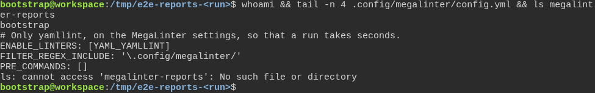
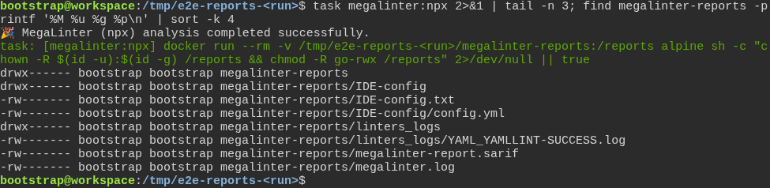
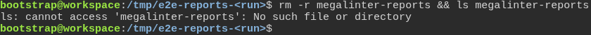
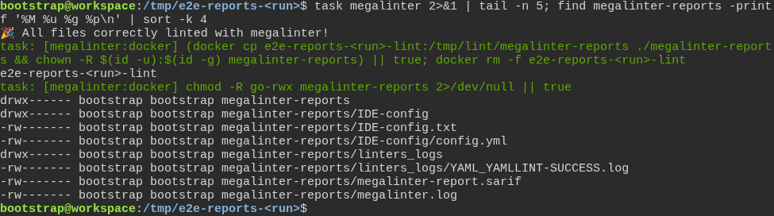

# a freshly generated project passes its own quality gate

**Scenario:** MegaLinter's reports belong to the developer who ran it, and to no one else

<a name="storyboard-result"></a>

> [!tip] PASSED
> 4 steps · 4 frames

**On this page**

[Result](#storyboard-result) · [Replay and source](#storyboard-replay)

<table width="100%">
<tr>
<th width="50%">

**1. Given a generated project where MegaLinter runs only yamllint on its own settings**

</th>
<th width="50%">

**2. Then task megalinter:npx leaves reports only the developer can read or change**

</th>
</tr>
<tr>
<td width="50%" valign="top">

[](../../screenshots/base/02-daily-work/report-permissions/yamllint-only-project.webp)

The developer is bootstrap, an ordinary user without administrator rights. The last lines of the project's MegaLinter settings keep one check, yamllint, on the MegaLinter settings files only, so that a run takes seconds. PRE\_COMMANDS: \[\] skips the spelling dictionaries MegaLinter would install first.
ls finds no megalinter-reports folder yet: every report on the next cards comes from the run shown there.

<details>
<summary>Command</summary>

```shell
whoami && tail -n 4 .config/megalinter/config.yml && ls megalinter-reports
```

</details>

</td>
<td width="50%" valign="top">

[](../../screenshots/base/02-daily-work/report-permissions/npx-reports-private.webp)

task megalinter:npx is the run behind task devsecops:code. MegaLinter runs as root in its own container and writes its reports straight into the project. The task's last step, in green, gives them to the user who ran it with chown, then takes every right away from everyone else with chmod -R go-rwx.
find lists each report with its rights, its owner and its group. Every line reads bootstrap bootstrap. In drwx------ and -rw-------, the letters are bootstrap's own rights to open, read and change, and the dashes after them mean nothing for anyone else.

<details>
<summary>Command</summary>

```shell
task megalinter:npx 2>&1 | tail -n 3; find megalinter-reports -printf '%M %u %g %p\n' | sort -k 4
```

</details>

</td>
</tr>
</table>

<table width="100%">
<tr>
<th width="50%">

**3. And the developer can delete those reports without administrator rights**

</th>
<th width="50%">

**4. Then task megalinter leaves its reports to the developer alone too**

</th>
</tr>
<tr>
<td width="50%" valign="top">

[](../../screenshots/base/02-daily-work/report-permissions/reports-deleted.webp)

rm -r removes the folder and every report in it with bootstrap's own rights, without sudo, and ls confirms it is gone.

<details>
<summary>Command</summary>

```shell
rm -r megalinter-reports && ls megalinter-reports
```

</details>

</td>
<td width="50%" valign="top">

[](../../screenshots/base/02-daily-work/report-permissions/docker-reports-private.webp)

task megalinter, the usual way to run MegaLinter on a computer, runs it in Docker on a copy of the project, then copies the reports back as bootstrap. Its last step, in green, is chmod -R go-rwx megalinter-reports.
find shows the same rights as after task megalinter:npx: bootstrap bootstrap on every line, and nothing for anyone else.

<details>
<summary>Command</summary>

```shell
task megalinter 2>&1 | tail -n 5; find megalinter-reports -printf '%M %u %g %p\n' | sort -k 4
```

</details>

</td>
</tr>
</table>

<a name="storyboard-replay"></a>

<details>
<summary>Replay this scenario · source and checks</summary>

```shell
task test -- --grep "@report-permissions"
```

**Source**

```text
project/tests/e2e/features/02-daily-work/megalinter-reports.feature
```

Every frame is its own pixel baseline (tolerance: 0).

</details>
