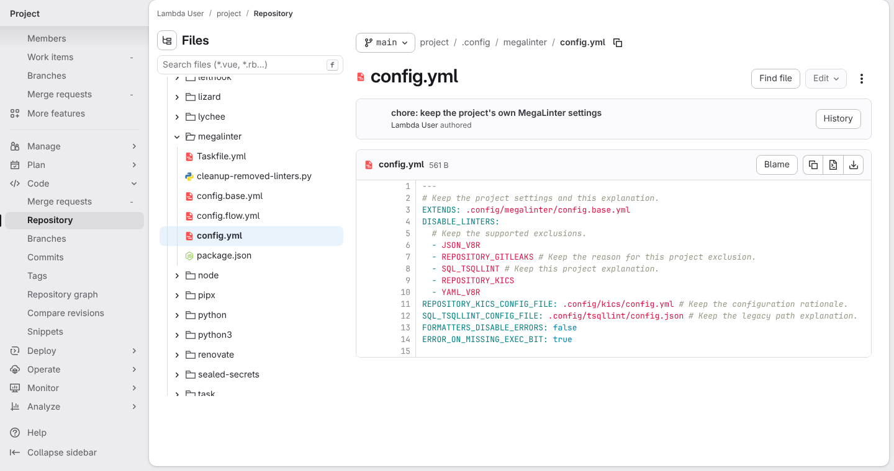
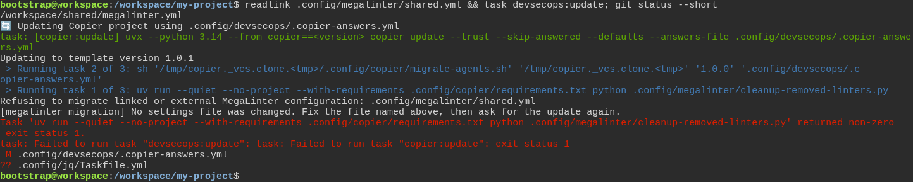
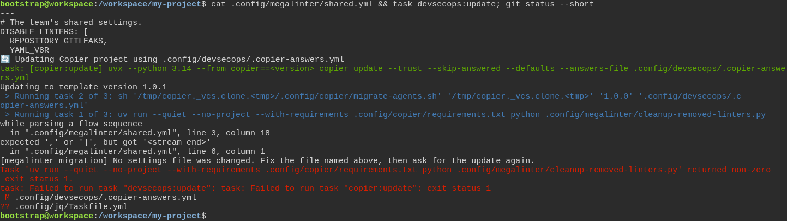
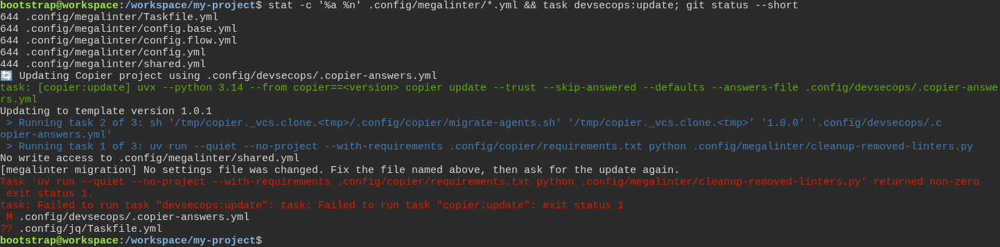
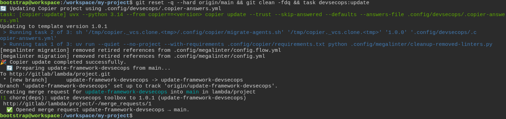
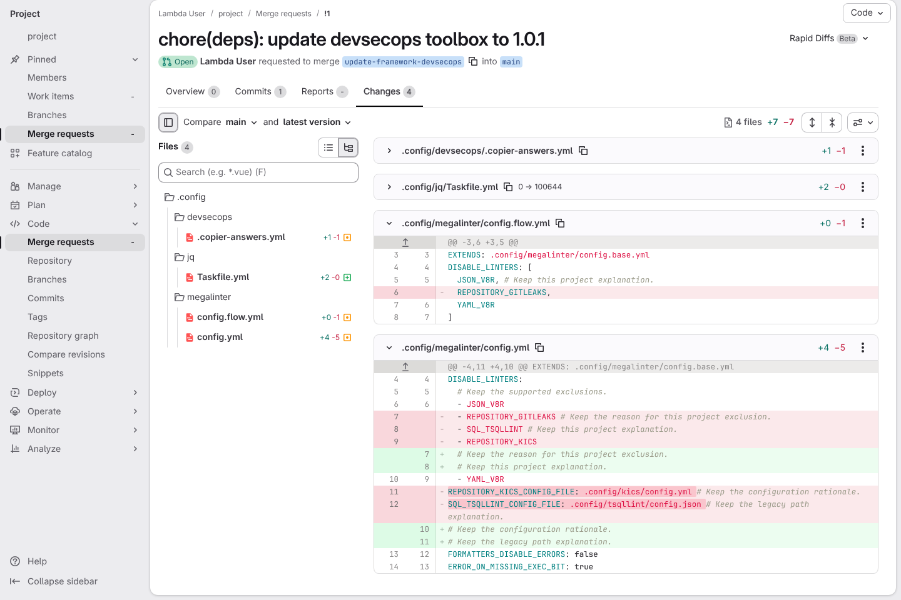
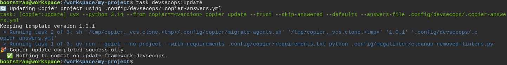

# a freshly generated project passes its own quality gate

**Scenario:** a framework update removes retired linters and preserves project controls

<a name="storyboard-result"></a>

> [!tip] PASSED
> 7 steps · 7 frames

**On this page**

[Result](#storyboard-result) · [A settings file linked outside the project stops the update](#storyboard-chapter-1) · [A settings file with a typo stops the update](#storyboard-chapter-2) · [A read-only settings file stops the update](#storyboard-chapter-3) · [Back on what GitLab holds, the update arrives as a clean merge request](#storyboard-chapter-4) · [Replay and source](#storyboard-replay)

<table width="100%">
<tr>
<th width="50%">

**1. Given the main branch on GitLab still names three retired linters in the project's MegaLinter settings**

</th>
<th width="50%">


</th>
</tr>
<tr>
<td width="50%" valign="top">

[](../../screenshots/base/02-daily-work/retired-linters/gitlab-settings-before.webp)

GitLab shows the project's MegaLinter settings, .config/megalinter/config.yml, on the main branch. They still name three linters MegaLinter has retired: REPOSITORY\_GITLEAKS, SQL\_TSQLLINT and REPOSITORY\_KICS, two of them with options of their own.
Around them sit the project's own choices: comments that explain its settings, two supported exclusions (JSON\_V8R and YAML\_V8R) and two strict checks. A second settings file, config.flow.yml, writes its list on one bracketed block and names REPOSITORY\_GITLEAKS too.

<details>
<summary>Command</summary>

```shell
http://gitlab/<lambda-user>/<project>/-/blob/main/.config/megalinter/config.yml
```

</details>

</td>
<td width="50%" valign="top">


</td>
</tr>
</table>

<a name="storyboard-chapter-1"></a>

## A settings file linked outside the project stops the update

<table width="100%">
<tr>
<th width="50%">

**2. Then the framework update stops at a settings file linked outside the project, before it changes any MegaLinter setting**

</th>
<th width="50%">


</th>
</tr>
<tr>
<td width="50%" valign="top">

[](../../screenshots/base/02-daily-work/retired-linters/update-refused-by-link.webp)

On their own machine, the developer has added a third settings file, shared.yml, and committed it without pushing. It is a link: readlink shows it points to /workspace/shared/megalinter.yml, a file outside the project.
The developer asks for the framework update. Copier brings the new release in, then runs the MegaLinter clean-up, which stops with "Refusing to migrate linked or external MegaLinter configuration". The task fails, so nothing is pushed and no merge request opens.
git status lists the two files Copier had already written. No MegaLinter settings file is among them: the clean-up checks every file before it changes any.

<details>
<summary>Command</summary>

```shell
readlink .config/megalinter/shared.yml && task devsecops:update; git status --short
```

</details>

</td>
<td width="50%" valign="top">


</td>
</tr>
</table>

<a name="storyboard-chapter-2"></a>

## A settings file with a typo stops the update

<table width="100%">
<tr>
<th width="50%">

**3. Then the framework update stops at a settings file that is not valid YAML and names it, before it changes any MegaLinter setting**

</th>
<th width="50%">


</th>
</tr>
<tr>
<td width="50%" valign="top">

[](../../screenshots/base/02-daily-work/retired-linters/update-refused-by-typo.webp)

The developer has undone what the stopped update wrote, then replaced the link with a file of their own, shared.yml, committed without pushing. cat shows a typo: its list opens with a bracket that never closes.
The clean-up names the file and the line where the list opens, line 3 of shared.yml. It says "No settings file was changed" and asks to fix the file, then ask for the update again. The task fails, so nothing is pushed.
git status lists only the two files Copier had already written.

<details>
<summary>Command</summary>

```shell
cat .config/megalinter/shared.yml && task devsecops:update; git status --short
```

</details>

</td>
<td width="50%" valign="top">


</td>
</tr>
</table>

<a name="storyboard-chapter-3"></a>

## A read-only settings file stops the update

<table width="100%">
<tr>
<th width="50%">

**4. And the framework update stops at a read-only settings file and names it, before it changes any MegaLinter setting**

</th>
<th width="50%">


</th>
</tr>
<tr>
<td width="50%" valign="top">

[](../../screenshots/base/02-daily-work/retired-linters/update-refused-by-read-only.webp)

The developer has undone what the stopped update wrote, closed the bracket in shared.yml and committed the fix. Then they made shared.yml read-only: stat shows 444 for it, so nobody may write it, and 644 for the four other files, which their owner may write.
The clean-up says "No write access to .config/megalinter/shared.yml", then "No settings file was changed". It checks that it may write every file before it writes any, so config.flow.yml and config.yml keep their retired linters for now.
git status lists only the two files Copier had already written.

<details>
<summary>Command</summary>

```shell
stat -c '%a %n' .config/megalinter/*.yml && task devsecops:update; git status --short
```

</details>

</td>
<td width="50%" valign="top">


</td>
</tr>
</table>

<a name="storyboard-chapter-4"></a>

## Back on what GitLab holds, the update arrives as a clean merge request

<table width="100%">
<tr>
<th width="50%">

**5. When the developer goes back to what GitLab holds and asks for the framework update again**

</th>
<th width="50%">

**6. Then the merge request removes only the retired linters and keeps every explanation and control**

</th>
</tr>
<tr>
<td width="50%" valign="top">

[](../../screenshots/base/02-daily-work/retired-linters/update-merge-request.webp)

The developer goes back to what GitLab holds: the reset drops the commits with the link and with shared.yml, and git clean removes the file the stopped update had added. Then they ask for the update again.
This time the clean-up prints "removed retired references" for config.flow.yml and for config.yml, and the update ends with "Opened merge request update-framework-devsecops → main."

<details>
<summary>Command</summary>

```shell
git reset -q --hard origin/main && git clean -fdq && task devsecops:update
```

</details>

</td>
<td width="50%" valign="top">

[](../../screenshots/base/02-daily-work/retired-linters/gitlab-merge-request-changes.webp)

The Changes tab of that merge request on GitLab, four files. The first two are the release itself, folded here: the version number in the answers file, and the one file this test release adds.
In both MegaLinter files, only the lines that name a retired linter go. A comment written at the end of such a line stays, on a line of its own. JSON\_V8R, YAML\_V8R, FORMATTERS\_DISABLE\_ERRORS and ERROR\_ON\_MISSING\_EXEC\_BIT stay as they were.

<details>
<summary>Command</summary>

```shell
http://gitlab/<lambda-user>/<project>/-/merge_requests/1/diffs
```

</details>

</td>
</tr>
</table>

<table width="100%">
<tr>
<th width="50%">

**7. And asking for the update a second time leaves nothing to change**

</th>
<th width="50%">


</th>
</tr>
<tr>
<td width="50%" valign="top">

[](../../screenshots/base/02-daily-work/retired-linters/update-repeated.webp)

The developer, now on the update branch, asks for the update once more. Copier says "Keeping template version 1.0.1", and the clean-up runs without removing anything.
The update ends with "Nothing to commit on update-framework-devsecops.": nothing is pushed, and the merge request stays as it was.

<details>
<summary>Command</summary>

```shell
task devsecops:update
```

</details>

</td>
<td width="50%" valign="top">


</td>
</tr>
</table>

<a name="storyboard-replay"></a>

<details>
<summary>Replay this scenario · source and checks</summary>

```shell
task test -- --grep "@retired-linters"
```

**Source**

```text
project/tests/e2e/features/02-daily-work/quality-gate.feature
```

Every frame is its own pixel baseline (tolerance: 0).

</details>
