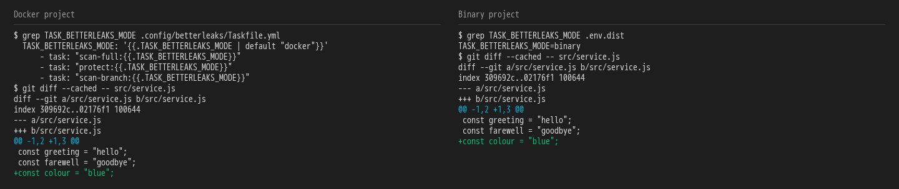
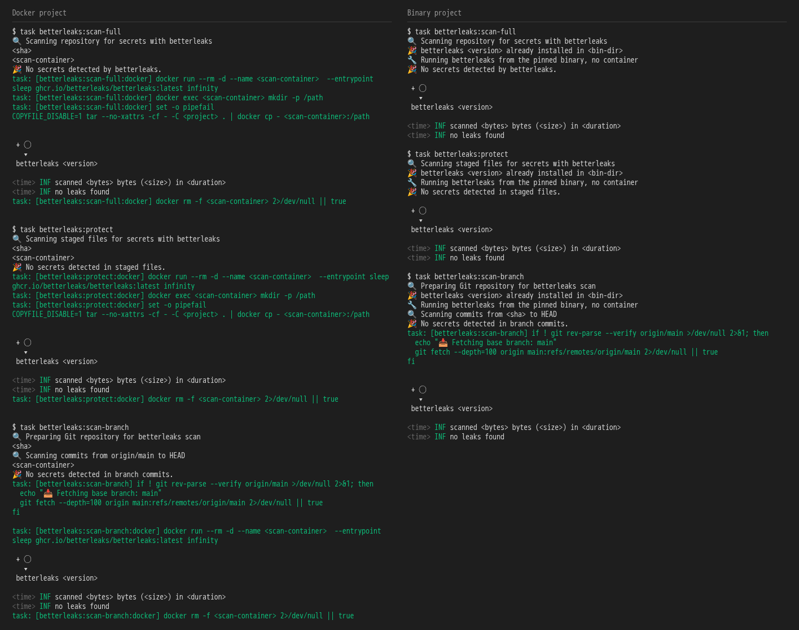
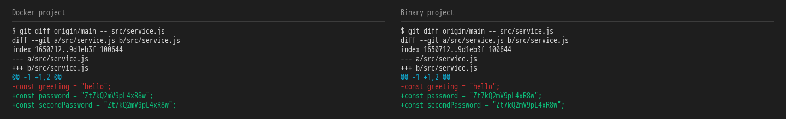
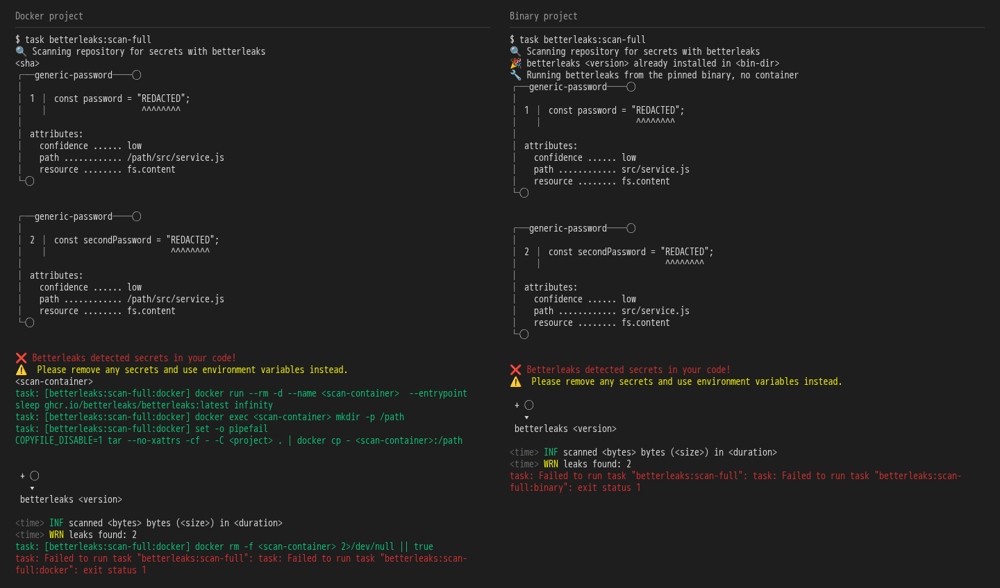
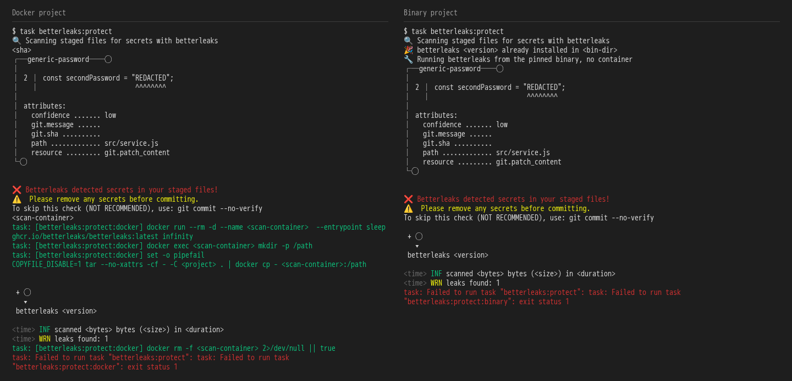
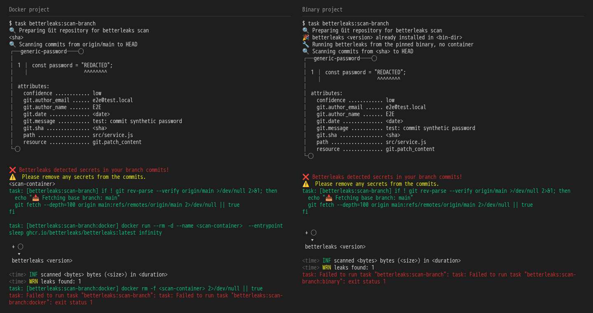

# the framework guards what reaches the repository: clean commits and no secrets

**Scenario:** a secret is blocked without copying its value into the scan log

<a name="storyboard-result"></a>

> [!tip] PASSED
> 6 steps · 6 frames

**On this page**

[Result](#storyboard-result) · [Ordinary work passes in both modes](#storyboard-chapter-1) · [A detected value stays out of the log](#storyboard-chapter-2) · [Replay and source](#storyboard-replay)

<a name="storyboard-chapter-1"></a>

## Ordinary work passes in both modes

<table width="100%">
<tr>
<th width="50%">

**1. Given clean framework projects use Docker and binary scanners from their install answers**

</th>
<th width="50%">

**2. Then full, staged and branch scans pass on ordinary work in both modes**

</th>
</tr>
<tr>
<td width="50%" valign="top">

[](../../screenshots/base/02-daily-work/scanner-log-redaction/install-answers.webp)

Two projects generated with different install answers. The Docker one keeps the Taskfile default, "docker". The binary one answered that its runners refuse privileged containers, and its .env.dist says TASK\_BETTERLEAKS\_MODE\=binary.
Each has a clean commit and a clean staged change, so no scan reads an empty input.

</td>
<td width="50%" valign="top">

[](../../screenshots/base/02-daily-work/scanner-log-redaction/clean-scans.webp)

The three scans, in each project. All six print their own "No secrets detected" line.

<details>
<summary>Command</summary>

```shell
task betterleaks:scan-full && task betterleaks:protect && task betterleaks:scan-branch
```

</details>

</td>
</tr>
</table>

<a name="storyboard-chapter-2"></a>

## A detected value stays out of the log

<table width="100%">
<tr>
<th width="50%">

**3. When a synthetic password is committed and staged in both projects**

</th>
<th width="50%">

**4. Then full scans block the secret and redact its value in both modes**

</th>
</tr>
<tr>
<td width="50%" valign="top">

[](../../screenshots/base/02-daily-work/scanner-log-redaction/synthetic-password.webp)

Only a synthetic password is used. One line is committed and a second one is staged, so every scan has a real finding to block.

</td>
<td width="50%" valign="top">

[](../../screenshots/base/02-daily-work/scanner-log-redaction/full-blocked.webp)

The full scan finds both lines. Each finding names the rule generic-password, the file and the line, and shows "REDACTED" where the value was.

<details>
<summary>Command</summary>

```shell
task betterleaks:scan-full
```

</details>

</td>
</tr>
</table>

<table width="100%">
<tr>
<th width="50%">

**5. And staged scans block the secret and redact its value in both modes**

</th>
<th width="50%">

**6. And branch scans block the secret and redact its value in both modes**

</th>
</tr>
<tr>
<td width="50%" valign="top">

[](../../screenshots/base/02-daily-work/scanner-log-redaction/staged-blocked.webp)

The staged scan finds the staged line, line 2, and hides its value the same way.

<details>
<summary>Command</summary>

```shell
task betterleaks:protect
```

</details>

</td>
<td width="50%" valign="top">

[](../../screenshots/base/02-daily-work/scanner-log-redaction/branch-blocked.webp)

The branch scan finds the committed line, line 1, in the commit that added it, and hides its value the same way.

<details>
<summary>Command</summary>

```shell
task betterleaks:scan-branch
```

</details>

</td>
</tr>
</table>

<a name="storyboard-replay"></a>

<details>
<summary>Replay this scenario · source and checks</summary>

```shell
task test -- --grep "@scanner-log-redaction"
```

**Source**

```text
project/tests/e2e/features/02-daily-work/secret-scans.feature
```

Every frame is its own pixel baseline (tolerance: 0).

</details>
